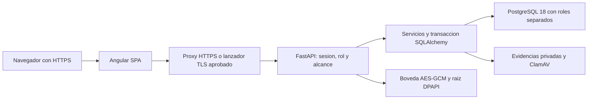
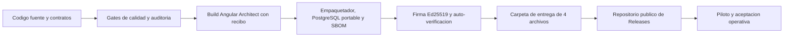
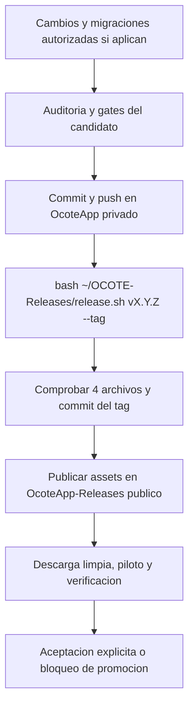

# OCOTE: Manual Tecnico para Desarrolladores y Guia de Liberacion

**Release Playbook para v1.1.0 y siguientes entregas compatibles.**

Fecha de revision: 2026-11-27. Plataforma de referencia: Windows x64, Git Bash y Python 3.12. Este documento vive junto a `ocoteApp/`, no dentro de esa carpeta. Su objetivo es permitir una retoma reproducible sin convertir antecedentes historicos en permisos operativos actuales.

**Alcance de esta redaccion:** solo consulta de documentacion y codigo de entrega autorizado. No se ejecutaron instaladores, SQL, PG0, PG1, builds, servicios, capturas administrativas, generacion de llaves ni publicaciones. Los comandos siguientes son instrucciones para futuras ejecuciones expresamente autorizadas, no acciones realizadas al crear este manual.

## 1. Resumen tecnico y arquitectura

### 1.1. Autoridad y estado vigente

Leer primero [AGENTS.md](ocoteApp/AGENTS.md), despues los contratos enlazados en su cabecera. [El adaptador de Copilot](ocoteApp/.github/copilot-instructions.md) remite a esa misma autoridad. Las actas recientes sustituyen estados antiguos que aparecen mas abajo en los documentos, sin borrar su historia.

Fuentes principales:

- [Entrada del proyecto](ocoteApp/README.md).
- [Especificacion funcional y visual](ocoteApp/docs/01-spec-driven-development.md).
- [Arquitectura y seguridad](ocoteApp/docs/02-arquitectura.md).
- [Estado, evidencia y roadmap](ocoteApp/docs/03-estado-actual-y-roadmap.md).
- [Entorno y portabilidad](ocoteApp/docs/04-entorno-y-portabilidad.md).
- [Instalacion, entrega y protocolo de release](ocoteApp/docs/05-paquetizacion-instalacion-y-actualizaciones.md).
- [Runbook del backend](ocoteApp/backend/README.md).

Al corte documental, F1-F12 y el bloque final F7 estan cerrados **local/sintetico**. El incremento posterior de PostgreSQL portable se valido con procesos simulados. No implica homologacion de un host cliente, antivirus real, proveedor externo, custodia independiente, backup off-host ni confianza TLS del navegador.

La referencia de esquema vigente es **`20261126_0011`**, con 72 tablas y 12 releases terminales en el ultimo inventario historico certificado. No es una medicion nueva ni una razon para volver a administrar la base existente.

**Limitacion de producto importante:** el actualizador distribuible consultado admite origen y destino en la head vigente `0011`; no contiene un proceso generico ya homologado para `0011 -> 0012`. Una version de aplicacion y una revision Alembic son identificadores distintos.

### 1.2. Stack de referencia

| Capa | Version o contrato confirmado | Observaciones de mantenimiento |
| --- | --- | --- |
| Python | `>=3.12,<3.13` | Python 3.12 x64 para el entorno Windows documentado. |
| API | FastAPI `>=0.121,<1`, Uvicorn `>=0.38,<1`, Pydantic v2 | Rangos declarados en pyproject; la resolucion exacta esta en el lock protegido. |
| Persistencia | SQLAlchemy `>=2.0.44,<2.1`, Alembic `>=1.17,<2`, psycopg `>=3.2.12,<4` | Una unidad transaccional por comando, permisos y constraints PostgreSQL reales. |
| Frontend | Angular 21 LTS; ultima resolucion documental 21.2.26 | package.json declara rangos; npm ci restaura la resolucion de package-lock, no necesariamente el extremo inferior del rango. |
| Herramientas Angular | CLI/build 21.2.31, Material/CDK 21.2.14, TypeScript 5.9.3 | Valores resueltos registrados en el roadmap; no actualizar automaticamente. |
| Node y npm | Node 22.21.1 / npm 10.9.4 | Pareja documentada de referencia. No sustituir por una version mayor por conveniencia. |
| Interfaz | Standalone SPA, SCSS, Material, ECharts/ngx-echarts, vis-timeline | Angular sigue en la raiz de ocoteApp; no mover a otra carpeta. |
| Base de datos | PostgreSQL 18; minor 18.4 del entorno historico | Binarios x64 completos, extension btree_gist y roles separados. Otro major exige plan y homologacion. |
| Sesiones | Argon2id y JWT RS256, refresh rotatorio y CSRF | Access/CSRF solo en memoria; refresh en cookie protegida; Web Locks obligatorios. |
| Firma de entrega | Ed25519, firma separada y ancla publica explicita | La identidad de release no es la raiz de datos ni la clave JWT. |
| Inventario | CycloneDX 1.6 | Locks Python/npm, mas componentes file con SHA256 por cada archivo portable incluido. |
| Boveda | AES-256-GCM y raiz protegida mediante Windows DPAPI | DPAPI liga proteccion a la identidad Windows; no promete portabilidad de llaves entre cuentas o equipos. |
| Toolchain Python | setuptools 80.9.0; pip-tools 7.5.2 en dependencias dev | Hay avisos de seguridad documentados; no interpretar el pin como aprobacion productiva. |

No se reprodujo aqui el contenido completo de los lockfiles. Los rangos de [package.json](ocoteApp/package.json) y [pyproject.toml](ocoteApp/backend/pyproject.toml) no reemplazan esos locks como inventario exacto de una compilacion.

package.json mantiene version interna `0.0.0` y pyproject `0.1.0` en el checkout consultado. El nombre comercial `v1.1.0` no actualiza esos campos automaticamente. El manifiesto de entrega identifica la head de esquema; el proveedor debe vincular adicionalmente tag, commit, version SemVer y hashes del paquete en su evidencia de release.

### 1.3. Mapa de carpetas

```text
<raiz-Git-privada>/
  README-OCOTE-DESARROLLADOR.md       Este manual, fuera de ocoteApp
  README-OCOTE-USUARIO.md             Guia independiente de usuario
  ocoteApp/                         Raiz de trabajo de la aplicacion
    AGENTS.md                       Reglas y autorizaciones vigentes
    .github/copilot-instructions.md  Adaptador de instrucciones
    .vscode/tasks.json              Tareas visibles; no equivalen a permiso
    backend/
      app/                          API, modelos, servicios y seguridad
      alembic/versions/             Cadena de revisiones inmutables
      tests/                        Pruebas PG0 y PostgreSQL opt-in
      tools/delivery*.py            Entrega, firma, SBOM y operacion
      requirements.lock             Dependencias exactas con hashes
      .venv/                        Entorno local ignorado
      .local/                       Estado/llaves de desarrollo ignorados
    src/                            Angular, estilos y pantallas
    public/logos/                   Assets oficiales protegidos
    docs/                           Contratos, actas y runbooks
    scripts/                        Helpers historicos protegidos
    database/
      postgres/                     bin/lib/share; ignorado, sin datos
      data/                         Cluster de desarrollo; ignorado
      logs/                         Logs locales ignorados
    dist/ocote-app/                  Resultado generado por Architect
```

En este layout la raiz Git esta un nivel por encima de `ocoteApp`. Comprobarlo con `git rev-parse --show-toplevel`: afecta a la limpieza global, al staging y a la prohibicion de guardar llaves dentro de Git. No asumir que estar fuera de ocoteApp equivale a estar fuera del repositorio.

La carpeta `~/OCOTE-Releases/` y las llaves bajo LOCALAPPDATA deben quedar fuera de **toda** la raiz Git, no solamente fuera de la carpeta de la aplicacion.

### 1.4. Arquitectura de ejecucion



El navegador nunca se conecta directamente a PostgreSQL. Los routers adaptan y autorizan; los servicios controlan reglas y transacciones; los modelos y constraints protegen tambien en BD. No hacer commits en routers ni usar la visibilidad de un boton como control de acceso.

### 1.5. Construccion y entrega



## 2. Reglas de oro e invariantes

### 2.1. Superficies protegidas

| Archivo o carpeta | Regla | Para modificar |
| --- | --- | --- |
| `scripts/` | No adaptar helpers historicos como actualizador cliente ni retirar sus guardas. | Autorizacion explicita del cambio de superficie; preferir herramientas nuevas propias. |
| `public/logos/` | Preservar assets oficiales, derivados y licencias. | Autorizacion expresa; branding operativo no autoriza reescribir originales. |
| `backend/alembic/versions/`, revisiones `0001` a `0011` | Aplicadas/publicadas: inmutables. Nunca retocar para hacer pasar un restore o test. | El cambio de esquema exige una revision nueva y autorizacion; no se reescribe la historia aplicada. |
| Helpers historicos `f1` a `f12` y sus scripts visuales/release/worker | Conservar comandos, evidencia y hashes historicos. | No reutilizar apply ni permisos consumidos. Nueva herramienta y alcance aprobado cuando corresponda. |
| `package-lock.json` | No cambiar con npm install/update, migraciones automaticas o audit fix no autorizados. | Decision explicita de dependencias, versionado revisado y repeticion de gates. |
| `backend/requirements.lock` | No regenerar ni actualizar pins como parte de instalar o compilar. | Autorizacion explicita y acotada; conservar pins fuera del alcance, hashes y validacion de wheels. |
| `backend/pyproject.toml`, package.json y build pins | No usarlos para sortear la proteccion de los locks. | La misma revision de compatibilidad y riesgo que requiera el cambio de dependencias. |
| `database/data/`, raiz DPAPI y estado del cliente | No editar archivos internos, reemplazar claves, resetear datos ni copiar clusters vivos. | Procedimiento administrativo nuevo, respaldo y recuperacion aprobados; nunca un arreglo de prueba. |
| Evidencia F1-F12/F7 y manifests aprobados | No reescribir un resultado fallido ni regenerar el artefacto ya ensayado para hacerlo coincidir con docs nuevas. | Registrar intentos y hashes nuevos por separado. |

El permiso para trabajar en una funcionalidad no incluye automaticamente los locks, los servicios, las credenciales ni un nuevo ensayo administrativo. Documentar la autorizacion antes de ejecutarla; las excepciones historicas no son permisos reutilizables.

### 2.2. Fail-closed y secretos

- **Fail-closed:** si falta configuracion, politica, antivirus, llave, identidad o prueba vigente, rechazar la operacion. Una BD caida no significa una instalacion vacia; un error TLS no autoriza bajar la validacion.
- No ejecutar `powershell.exe` en automatizacion. No cambiar politica Windows, elevar privilegios o introducir bypass de TLS para que una prueba pase. Utilizar las APIs nativas y herramientas ya aprobadas.
- Nunca versionar `.env`, `.local/`, `backend/.local/`, pgpass, llaves privadas Ed25519, claves JWT/CSRF/DPAPI, `database/postgres/`, `database/data/`, logs, dumps, backups, node_modules o .venv. Las plantillas `.env.example` no contienen secretos reales.
- Una exclusion de Git no retira archivos previamente rastreados. Detectar con `git ls-files`; una retirada con `git rm --cached` requiere autorizacion propia, preserva disco y no debe mezclarse con borrado de datos.
- No imprimir entornos, DSN, contrasenas, tokens o cuerpos sensibles. No usar `set -x`, passwords en argumentos, URL con secreto ni secretos por chat. Entrada administrativa solo en terminal visible sin eco y con el contexto aprobado.
- Separar la llave de firma Ed25519 de la raiz AES/DPAPI de instancia y del par JWT RSA. No regenerar ninguna por un error de arranque.
- `keygen` produce una PEM privada sin passphrase. ACL privada no sustituye cifrado de volumen, custodios y respaldo cifrado. Nunca entregarla al cliente ni publicarla como asset.
- Managed exige hostname, IP aprobada fijada y `sslmode=verify-full` con CA valida. No usar IP/host alternativos para evitar un error de identidad.
- Runtime no hereda `PGPASSWORD` administrativo. No dejar capturas temporales despues de los ensayos, no extender su TTL ni renovar silenciosamente.
- No instalar servicios, tareas o proveedores reales por generar un paquete o una plantilla. Piloto, destino, identidad Windows y ventana necesitan su aprobacion.

### 2.3. Separacion de roles SQL

| Identidad | Uso permitido | Prohibido |
| --- | --- | --- |
| `ocote_runtime` | API y pasadas de trabajo con grants minimos por tabla/accion. | DDL, superusuario, pertenencia al migrador, borrar historial o administrar destinos de prueba. |
| `ocote_migrador` | Revisiones y operaciones controladas, por endpoint directo y durante ventana aprobada. | Ser la credencial diaria de API/workers o usarse para omitir el protocolo de release. |
| Administrativa de PostgreSQL | Solo preparacion/limpieza exacta de destinos autorizados. | Guardarla en SPA, runtime, logs o usar la captura de una fase anterior. |

La base de aplicacion se llama exactamente `ocoteAppDatabase`; preservar mayusculas. La preparacion Local portable crea cuentas separadas y usa superusuario solo durante el setup nuevo. Su arranque posterior no ejecuta initdb ni utiliza la contrasena de superusuario.

### 2.4. Invariantes de negocio y seguridad

- Cuatro roles exactos: admin, gerente, lider y colaborador; comprobar rol **y** alcance en servidor antes de consultar, agregar o paginar. Gerente no mueve tareas; colaborador no obtiene analitica/evaluaciones/exports.
- Conservar originales, task_history, audit_events, solicitudes terminales, releases y evaluaciones finales. No DELETE/purga ni reapertura para corregir estadisticas.
- Etapa, porcentaje y puntualidad son conceptos separados. No inventar ranking, pesos, scores o cascadas de fechas.
- Planes con horizonte configurable y contencion padre-hijo; annual_plans es nombre tecnico, no un limite de un plan por ano.
- Control de version y 409: conservar el formulario y exigir descarte/recarga explicitos; no sobreescribir silenciosamente.
- Access y CSRF solo memoria; refresh solo cookie HttpOnly/Secure/SameSite; Web Locks obligatorios. No localStorage, no rebajar Secure y no fabricar Origin/Referer.
- Mantener `AUTH_ORIGIN=https://localhost:8443` en el perfil local ya existente. API y proxy loopback no implican acceso de red compartida homologado.
- Evidencia privada, limites, formato/firma/hash y ClamAV fresco/limpio; ausencia, error o resultado desconocido bloquean. No simular antivirus real como evidencia de homologacion.
- Parametros, modulos, custodios y proveedores requieren captura explicita; no seeds de negocio, usuarios demo o contactos inventados en origen.

## 3. Entorno desde cero en una PC de desarrollo

### 3.1. Prerrequisitos y convenciones

Este apartado documenta una **operacion futura autorizada**. En la tarea que creo este manual no se ejecuto ninguno de estos comandos de instalacion o arranque.

| Requisito | Referencia | Control previo |
| --- | --- | --- |
| Windows | x64 y cuenta de desarrollo aprobada | No usar el perfil de un cliente ni ejecutar como administrador por comodidad. |
| Python | 3.12 x64, lanzador py disponible | `py -3.12 --version`. |
| Node/npm | 22.21.1 / 10.9.4 de referencia | `node --version` y `npm --version`. |
| Git Bash/MSYS | Bash 4+ y Git para Windows | Sintaxis Bash en Git Bash, no pegarla en CMD o PowerShell. |
| Chrome | Ejecutable aprobado para ChromeHeadless | Ruta documentada `C:/Program Files/Google/Chrome/Application/chrome.exe`. |
| PostgreSQL | Distribucion confiable major 18 x64 completa | bin/lib/share y licencias; el checkout no la descarga. |
| Accesos | Repositorio privado, dependencias y custodios aprobados | Claves/credenciales fuera de Git; sin credenciales de produccion. |

Salvo indicacion contraria, los comandos se ejecutan desde la carpeta que contiene package.json y backend/, es decir **ocoteApp**, no desde su padre Git. Las rutas `__...__` son datos que debe elegir el operador antes de ejecutar; no son valores ya autorizados.

### 3.2. Clonar y comprobar el layout

Con acceso SSH ya configurado para la identidad autorizada:

```bash
git clone git@github.com:LAngelVp/OcoteApp.git
cd OcoteApp/ocoteApp
git rev-parse --show-toplevel
git status --short -- .
```

La doble ruta es intencional: el remoto contiene la carpeta ocoteApp dentro de su raiz Git. Si la estructura cambia, localizar package.json/AGENTS.md antes de continuar. No imprimir tokens ni incrustarlos en la URL de clone.

Leer los rectores y comprobar la autorizacion vigente. Un clon nuevo no hereda permiso para administrar la base de otro equipo.

### 3.3. Preparar Python sin modificar el lock

Solo si backend/.venv no existe:

```bash
py -3.12 -m venv backend/.venv
backend/.venv/Scripts/python -m pip install --require-hashes -r backend/requirements.lock
backend/.venv/Scripts/python -m pip check
```

No hacer pip install -U ni instalar el proyecto con una resolucion libre que sustituya el lock. Para un entorno existente, comprobarlo antes de recrearlo. En una red restringida, preparar wheels oficiales aprobados y completos para Python/SO/arquitectura; instalar offline manteniendo --require-hashes, sin recurrir a paquetes sueltos no fijados.

La instalacion con hashes comprueba integridad, no ausencia de vulnerabilidades. Guardar logs tecnicos saneados fuera del checkout.

### 3.4. Preparar npm sin reescribir dependencias

```bash
npm ci
git diff --exit-code -- package.json package-lock.json backend/pyproject.toml backend/requirements.lock
```

npm ci instala la resolucion del lock y falla si no coincide con package.json. Revisar la instalacion y los riesgos D07 antes de ejecutarla; no sustituir un fallo por npm install, --force o --legacy-peer-deps. No borrar un lock para resolver un conflicto.

### 3.5. Colocar PostgreSQL portable

Obtener de un proveedor aprobado una distribucion Windows x64 PostgreSQL 18 completa. Colocar solo sus recursos de programa en:

```text
database/postgres/bin/
database/postgres/lib/
database/postgres/share/
```

El paquete exige initdb.exe, pg_ctl.exe, postgres.exe, psql.exe, pg_dump.exe y pg_restore.exe; conservar DLL, recursos y licencias del distribuidor. Aprobar minor, procedencia, antivirus y licencia. No copiar data/logs del equipo anterior ni agregar esos binarios a Git.

Comprobaciones de metadata Git, sin leer un cluster:

```bash
git check-ignore -v database/postgres/bin/postgres.exe
git ls-files -- database/postgres database/data
```

La segunda orden debe quedar sin salida. Si muestra rutas, parar y resolver el rastreo con autorizacion; no hacer git add -f ni borrar archivos para ocultarlo.

### 3.6. Limite de arranque desde cero: cluster no incluido

**Colocar los binarios no crea un cluster.** El helper de desarrollo exige `database/data/` ya inicializado con identidad y major correctos; no ejecuta initdb. El cluster y los secretos no vienen en Git.

En una PC realmente vacia se necesita una preparacion nueva **expresamente aprobada** del cluster de desarrollo, base exacta, extension btree_gist, roles, grants, esquema vigente y configuracion privada. Coordinarla con el responsable; no copiar un cluster vivo, usar datos reales de cliente ni resucitar `f1_local provision/rehearse` sobre el origen actual. No existe en lo consultado un comando universal aprobado para convertir cualquier clon vacio en ese perfil de desarrollo.

El Wizard Local del paquete resuelve otra necesidad: una **instalacion cliente nueva** bajo un directorio de estado privado, no la preparacion automatica de database/data y backend/.env del checkout. No mezclar ambos perfiles ni apuntar el Wizard al origen existente.

Una vez que el cluster de desarrollo este preparado y su arranque autorizado:

```bash
bash scripts/init-dev.sh --check
```

Si solo esta detenido o falta la base y el responsable autoriza iniciar/asegurar ese destino local:

```bash
bash scripts/init-dev.sh
bash scripts/init-dev.sh --check
```

`--check` conecta al PostgreSQL local para comprobarlo; por tanto **no pertenece a una tarea exclusivamente documental**. El modo normal puede arrancar el cluster esperado y asegurar la base. Ninguno aplica Alembic, seeds, bootstrap, instala Python/npm o levanta API/UI. Error de identidad, version o PID bloquea; no envolverlo con `|| true`.

El fallback publico del helper es exclusivamente local/sintetico y nunca se promueve a cliente, nube, runtime o red compartida. Para otra credencial, usar el canal temporal aprobado del operador; no escribirla en comandos o archivos del repositorio. PGPASSWORD prevalece sobre PGPASSFILE en init-dev; no asumir que elegira un pgpass existente.

### 3.7. Configuracion privada, esquema y autenticacion

| Configuracion | Perfil de desarrollo | Regla |
| --- | --- | --- |
| `backend/.env` | Configuracion Pydantic local | Preparar desde la plantilla aprobada en un directorio con ACL privada; no source del archivo ni copia de secretos de otro cliente. |
| `DATABASE_URL` | postgresql+psycopg hacia ocoteAppDatabase, usuario ocote_runtime | Solo credencial runtime, endpoint local aprobado. |
| `MIGRATION_DATABASE_URL` | Misma base, ocote_migrador y endpoint directo | No entregar como conexion de API. |
| `HEALTH_TOKEN` | Secreto de monitor, al menos 32 caracteres | Nunca SPA, query string o logs. |
| `APP_ENV` / `DEPLOYMENT_MODE` | development/test y local segun perfil | No usar desarrollo como perfil de produccion. |
| `ORGANIZATION_TIMEZONE` | IANA elegida explicitamente | Entrada bootstrap, no override posterior de la zona guardada. |
| `backend/.local/auth.env` | Referencias a RSA3072, CSRF y AUTH_ORIGIN | Generacion nueva solo aprobada; conservar identidad, ACL y llaves existentes. |
| Estado de boveda y providers | Raiz protegida y configuracion explicita | Ausencia no autoriza crear raiz alternativa al arrancar. |

Verificar la head y los grants mediante el procedimiento administrativo aprobado antes de usar la API. Una base vacia creada por init-dev no contiene automaticamente las 11 migraciones ni un Administrador. No ejecutar alembic upgrade head directamente contra el origen para saltar backups/restore/ledger.

El runbook conserva comandos historicos de bootstrap para instalaciones nuevas. No son un procedimiento de reset ni una autorizacion permanente. En el checkout con identidad/admin previos, **no repetir init-auth ni bootstrap-admin**. En una PC nueva deben formar parte de un plan de aprovisionamiento aprobado para el perfil escogido, sin inventar usuarios, catalogos o parametros.

### 3.8. Backend y frontend de desarrollo

Solo despues de la preparacion anterior, sin mantenimiento pendiente y con permiso de arranque, en una terminal dedicada:

```bash
backend/.venv/Scripts/python -m uvicorn app.main:create_app --factory --app-dir backend --host 127.0.0.1 --port 8000 --no-access-log
```

En otra terminal, desde la misma raiz de aplicacion:

```bash
npm start -- --host 127.0.0.1 --port 8443 --ssl --no-open
```

Abrir `https://localhost:8443/login` en el navegador aprobado. Conservar proxy y AUTH_ORIGIN existentes. La API HTTP de 127.0.0.1:8000 es upstream privado, no un origen alternativo de login. No usar HTTP:4200 para sortear cookies Secure ni aceptar certificados indiscriminadamente.

Si un puerto esta ocupado, identificar al propietario y coordinar la ventana; no terminar procesos ajenos ni cambiar origen/puertos a ciegas. El helper no da permiso para borrar postmaster.pid. No cerrar terminales de un PostgreSQL ajeno al proceso que se inicio.

En el perfil distribuible, `tools.delivery runtime` y las pasadas de worker comprueban/inician solo su cluster portable sellado antes del SQL. No trasladar esa responsabilidad al arranque legacy de desarrollo ni instalar servicios por documentar estos comandos.

## 4. Comandos y gates de calidad

### 4.1. Tabla de gates

Ejecutar lo aplicable al cambio y al alcance aprobado; detenerse ante cualquier gate fallido. En cambios exclusivamente documentales usar validaciones documentales, no conectar a PostgreSQL ni correr negocio. Para releases tecnicas conservar evidencia nueva del candidato exacto, no citar conteos historicos como ejecucion actual.

| Gate | Comando exacto desde ocoteApp | Que valida / condicion |
| --- | --- | --- |
| Limpieza de aplicacion | `git status --short -- .` | Sin cambios pendientes dentro de ocoteApp para construir un candidato final. |
| Limpieza global | `git status --short` | Incluye manuales junto a ocoteApp por estar dentro de la misma raiz Git. |
| Ruff | `backend/.venv/Scripts/python -m ruff check backend` | Estilo, imports y errores estaticos del backend. |
| Dependencias Python | `backend/.venv/Scripts/python -m pip check` | Compatibilidad del entorno instalado; no es una auditoria de vulnerabilidades. |
| PG0 | `env -u PGPASSWORD OCOTE_RUN_PG_TESTS=0 PYTHONPATH=backend backend/.venv/Scripts/python -m pytest -q --tb=short -rN backend/tests` | Slice completo sin PostgreSQL opt-in; conexiones/subprocesos del incremento portable simulados. |
| PG1, solo autorizado | `OCOTE_RUN_PG_TESTS=1 PYTHONPATH=backend backend/.venv/Scripts/python -m pytest -q --tb=short -rN backend/tests` | Pruebas PostgreSQL reales; el flag no provisiona credenciales, aislamiento ni permisos. Requisitos en 4.2. |
| Angular ChromeHeadless | `CHROME_BIN='C:/Program Files/Google/Chrome/Application/chrome.exe' NG_CLI_ANALYTICS=false node node_modules/@angular/cli/bin/ng.js test --watch=false --browsers=ChromeHeadless --progress=false --reporters=dots` | Unitarias y render de componentes en el navegador instalado. |
| Build Architect | `NG_CLI_ANALYTICS=false NG_BUILD_PARALLEL_TS=0 NG_BUILD_MAX_WORKERS=1 node backend/tools/delivery_build.cjs` | Target production real, typecheck/budgets y recibo para el empaquetador. |
| Documentacion | `node` con el bloque de 4.4 y comprobaciones complementarias | Control minimo de H1/fences/tablas/destinos locales; completar JSON/JSONC, anclas y render segun el cambio. |
| Diff | `git diff --check` y `git diff --cached --check` | Whitespace de cambios sin preparar y preparados; no sustituye tests ni seguridad. |
| Firma e inventario | `python -m tools.delivery verify-signature "$ZIP" --signature "$SIG" --public-key "$PUBLIC"` | Desde Python/entorno definidos en 4.3: hashes del payload, SBOM y firma con ancla independiente. |
| Auditoria | `npm audit --json --package-lock-only --ignore-scripts` y flujo OSV de 6.3 | Riesgos por versiones exactas; sin fix, sin renovar excepciones. |

La tarea [OCOTE F7 final: build Architect](ocoteApp/.vscode/tasks.json) apunta al script oficial actual. Existen tareas historicas F11/F12 y tareas Corte2 con entrada administrativa: su presencia en VS Code **no permite ejecutarlas otra vez**. No disparar una tarea de credencial o final-gates por conveniencia.

### 4.2. Cuanto autoriza PG1 y cuando aplica

PG1 se requiere cuando el cambio autorizado necesita acreditar semantica PostgreSQL: migraciones, constraints, grants, concurrencia, preservacion o el ensayo real de instalacion/upgrade. No sustituirlo por SQLite ni afirmar que PG0 demuestra un restore real.

Antes de ejecutar el comando de la tabla:

1. Obtener nueva autorizacion de alcance, cluster/destino, ventana y operador. En el estado vigente no hay permiso general para mas PG1, UUID, SQL o capturas.
2. Ejecutar el preflight local aprobado y confirmar identidad/version/rutas/puertos. No apuntar un helper local a nube ni al host cliente por cambiar variables.
3. Preparar destinos UUID aislados y datos sinteticos, roles limitados y egress inhibido. El nombre exacto debe corresponder al driver/test aprobado; no inventar una base de origen alternativa para saltar una guarda.
4. Capturar la credencial administrativa solo cuando las herramientas y gates previos estan listos, mediante tarea visible/contexto propio, sin eco. Los relevos historicos fueron revocados y no se reutilizan; TTL 60 minutos cuando ese contrato aplique, sin renovacion silenciosa.
5. Usar runtime para pruebas de dominio y el relevo administrativo solo para preparar/eliminar destinos exactos. Nunca convertir runtime en superusuario.
6. Conservar logs completos/JUnit, presupuesto de limpieza y evidencia fuera del checkout. Fallo, expiracion, test omitido relevante o interrupcion no acreditan el gate.
7. Revocar en finally, verificar ausencia de sellos y limpiar solo UUID propias autorizadas, sin FORCE, validando cluster/owner/sesiones. No eliminar datos ni PID ajenos. Registrar residuos si no es seguro limpiarlos.

El comando PG1 mostrado es la invocacion de pytest, **no un procedimiento administrativo autocontenido**. Si requiere credenciales o variables adicionales, deben proporcionarse segun el driver aprobado y sus fixtures, no adivinarlas desde un chat ni reutilizar configuracion de un intento anterior.

### 4.3. Referencia completa de tools.delivery

El CLI real esta en [delivery.py](ocoteApp/backend/tools/delivery.py). Desde fuente, activar el venv y preparar solo el path de importacion:

```bash
source backend/.venv/Scripts/activate
export PYTHONPATH="$PWD/backend"
python -m tools.delivery --help
```

Las tablas usan ese `python`. Desde un paquete extraido, ejecutar desde su carpeta backend con Python 3.12 y dependencias aprobadas; no apuntar PYTHONPATH al checkout del desarrollador. Para automatizacion externa es preferible invocar el interprete del venv por ruta explicita, sin depender de un Python global.

| Subcomando | Sintaxis real | Comportamiento y limites |
| --- | --- | --- |
| `package` | `python -m tools.delivery package --output "$ZIP" [--build "$BUILD"] [--postgres-dir "$PG_ROOT"]` | --output obligatorio/nuevo; --build por defecto dist/ocote-app/browser. Exige recibo Architect e inventario exacto. Portable solo opt-in. |
| `verify` | `python -m tools.delivery verify "$ZIP"` | ZIP/manifiesto/hash/SBOM/cadena de migraciones. No autentica emisor sin verify-signature. |
| `keygen` | `python -m tools.delivery keygen --directory "$KEYDIR"` | Directorio nuevo/ACL privada/fuera de toda la raiz Git; no sobrescribe ni imprime privada. |
| `sign` | `python -m tools.delivery sign "$ZIP" --private-key "$PRIVATE" --signature "$SIG"` | Ed25519 sobre SHA del ZIP exacto y manifest canonico; firma de salida nueva. |
| `verify-signature` | `python -m tools.delivery verify-signature "$ZIP" --public-key "$PUBLIC" --signature "$SIG"` | Todos los argumentos son obligatorios; clave publica de confianza explicita. |
| `sbom` | `python -m tools.delivery sbom --output "$SBOM"` | Genera inventario base de locks en archivo nuevo. No tiene flag --postgres-dir; el package incorpora el inventario portable en su SBOM interno. |
| `operations-templates` | `python -m tools.delivery operations-templates --output "$TEMPLATES_NEW"` | Directorio de salida debe ser nuevo. Genera plantillas, no registra tareas ni instala servicios. |
| `record-restore` | `python -m tools.delivery record-restore --proof "$PROOF" --output "$MEASUREMENT" --rpo-goal 86400 --rto-goal 14400` | Los cuatro flags son obligatorios. Consume prueba de restore ya verificado; metas en segundos. No ejecuta ni certifica una restauracion. |
| `setup` | `python -m tools.delivery setup --state "$NEW_STATE" --origin "$ORIGIN" --artifact "$ZIP" --signature "$SIG" --public-key "$PUBLIC" [opciones comunes]` | Nuevo estado/instalacion; origen obligatorio. No para upgrades ni base existente. |
| `runtime` | `python -m tools.delivery runtime --state "$SEALED_STATE" --artifact "$ZIP" --signature "$SIG" --public-key "$PUBLIC" [opciones comunes]` | Solo bootstrap sellado; no posee --origin ni inicializa admin. Portable propio primero si hay metadata sellada. |
| `upgrade` | `python -m tools.delivery upgrade --artifact "$ZIP" --evidence "$NEW_EVIDENCE" --maintenance "$MARKER" --trusted-sha256 "$ZIP_SHA256" --restore-database "$RESTORE_UUID_NAME" --operator "$OPERATOR" --writers-stopped --execute --signature "$SIG" --public-key "$PUBLIC" [--pg-bin "$PG_BIN"]` | Todos obligatorios excepto --pg-bin. Captura interactivamente conexion y secretos por getpass. Evidencia y marker deben ser nuevos. No tiene --state ni --origin. |
| `reopen` | `python -m tools.delivery reopen --state "$SEALED_STATE" --receipt "$COMPLETE_JSON" --maintenance "$MARKER" --ca-file "$CA" --artifact "$ZIP" --signature "$SIG" --public-key "$PUBLIC" --expected-instance "$INSTANCE_UUID" --origin "$ORIGIN" --operator "$OPERATOR" --execute` | Todos obligatorios. Verifica recibo autenticado/marker/instancia/backup/health TLS y retira mantenimiento solo al aprobar. Sin SQL ni captura administrativa. |

Los corchetes de las tablas indican opciones; no se escriben literalmente. No son comandos para copiar sin resolver variables, autorizaciones y directorios.

Opciones compartidas **solo por setup/runtime**:

| Opcion | Valor por defecto / contrato |
| --- | --- |
| `--state` | Obligatorio, directorio privado apropiado para nuevo setup o runtime ya sellado. |
| `--port` | 8000; puerto del servidor web de backend, no el puerto PostgreSQL ni necesariamente el origen visible 8443. |
| `--tls-cert`, `--tls-key` | Ambos necesarios cuando no se usa un proxy HTTPS aprobado; llave en directorio privado. |
| `--behind-approved-proxy` | Flag sin valor. Declara un proxy HTTPS realmente preparado; no crea el proxy ni autoriza HTTP publico. |
| `--log-file` | Opcional; ruta privada de logging tecnico rotativo. |
| `--log-max-bytes` | 10485760 por defecto; rango validado 1 MiB a 100 MiB. |
| `--log-files` | 10 por defecto; rango validado 1 a 1000. |
| `--artifact`, `--signature`, `--public-key` | Obligatorios incluso para runtime; arbol extraido debe corresponder al manifest firmado. |

Precisiones operativas:

- `upgrade --restore-database` exige el patron `ocote_f2_restore_` seguido de 32 caracteres hexadecimales minusculos, para un destino aislado aprobado. No acepta ocoteAppDatabase como destino de restore.
- `--trusted-sha256` es el SHA256 esperado del ZIP, 64 hexadecimales minusculos; no es el fingerprint publico ni el hash del manifest.
- Omitir --pg-bin solo funciona si el arbol actual extraido incluye portable y su manifest coincide con el del artefacto firmado. Se elige **ese** postgres/bin; no hay busqueda automatica en database/postgres del desarrollador. Un arbol anterior distinto puede requerir ruta explicita aprobada.
- Setup crea admin/raiz/RSA/CSRF solo para un destino virgen; runtime rechaza setup aunque falle BD. Estado installing o fallo local queda bloqueado para recuperacion, sin reset.
- La reapertura requiere API nueva iniciada bajo mantenimiento, CA explicita y monitor autenticado. No basta con que una pantalla de login responda.
- Toda copia de paquete distribuido debe conservar SBOM, manifest y cadena completa de migraciones. No se entrega un runtime PostgreSQL con datos inicializados del desarrollador.

### 4.4. Validacion documental y evidencia

No existe un subcomando `tools.delivery docs-check`. Utilizar un validador aprobado externo o el siguiente control minimo sin dependencias, desde ocoteApp. No modifica archivos. Valida estructura basica y destinos de enlaces relativos; no demuestra render Mermaid, accesibilidad ni correccion semantica del contenido.

```bash
node <<'NODE'
const fs = require('node:fs');
const path = require('node:path');
const files = ['README.md', 'AGENTS.md', '.github/copilot-instructions.md',
  'backend/README.md', ...['01-spec-driven-development', '02-arquitectura',
  '03-estado-actual-y-roadmap', '04-entorno-y-portabilidad',
  '05-paquetizacion-instalacion-y-actualizaciones'].map(name => 'docs/' + name + '.md')];
const errors = [];
for (const file of files) {
  const lines = fs.readFileSync(file, 'utf8').replace(/\r\n/g, '\n').split('\n');
  let marker = '', h1 = 0, tableWidth = 0;
  for (const line of lines) {
    const fence = line.match(/^\s*(`{3,}|~{3,})/);
    if (fence) { marker = marker ? '' : fence[1][0]; continue; }
    if (marker) continue;
    if (/^# /.test(line)) h1++;
    if (line.trim().startsWith('|')) {
      const width = line.trim().replace(/^\|/, '').replace(/\|$/, '').split(/(?<!\\)\|/).length;
      if (tableWidth && width !== tableWidth) errors.push(file + ': table width');
      tableWidth = width;
    } else tableWidth = 0;
    for (const match of line.matchAll(/\[[^\]]*\]\(([^)]+)\)/g)) {
      const target = match[1].split('#')[0];
      if (target && !/^[a-z]+:/i.test(target) &&
          !fs.existsSync(path.resolve(path.dirname(file), decodeURIComponent(target))))
        errors.push(file + ': missing link ' + target);
    }
  }
  if (marker || h1 !== 1) errors.push(file + ': fences/H1');
}
if (errors.length) { console.error(errors.join('\n')); process.exitCode = 1; }
else console.log('Basic Markdown structure and local targets: PASS');
NODE
git diff --check
git diff --cached --check
```

Agregar validacion de anclas, bloques JSON/JSONC con parser, IDs/relaciones, render de diagramas y enlaces HTTP cuando corresponda al cambio. No declarar un link caido por bloqueo de red ni un chequeo estructural como prueba de runtime. JSONC admite comentarios: no usar JSON.parse directamente sobre tasks.json.

Separar evidencia tecnica de los hashes finales de documentos. No agregar a mano al paquete probado una correccion documental y conservar la misma firma: cualquier cambio de bytes requiere nueva construccion/firma y las comprobaciones aplicables.

La referencia historica mas reciente es PG0 744 aprobadas/108 omitidas/13 advertencias, Angular 233/233 y Architect 434.15 kB iniciales. **No se repitieron aqui** y no son conteos esperados inmutables para versiones futuras.

## 5. Preparacion unica del entorno de liberacion

### 5.1. Paso 1: generar y custodiar Ed25519 una sola vez

Esta operacion crea una **identidad real de firma**: aprobar antes responsable, custodia, respaldo, canal publico y politica de rotacion/revocacion. No promover las llaves efimeras de tests ni generar una nueva clave en cada release.

Desde ocoteApp, con venv activado y PYTHONPATH como en 4.3:

```bash
python -m tools.delivery keygen --directory "$LOCALAPPDATA/OCOTE/release-signing"
```

LOCALAPPDATA debe existir y apuntar al perfil Windows aprobado. `release-signing` debe ser nuevo y estar fuera de toda la raiz Git. Si ya existe, **no borrarlo ni regenerarlo**: validar el material y su custodia. El comando aplica ACL y rechaza ubicaciones dentro del repositorio.

| Archivo generado | Clasificacion | Destino |
| --- | --- | --- |
| `signing-private.pem` | Privado PKCS8 Ed25519, sin passphrase en la implementacion actual | Directorio privado aprobado; solo proceso de firma y custodios. Nunca Git, ZIP, cliente, logs o chat. |
| `signing-public.pem` | Publico SPKI Ed25519 | Se copia como ocote-release-public.pem a la entrega; confirmar su fingerprint por canal independiente. |

Politica minima de custodia:

1. Restringir acceso a la identidad de release y proteger el volumen. No quitar ACL para resolver un error.
2. Conservar respaldo **cifrado** en gestor que admita archivos secretos o USB cifrada bajo custodia fisica, separado del PC de build. Acordar titular y suplente; no enviar la PEM por correo abierto.
3. Probar recuperacion de la clave en entorno autorizado sin cambiar identidad publica. Registrar quien puede acceder y como revocarla si se compromete.
4. Publicar/confirmar la huella de la clave por un canal independiente del ZIP/SIG. El key_id de verify-signature identifica la publica, pero una clave cambiada junto con el paquete no es confianza independiente.
5. La rotacion necesita aprobacion y transicion de ancla; no sustituir silenciosamente ocote-release-public.pem porque una firma no verifica.

Una firma valida identifica una entrega autorizada e integra, no demuestra que este libre de vulnerabilidades o que el cliente tenga una instalacion homologada.

### 5.2. Paso 2: carpeta externa y scripts maestros

Preparacion de estructura para una futura configuracion autorizada, sin crear los scripts desde este manual:

```bash
mkdir -p "$HOME/OCOTE-Releases"
```

```text
~/OCOTE-Releases/
  release.sh
  ocote-cliente.cmd
  v1.1.0/
    ocote-v1.1.0.zip
    ocote-v1.1.0.zip.sig
    ocote-release-public.pem
    ocote-cliente.cmd
  v1.1.1/
    ... cuatro archivos de esa entrega, sin mezclar versiones ...
```

Los dos scripts maestros viven fuera de ocoteApp y fuera del Git root. No son sustitutos nuevos de scripts/ ni deben contener llaves privadas o credenciales SQL. Proteger y versionar sus revisiones por un medio **privado** aprobado separado; la copia del CMD que se publica necesita procedencia verificable propia.

**Estado de comprobacion:** el alcance de esta tarea no permite inspeccionar esos dos archivos externos. Las siguientes son sus responsabilidades y estructura esperadas, no una certificacion de que cualquier copia local las cumpla. Tampoco se ejecuto release.sh ni el CMD para verificarlas.

### 5.3. Contrato esperado de release.sh

Entrada prevista:

```bash
bash ~/OCOTE-Releases/release.sh v1.1.0
bash ~/OCOTE-Releases/release.sh v1.1.0 --tag
```

La segunda forma agrega creacion y push del tag **solo si** el script revisado implementa esa opcion. No ejecutar ambas para producir dos veces la misma version; son alternativas. Revisar los efectos exactos de --tag antes de usarlo con un remoto.

Secuencia que debe implementar el script:

1. Validar `vMAJOR.MINOR.PATCH`, rutas absolutas del checkout/venv/llaves y salidas nuevas. Resolver su propia carpeta sin depender del cwd. No incluir secretos ni usar shell tracing.
2. Verificar limpieza Git global y de la aplicacion, commit/branch/remoto autorizados y ausencia del tag final. No commitear ni hacer reset, stash o checkout automaticamente para ocultar suciedad.
3. Ejecutar Ruff, pip check y PG0. Integrar Angular ChromeHeadless y auditoria como gates, o exigir evidencia previa vinculada al mismo commit y manifest. No ejecutar PG1/SQL/capturas silenciosamente desde un release ordinario.
4. Ejecutar el build oficial `node backend/tools/delivery_build.cjs` y exigir resultado success y recibo coincidente. No contar un log de generacion completada como exito del proceso.
5. Empaquetar **con** `--postgres-dir database/postgres` para la entrega Local. Verificar procedencia/licencias del runtime y que solo contiene bin/lib/share/avisos permitidos, nunca datos.
6. Firmar el ZIP con la clave existente bajo LOCALAPPDATA y verificar inmediatamente con la publica esperada. No firmar si fallo un gate ni regenerar llaves.
7. Copiar solamente la publica con nombre de entrega y el CMD revisado a la carpeta nueva. Comprobar exactamente cuatro archivos y conservar por separado inventarios, logs y evidencia de ingenieria.
8. Revalidar que fuentes, build y artefacto corresponden al commit esperado. Impedir cambios de codigo entre gates, hash, firma y etiquetado.
9. Si se solicito --tag, crear y subir un tag nuevo del commit exacto al remoto **privado** aprobado, solo despues de todos los checks. No mover/forzar tags ni publicar el repo fuente como efecto lateral.
10. Fallar con salida no cero y evidencia saneada ante cualquier problema. No sobreescribir carpetas/releases existentes ni borrar un intento para reintentar sin diagnostico.

Comandos centrales reales que debe orquestar, una vez definidos los datos de este candidato:

```bash
VERSION=v1.1.1
OUT="$HOME/OCOTE-Releases/$VERSION"
KEYDIR="$LOCALAPPDATA/OCOTE/release-signing"
ZIP="$OUT/ocote-$VERSION.zip"
SIG="$ZIP.sig"
PRIVATE="$KEYDIR/signing-private.pem"
PUBLIC="$KEYDIR/signing-public.pem"
test ! -e "$OUT" || { printf '%s\n' 'Salida existente: detenerse'; exit 1; }
mkdir "$OUT"
PYTHONPATH=backend backend/.venv/Scripts/python -m tools.delivery package \
  --build dist/ocote-app/browser --postgres-dir database/postgres --output "$ZIP"
PYTHONPATH=backend backend/.venv/Scripts/python -m tools.delivery sign \
  "$ZIP" --private-key "$PRIVATE" --signature "$SIG"
PYTHONPATH=backend backend/.venv/Scripts/python -m tools.delivery verify-signature \
  "$ZIP" --signature "$SIG" --public-key "$PUBLIC"
cp "$PUBLIC" "$OUT/ocote-release-public.pem"
cp "$HOME/OCOTE-Releases/ocote-cliente.cmd" "$OUT/ocote-cliente.cmd"
```

Es un bloque de referencia para un candidato **nuevo**, no un release.sh completo ni un reemplazo de sus gates. Ejecutarlo solo despues de validar precondiciones y con control de errores estricto en el script revisado. La publica se renombra al copiar; la privada nunca se copia.

El SBOM portable completo esta dentro del ZIP y cubierto por firma. `tools.delivery sbom` por separado genera solo el inventario base de locks; no publicarlo como si incluyera automaticamente los binarios nativos agregados despues.

### 5.4. Contrato esperado de ocote-cliente.cmd

| Accion externa | Delegacion real y requisitos |
| --- | --- |
| `instalar` | Comprobar nombres/firma/ancla antes de confiar en contenido, extraer en release nuevo, preparar dependencias con hashes y lanzar `tools.delivery setup` con state/origin/firma/TLS explicitos. Solo destino nuevo; el Wizard Local crea cluster nuevo, roles, base fija y admin. |
| `plantillas` | Delegar a `tools.delivery operations-templates --output` nuevo. Completar/importar con cuenta, permisos y destinos aprobados; generar XML no instala tareas. |
| `actualizar` | Delegar a `tools.delivery upgrade` con todos sus flags, hashes, destino UUID y quietud reales; pedir credenciales en terminal sin eco. No usar instalar como actualizacion. |
| `reabrir` | Delegar a `tools.delivery reopen` con receipt autenticado, instancia, marker, CA y health correctos; no borrar mantenimiento manualmente. |
| Certificado local | Si no hay certificado empresarial y no existe el local acordado, preparar certificado/clave en `C:\OCOTE\tls\` usando mecanismo aprobado **sin powershell.exe**, con ACL privada, SAN localhost y validacion de vigencia/identidad. No sobrescribir ni instalar confianza global automaticamente. |
| PostgreSQL portable | Detectar postgres/bin solo en la distribucion verificada y completa. En upgrade respetar la condicion de --pg-bin; nunca caer a database/postgres/data del desarrollador o a un ejecutable arbitrario del PATH. |

La generacion TLS automatica de esa ruta es una **obligacion esperada del wrapper**, no una funcion de tools.delivery confirmada por el CLI: el programa requiere --tls-cert/--tls-key o --behind-approved-proxy; no genera ese certificado por si solo. Revisar la implementacion del CMD antes de prometerlo al cliente y ensayarla en host limpio.

La firma ZIP no autentica por si sola un CMD suelto entregado junto a el. Aprobar tambien el canal/procedencia del launcher y cualquier verificador usado antes de extraer. El verificador debe ser confiable antes de ejecutar codigo recibido de un paquete aun no autenticado.

No modificar los cuatro archivos despues de verificar/publicar. No publicar la llave privada TLS, la PEM privada Ed25519, logs, state, bootstrap, dumps o rutas internas del desarrollador.

## 6. Procedimiento de lanzamiento v1.x.x

### 6.1. Flujo de lanzamiento



Commit/push/tag/publicacion son operaciones futuras que ejecuta el responsable. Crear este documento no autoriza realizarlas. No confundir un tag fuente, un ZIP de codigo que ofrece GitHub y un paquete instalable firmado.

### 6.2. SemVer y migraciones

| Ejemplo | Uso | Condicion |
| --- | --- | --- |
| `v1.1.0` | Primera entrega identificada de esta linea. | Si tag/carpeta ya existen, no regenerar bytes distintos bajo el mismo identificador. |
| `v1.1.1` | Correccion compatible, sin ruptura contractual. | Repetir gates y conservar compatibilidad declarada; que sea patch no exime pruebas de migracion si la contiene. |
| `v1.2.0` | Funcionalidad nueva compatible con el contrato publico. | Autorizacion de alcance y compatibilidad real de esquema/instalador/updater. |
| `v2.0.0` | Ruptura de contrato o compatibilidad. | Plan de transicion, migraciones y aceptacion expresos, no solo renombrar el ZIP. |

No reutilizar tags publicados ni hacer force-push para reparar una entrega. Si hay un error de bytes o de contenido autorizado, emitir otra version. El nombre v1.x.x no permite editar revisiones aplicadas ni ampliar fases funcionales cerradas.

Para un cambio de esquema autorizado:

1. Definir contrato, fuente/target soportados, preservacion y plan expand/backfill/validate/contract antes del codigo. No crear seeds de negocio ni defaults que inventen datos.
2. Mantener intactas `0001` a `0011`. Crear una revision nueva posterior a `20261126_0011`, normalmente `0012`, con ID fechado unico y down_revision correcto.
3. Comando de generacion **solo de archivo**, para una autorizacion futura de nueva revision, desde ocoteApp:

```bash
PYTHONPATH=backend backend/.venv/Scripts/python -m alembic \
  -c backend/alembic.ini revision --rev-id __AAAAMMDD_0012__ -m __DESCRIPCION_CORTA__
```

4. Revisar el archivo generado y sus grants/constraints/indices/triggers; no aplicar autogenerate sin revision humana ni usar DDL manual, create_all o stamp para declarar estado.
5. Adaptar mediante **nuevo alcance autorizado** el contrato de head, la cadena del verificador, setup, comparadores, worker y actualizador que lo necesiten. El verificador actual exige 11 revisiones y HEAD vigente; no basta con agregar un archivo 0012 y cambiar una constante.
6. Construir fixtures y driver nuevos o propios del incremento, sin editar helpers historicos. Probar desde las heads de origen admitidas hacia el target en destinos aislados.
7. Ensayar un primer upgrade y un segundo upgrade al mismo target. El segundo debe ser **no-op**: comparar snapshots de filas, catalogo, ACL/grants, boveda, originales, historia y raiz, no solo que el comando devuelva cero.
8. Probar backup cifrado y restore aislado autenticando/descifrando el ciphertext que realmente se respaldara. Restaurar el dump plano original no demuestra el camino cifrado.
9. Ejecutar gates PG0 y, cuando se autorice, UUID/PG1 completos, documentar evidencia y preservar el origen. Para una release real usar el protocolo unico de guia05/seccion7; no alembic upgrade head manual sobre el cliente.
10. Fallo conserva mantenimiento/evidencia. Fix-forward preferido; downgrade o restore/switchover requieren plan probado/autorizado. No prometer rollback sin perdida despues de nuevas escrituras.

`alembic heads` inspecciona el grafo fuente y puede servir para comprobar una sola head. `alembic current` y `upgrade` pueden conectar a BD: no ejecutarlos en una tarea documental ni contra un destino no autorizado. La generacion anterior tampoco se ejecuto para redactar este archivo.

### 6.3. Auditoria de dependencias y excepciones

Antes de promocionar, auditar las versiones exactas del candidato y conservar respuestas originales, fuente, fecha UTC, inventario/lock hashes, severidad, alias y cobertura. Una consulta fallida o incompleta no significa cero vulnerabilidades.

Auditoria npm sin remediacion automatica:

```bash
npm audit --json --package-lock-only --ignore-scripts
```

Puede retornar codigo no cero por hallazgos; conservar y evaluar el resultado. No seguir como si el gate hubiera aprobado, ni aplicar npm audit fix, --force o downgrade sugerido sin revision y permiso de locks.

Para Python, usar el inventario de requirements.lock y consultar OSV por paquete/version exactos. La herramienta existente es [delivery_audit.py](ocoteApp/backend/tools/delivery_audit.py), separada del CLI tools.delivery:

```bash
PYTHONPATH=backend backend/.venv/Scripts/python -m tools.delivery_audit --help
AUDIT_OUT="$LOCALAPPDATA/OCOTE/release-audits/v1.1.1-__INTENTO_NUEVO__"
PYTHONPATH=backend backend/.venv/Scripts/python -m tools.delivery_audit --output "$AUDIT_OUT"
```

Sustituir el identificador de intento y comprobar que AUDIT_OUT no exista; no crearlo antes porque la herramienta lo prepara con ACL privada. La herramienta consulta npm y OSV y conserva npm-audit.json, respuestas OSV y audit-summary.json, sin cambiar locks. Su salida **0 significa consultas completas, no cero vulnerabilidades**; salida 2 indica cobertura incompleta. Revisar findings y la decision de riesgo incluso cuando finalice con cero. No se ejecuto esta consulta de red al redactar el manual.

No instalar pip-audit u otras dependencias no fijadas para improvisar un gate; usar tooling aprobado. Agrupar alias del mismo aviso, conservar severidad desconocida y revisar transitivas/build, ademas de runtime. El binario PostgreSQL de proveedor tambien necesita procedencia, version exacta y revision de avisos; un componente file identificado por hash no resuelve por si solo esa auditoria de proveedor.

Referencia historica del 2026-11-27, **no consulta nueva**: npm 21 moderadas, cero altas/criticas; Python setuptools 80.9.0 con dos avisos unicos, uno moderado y uno bajo. Los hallazgos, remediaciones sugeridas y limites estan en acta26. No declarar auditoria limpia porque los paquetes esten firmados.

**Vencimiento de excepciones: 24/12/2026.** No se renueva por publicar una version, ejecutar tests o escribir un manual. Antes de cliente/piloto/produccion se necesita remediacion autorizada o decision explicita de riesgo, exposicion y vencimiento; la excepcion local no se hereda al host cliente. No hay aceptacion de riesgo ficticia ni permiso para actualizar locks.

### 6.4. Dos repositorios: fuente privada y distribucion publica

Esta es la **estrategia objetivo solicitada**, no una afirmacion de que ya se hayan creado los remotos o cambiado sus visibilidades. Confirmar propietario, permisos y visibilidad en GitHub con el responsable antes de push o publicacion. Hacer privado un repo previamente publico no retira clones ya obtenidos; revisar historial y rotar cualquier secreto expuesto por procedimiento aprobado.

| Repositorio | Visibilidad objetivo | Contenido permitido | No publicar alli |
| --- | --- | --- | --- |
| `LAngelVp/OcoteApp` | Privado | Codigo, contratos, tests, commits, tags tecnicos y este manual de desarrollador en la raiz Git junto a ocoteApp. | Secretos, datos vivos, binarios PostgreSQL rastreados y evidencia privada de cliente. |
| `LAngelVp/OcoteApp-Releases` | Publico | README de usuario final y Releases con los cuatro archivos de entrega. | Checkout fuente, este manual tecnico, llaves privadas, configuracion local o logs/backups. |

El repositorio publico recibe como README.md una **copia revisada** de la guia de usuario, con enlaces de descarga al repositorio de distribucion publico y sin referencias a recursos privados necesarios para instalar. No modificar la guia privada ni asumir que sus enlaces historicos al repo fuente ya apuntan al nuevo remoto.

La arquitectura publica expone necesariamente el contenido del ZIP distribuido: el empaquetador actual incluye archivos Python, revisiones y runbooks seleccionados. **Privado el repo fuente no significa oculto todo el codigo del paquete.** Si el objetivo es confidencialidad total del fuente, el formato de distribucion actual no la garantiza; requiere otra decision y trabajo autorizado. No publicar el ZIP sin revisar exactamente lo que inventaria su manifest.

No agregar codigo o submodulos al repo publico para facilitar instalaciones. GitHub ofrece Source code ZIP/TAR.GZ del repo de Releases; esas descargas no son el paquete instalable y su README debe aclararlo.

### 6.5. Secuencia para la primera entrega y siguientes

1. **Elegir version nueva:** comprobar que no existe ya la carpeta/tag/release final. Si v1.1.0 ya existe, usar v1.1.1 u otra version apropiada para un candidato distinto. No sobreescribir.
2. **Aprobar alcance:** contratos, cambios de esquema si aplican, excepciones, locks y pruebas reales necesarias. Una release documental no abre fases cerradas.
3. **Implementar y validar:** ejecutar gates del cambio y auditoria con evidencia; si toca PostgreSQL, ensayos reales solo tras su permiso/captura propios. No modificar codigo durante el gate final del candidato.
4. **Revisar el diff completo:** fuentes, manuales de la raiz Git, ausencia de secretos, locks protegidos y rutas ignoradas. Resolver cambios propios sin revertir ajenos.
5. **Commit y push privados:** tras revision humana, preparar solo los paths exactos aprobados, crear el commit y subir la rama al repo fuente **verificado privado**. No usar git add . como sustituto de revisar archivos.

```bash
git diff --check
git diff --cached --check
git status --short
git add -- __RUTA_EXACTA_REVISADA_1__ __RUTA_EXACTA_REVISADA_2__
git diff --cached --stat
git commit -m "__MENSAJE_DEL_CAMBIO_APROBADO__"
git push origin __RAMA_APROBADA__
```

Estos comandos son una referencia futura; los placeholders no se ejecutan literalmente. Si se agrega este manual desde ocoteApp, su path relativo es ../README-OCOTE-DESARROLLADOR.md porque esta en la raiz Git padre. No crearlo dentro de la aplicacion para facilitar staging.

6. **Construir el candidato desde ese commit limpio**, con el release.sh externo previamente revisado:

```bash
bash ~/OCOTE-Releases/release.sh v1.1.1 --tag
```

Para una primera entrega aun inexistente sustituir v1.1.1 por v1.1.0; para la siguiente funcionalidad compatible, por ejemplo v1.2.0. La forma general es `bash ~/OCOTE-Releases/release.sh vX.Y.Z --tag`. El script debe repetir o vincular gates al mismo commit y no ejecutar PG1 no autorizado.

7. **Verificar salida y tag:** comprobar commit exacto del tag privado, ZIP/SIG/clave/CMD y fingerprint publico. Repetir verify-signature con ancla confirmada, inventario y conteo de archivos. Si algo no coincide, bloquear publicacion.
8. **Publicar en el repo publico de Releases:** en GitHub, abrir el repositorio de distribucion aprobado, entrar a Releases y crear una nueva entrega con tag publico de version. Ese tag corresponde al repo de distribucion y no se supone igual al SHA del tag fuente privado. Registrar la relacion por version y hashes, sin publicar codigo privado.
9. **Adjuntar exactamente cuatro archivos** con los nombres de la tabla siguiente. Completar notas: version, compatibilidad de origen/target, sistemas probados, cambios, limites, instalacion, soporte, hash/fingerprint y riesgos aceptados o bloqueantes. No adjuntar llaves privadas ni el checkout.
10. **Descargar desde el canal publicado** a un directorio nuevo y comprobar de nuevo firma/hash/launcher. Es la prueba del canal real, no solo de la copia que quedo en el PC del desarrollador.
11. **Piloto separado y autorizado:** host limpio, identidades/custodios/canal publico de confianza, TLS, Local portable real o destino externo aprobado, antivirus/almacenamiento, backup off-host y restore aislado; luego update/reopen de la combinacion soportada. Registrar positivos y negativos, no solo login.
12. **Aceptacion o bloqueo:** documentar resultados y limites. No anunciar produccion homologada por tag, build, firma o mocks. Si falla, detener promocion y conservar evidencia, sin reemplazar silenciosamente assets.

| Archivo de vX.Y.Z | Origen | Comprobacion antes de adjuntar |
| --- | --- | --- |
| `ocote-vX.Y.Z.zip` | tools.delivery package con portable opt-in para Local | Recibo Architect, manifest completo, SBOM, cadena de migraciones, runtime sin datos vivos. |
| `ocote-vX.Y.Z.zip.sig` | tools.delivery sign sobre ese ZIP exacto | verify-signature con la publica aprobada; no reutilizar la de otra version. |
| `ocote-release-public.pem` | Copia de signing-public.pem aprobada | Mismo fingerprint del ancla publicada por canal independiente; jamas la privada. |
| `ocote-cliente.cmd` | Launcher externo revisado y ensayado | Version compatible, procedencia y acciones comprobadas, sin secretos ni PowerShell. |

Aunque GitHub publique notas o hashes en la pagina, no confundirlos con un ancla independiente si todo puede cambiar bajo la misma cuenta comprometida. Preservar custodios y canal de confianza separados segun el modelo de entrega.

### 6.6. Instalacion inicial, upgrade y reapertura

**Instalacion inicial:** destino nuevo, estado privado fuera de releases/Git, misma identidad Windows aprobada para setup/runtime/workers, codigo temporal de un uso, parametros explicitos y primer admin elegido. Local portable solo crea su cluster nuevo; externo exige verify-full/CA y preparacion DBA. El sellado posterior es irreversible desde el Wizard.

**Actualizacion:** detener escritores por mecanismo de propiedad/proceso aprobado; lock persistente y de configuracion; mantenimiento; backup AES-GCM con DEK envuelta; restore UUID del contenido descifrado autenticado; comparacion de filas/catalogo/ACL/grants/boveda; actualizacion soportada/no-op; preservacion de raiz/bootstrap/admin/historia y ledger auditable. No regenerar secretos ni invocar setup por upgrade.

**Reapertura:** API y workers compatibles bajo mantenimiento; receipt complete.json autenticado, instancia esperada, artifact/manifest/marker/backup coherentes y health HTTPS live/ready autenticado. Solo despues `reopen` archiva el marker y registra el resultado. Fallo conserva o restaura mantenimiento; nunca borrarlo manualmente para declarar exito.

**Contingencia:** conservar evidencia y origen; decision explicita antes de un nuevo intento. Una captura anterior, un PID historico o un manifest consumido no autorizan la recuperacion actual. Restore de origen, downgrade, switchover y cambio de identidad Windows requieren planes independientes probados. No copiar un .dpapi a otra cuenta y prometer recuperacion.

## 7. Checklist y solucion de problemas

### 7.1. Pre-Release accionable

- [ ] Autorizacion de alcance vigente y contratos actualizados; no se reabren F1-F12 por la version elegida.
- [ ] Version SemVer nueva, salida nueva y tags no reutilizados; commit candidato identificado.
- [ ] Visibilidad privada del fuente y publico del repositorio de Releases comprobadas por el responsable.
- [ ] Limpieza Git global y de ocoteApp; cambios ajenos preservados y no incluidos por accidente.
- [ ] Scripts/logos/revisiones0001-0011/helpers historicos intactos; cualquier excepcion de locks aprobada y documentada.
- [ ] Ningun secreto, data, binario portable rastreado, .env, .local, backup o log en staging/historial nuevo.
- [ ] Node/npm/Python/wheels aprobados y locks coherentes; npm ci y --require-hashes sin regeneraciones implicitas.
- [ ] Ruff, pip check y PG0 del candidato aprobados con logs/resultados trazables.
- [ ] PG1/UUID/no-op/restore reales acreditados solo cuando aplican y tras autorizacion/captura propia; sin omisiones relevantes ni residuos desconocidos.
- [ ] Angular ChromeHeadless y Architect production aprobados; dist, recibo y hashes exactos coherentes.
- [ ] Documentacion/enlaces/anclas/JSON/JSONC/Mermaid revisados; git diff --check y --cached sin errores.
- [ ] Auditorias npm/OSV y revision del runtime PostgreSQL completas; riesgo decidido, excepciones no renovadas y fecha 24/12/2026 considerada.
- [ ] PostgreSQL portable bin/lib/share/licencias completos, version/procedencia aprobadas y cero data/log/backups/exports/locks dentro del input.
- [ ] SBOM portable y manifest exhaustivos; ninguna correccion posterior se inyecto al ZIP ya probado.
- [ ] Llave Ed25519 existente/ACL/custodia/backup cifrado/recuperacion preparados; publica y fingerprint confirmados independientemente.
- [ ] release.sh revisado para fallar ante gates, no forzar tags ni ejecutar PG1 o arranques silenciosos.
- [ ] CMD revisado: extraccion segura, dependencias verificadas, comandos correctos, TLS local si aplica sin PowerShell y deteccion portable cercada.
- [ ] ZIP firmado y auto-verificado; cuatro archivos exactos en carpeta nueva y ninguna llave privada adjunta.
- [ ] Tag privado apunta al commit candidato; publicacion publica no expone repo fuente, manual tecnico ni secretos.
- [ ] Notas publicas declaran que el ZIP contiene los archivos de programa necesarios y no prometen confidencialidad de fuente que el formato no da.
- [ ] Descarga real y verificaciones repetidas desde Releases; guia de usuario publica con enlaces de distribucion correctos.
- [ ] Host piloto, identidad Windows, TLS, antivirus, custodios, backup/restore y aceptacion operativa aprobados antes de uso real.
- [ ] Sellos administrativos revocados, limpieza limitada acreditada y evidencia privada final conservada.

### 7.2. FAQ tecnica

| Error o condicion | Diagnostico seguro | Solucion permitida |
| --- | --- | --- |
| Arbol Git sucio | Ejecutar git status --short -- . y git status --short; recordar padre Git. | Revisar diff y separar cambios; commit solo de lo aprobado. No reset --hard, clean, stash ni checkout destructivo para hacer pasar release. |
| Manual externo aparece como untracked | Esta fuera de ocoteApp pero dentro de la raiz Git privada. | Versionarlo despues de revision en el repo privado cuando se autorice. No moverlo dentro de ocoteApp ni publicarlo en Releases. |
| Falta database/postgres | Clon no distribuye binarios. | Obtener runtime18 x64 aprobado con bin/lib/share/licencias; colocarlo en ruta ignorada. No descargar automaticamente ni copiar data. |
| package rechaza PG_VERSION, PID, logs o dumps | Se eligio un cluster o carpeta contaminada como input portable. | Corregir el directorio de entrada usando distribucion limpia de programas. No quitar controles ni empaquetar el cluster vivo. |
| Cluster inexistente en PC nueva | init-dev exige data inicializado y no ejecuta initdb. | Pedir preparacion de desarrollo expresamente autorizada; no aplicar helpers F1 historicos a una base existente ni copiar datos de cliente. |
| Llaves no encontradas en LOCALAPPDATA | Usuario/perfil/ruta distintos o custodia no provisionada. | Revisar identidad y ubicacion privada sin imprimir contenido. Recuperar del respaldo aprobado; keygen solo si es una identidad nueva realmente autorizada. |
| keygen rechaza directorio existente o repo | Guarda de no sobrescritura y aislamiento de llaves. | No borrar el directorio ni mover secretos a Git. Validar custodia existente o elegir ubicacion nueva fuera del Git root con aprobacion. |
| Lockfile modificado por error | npm install/update, pip-tools o formatter cambiaron una superficie protegida. | Parar, revisar diff/origen del cambio y pedir decision. No regenerar para ocultarlo ni revertir trabajo ajeno automaticamente. |
| postmaster.pid aparentemente huerfano | Su existencia sola no demuestra un proceso muerto; puede haber carrera o servidor ajeno. | No borrar PID ni matar procesos. Nueva autorizacion puntual, backup privado/hash, doble comprobacion Win32 y TCP/identidad; solo procedimiento aprobado despues. Permisos historicos estan consumidos. |
| Puerto5432/8000/8443 ocupado | Puede pertenecer a un entorno que debe preservarse. | Identificar propietario/proceso/listener y coordinar ventana. No terminar por numero ni cambiar AUTH_ORIGIN por conveniencia. |
| Ruff falla | Error concreto en archivos tocados o preexistente. | Corregir la superficie autorizada y repetir slice/Ruff; no desactivar reglas globales ni reformatear helpers protegidos. |
| Architect falla o falta recibo | El empaquetador no acepta un dist no acreditado o alterado. | Revisar error de target/typecheck/budget, ejecutar de nuevo el script oficial y mantener hashes del dist coherentes. No fabricar architect-result.json ni subir budgets para taparlo. |
| ng build imprime terminado pero no sale | Salida de consola no equivale a BuilderRun.result.success. | Usar delivery_build.cjs y su resultado oficial. No cancelar y contar exito ni terminar ng serve/PG ajenos al build. |
| ChromeHeadless no arranca | CHROME_BIN no apunta al ejecutable instalado/aprobado. | Corregir la ruta del comando o entorno de la tarea, sin instalar dependencias nuevas ni modificar locks por ese motivo. |
| Firma invalida | ZIP/SIG/publica de versiones distintas, alteracion o ancla incorrecta. | Detener publicacion/instalacion, obtener artefacto exacto y comprobar fingerprint independiente. No regenerar clave ni omitir verify-signature. |
| upgrade no encuentra pg-bin por defecto | Arbol sin portable o manifest no coincide con el firmado. | Proporcionar --pg-bin explicito de distribucion aprobada o ejecutar desde el arbol exacto verificado, segun el plan. Nunca fallback al checkout. |
| Intento/evidence/maintenance ya existen | Hay estado de una operacion previa, no un directorio temporal descartable. | Conservar evidencia y diagnosticar; no borrarlo para reintentar. Nuevo intento solo por procedimiento autorizado. |
| Head desconocida o cadena de12 revisiones rechazada | CLI/installer/updater todavia soportan0011 y once revisiones. | Plan autorizado de nueva head y herramientas compatibles con pruebas UUID/PG1; no editar migraciones antiguas ni stamp. |
| Inaccesibilidad de OSV/npm o red bloqueada | Cobertura de auditoria incompleta. | Registrar fuente/error y bloquear promocion o conseguir una decision explicita; no declarar cero avisos ni evadir politicas de red. |
| Aviso TLS o identidad desconocida | Certificado propio no confiable, vencido, alterado u origen incorrecto. | Verificar CA/hostname/fingerprint y certificado aprobado. Sin ignore-certificate-errors, Secure false ni confianza global automatica. |
| Actualizacion fallida / mantenimiento retenido | Control deliberado para impedir uso de estado no validado. | Guardar logs saneados y abrir contingencia; no borrar marker, falsear ledger ni arrancar para fingir cierre. |

### 7.3. Registro minimo de cada release

```text
Version SemVer:
Commit fuente y tag privado:
Version/hash de release.sh y del CMD revisados:
Head origen y destino soportadas:
Operador y autorizacion de alcance:
Fecha UTC y entorno de build:
Hashes de locks y resultado de auditorias:
Evidencia PG0/Angular/Architect/docs:
Evidencia UUID/PG1/backup/restore si aplica, con autorizacion propia:
SHA256 ZIP y manifest; fingerprint Ed25519 aprobado:
Ubicacion de los 4 archivos; URL de release publico:
Custodia de firma y de recuperacion de instancia, sin secretos:
Piloto, sistemas/proveedores probados y limites:
Excepciones y vencimiento; decision de promocion:
Incidencias/residuos y revocacion de capturas:
```

Conservar este registro y la evidencia en el canal privado aprobado. Las notas publicas deben contener solo lo apropiado para usuarios y confianza de la entrega. No subir este registro completo a un repo publico por comodidad.

### 7.4. Limites y mantenimiento de este manual

Se consultaron exclusivamente los rectores, package.json, pyproject.toml, tasks.json y herramientas delivery autorizadas. No se inspeccionaron los scripts externos de release ni se confirmaron cambios de visibilidad de remotos. No se ejecutaron los comandos operativos incluidos como ejemplos.

Mantener el manual sincronizado con argparse y contratos al autorizar una evolucion del CLI. Verificar especialmente nuevos flags, compatibilidad de head, soporte PostgreSQL, esquema SBOM y politica de firma; no preservar ejemplos obsoletos para aparentar continuidad. Las instrucciones actuales no renuevan excepciones, sellos, autorizaciones administrativas ni homologaciones de cliente.