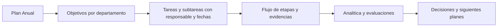
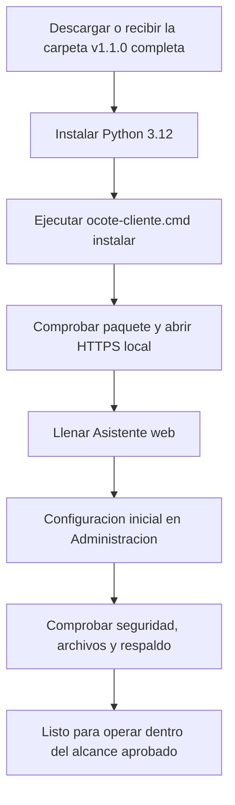
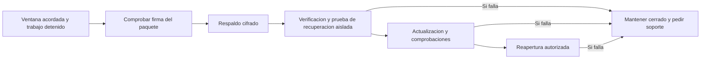

# OCOTE v1.1.0: Guia Completa y Descripcion del Proyecto

**Organizar el trabajo, saber como avanza y conservar evidencia de los resultados.**

Guia para personas que usan, administran o reciben OCOTE en una empresa. No necesitas saber programar. Fecha de revision: 27 de noviembre de 2026.

## 1. Portada y resumen ejecutivo

### Que es OCOTE

OCOTE es una aplicacion que se abre en el navegador para organizar los planes de una empresa, repartir tareas, revisar fechas y evaluar resultados con informacion comprobable. Esta guia corresponde a la entrega identificada como **v1.1.0**.

Ayuda a resolver preguntas cotidianas: que debemos conseguir, quien se encarga, cuando debe terminar, que esta detenido y con que documentos podemos demostrar una entrega. Evita depender de listas separadas, mensajes dispersos y porcentajes que cada persona interpreta de manera distinta.

Esta pensado para empresas y departamentos que necesitan coordinacion, seguimiento y rendicion de cuentas. La gerencia define el rumbo; los lideres organizan el trabajo de su departamento; los colaboradores ejecutan las tareas; y el administrador prepara y protege el sistema.

**OCOTE no es una clasificacion automatica de empleados.** Sus porcentajes describen el trabajo registrado; no sustituyen el criterio humano ni demuestran por si solos la calidad de una entrega.

Un plan puede ser anual, semestral, trimestral, mensual o tener fechas personalizadas. La expresion **Plan Anual**, utilizada en esta guia, no significa que solamente puedas trabajar por anos ni que exista un solo plan por ano.

### Antes de empezar: alcance de esta guia

Las funciones descritas estan implementadas en el proyecto, pero algunas necesitan configuracion y comprobaciones de la empresa para poder usarse. Por ejemplo, enviar correos requiere una cuenta autorizada; revisar archivos requiere un antivirus preparado; y recuperar respaldos necesita responsables y una prueba real.

Las pruebas locales documentadas no equivalen a una aprobacion de uso con datos reales en cualquier empresa. El PostgreSQL portable integrado, en particular, fue comprobado con procesos simulados; su instalacion real en el equipo del cliente todavia debe validarse con el proveedor. **Portable** significa que los programas de PostgreSQL vienen con la entrega y no requieren una instalacion separada del producto.

Esta guia no da por verificados los comandos de un lanzador externo que no forma parte del codigo consultado. Cuando se menciona una automatizacion de `ocote-cliente.cmd`, se indica lo que debe ofrecer el lanzador preparado por el proveedor. Si tu entrega no lo hace, pide ayuda; no sustituyas esos pasos por instrucciones improvisadas.

### Palabras utiles, sin complicaciones

| Palabra | Que significa aqui |
| --- | --- |
| Base de datos | El archivo organizado de informacion que permite guardar y relacionar planes, personas y tareas. |
| PostgreSQL | El programa que cuida y consulta esa base de datos. |
| HTTPS | Una conexion protegida entre tu navegador y OCOTE para que la informacion no viaje a la vista de otros. |
| Certificado | Un documento digital que ayuda al navegador a reconocer el sitio con el que se comunica. |
| Firma digital | Un sello que permite comprobar quien autorizo un paquete y si fue alterado despues. |
| Ed25519 | El nombre del metodo matematico usado para comprobar la firma del paquete. |
| Cifrado | Una proteccion que vuelve ilegible la informacion para quien no tiene la llave adecuada. |
| Puerto | Un numero de entrada que permite distinguir los programas que se comunican en una computadora. |
| Servidor | La computadora o servicio que mantiene OCOTE funcionando y guarda su informacion. |
| Modulo | Un grupo de funciones que resuelve una parte del trabajo, como tareas o notificaciones. |
| Respaldo | Una copia protegida para recuperar informacion ante un problema. |
| Version o release | Una entrega concreta de OCOTE; en esta guia, `v1.1.0`. |

### Roles y permisos

Un **rol** determina lo que una persona puede consultar o cambiar. Que una opcion no aparezca puede ser correcto: OCOTE protege la informacion segun el rol y el departamento.

| Rol | Que puede ver | Que puede hacer en el dia a dia | Limites importantes |
| --- | --- | --- | --- |
| Administrador | Informacion global y pantallas de administracion. | Crear departamentos y usuarios; configurar seguridad, parametros, etapas e integraciones; gestionar planes, tareas y evaluaciones; revisar el historial. | Es una cuenta de responsabilidad especial. Debe respetar los controles y no puede borrar el historial ni reabrir entregas finales para cambiarlas. Conviene no usarla para todo el trabajo cotidiano. |
| Gerente | Planes, objetivos, tareas y resultados de toda la organizacion. | Crear y gestionar planes y objetivos; revisar resultados; crear y finalizar evaluaciones; autorizar cambios de fecha con motivo. | No administra el sistema, no crea ni reasigna tareas, no mueve sus etapas, no completa subtareas ni carga evidencias. No puede aprobar su propia solicitud de cambio de fecha. |
| Lider | La planificacion y el trabajo de su departamento, sus indicadores y sus evaluaciones finales. | Crear y asignar tareas; organizar subtareas; mover etapas permitidas; adjuntar evidencia; solicitar cambios de fecha; colaborar y usar funciones habilitadas dentro de su alcance. | No administra otros departamentos ni cambia por su cuenta una fecha de compromiso. No crea ni finaliza evaluaciones y no edita la planificacion gerencial. |
| Colaborador | Sus tareas asignadas, sus subtareas y la informacion minima del plan y objetivo que las explica. | Completar subtareas existentes, avanzar etapas autorizadas, aportar evidencia, comentar y consultar sus avisos cuando esas funciones estan habilitadas. | No crea ni reasigna tareas, no administra personas, no aprueba fechas y no accede a analitica, evaluaciones ni exportaciones de equipo. |

Los permisos tambien se aplican al abrir un enlace recibido por correo. Compartir la direccion de una tarea no concede acceso a quien no lo tenia.

### Flujo general del trabajo



**Ejemplo ilustrativo:** la gerencia propone mejorar la atencion al cliente; un departamento recibe el objetivo de reducir tiempos de respuesta; su lider reparte las tareas; las personas registran avances y documentos; y la gerencia revisa resultados con las fechas originales y las actuales. Este ejemplo no crea datos ni configuracion en tu sistema.

## 2. Mapa completo de modulos y funciones

### Como leer las fases

Las etiquetas **F1 a F12** indican etapas de construccion del proyecto, no doce programas que debas instalar. Varias funciones se construyeron en mas de una fase. El asistente y la entrega segura completaron el trabajo de instalacion de F7 despues de las funciones empresariales.

La tabla incluye las funciones implementadas. Un modulo instalado puede permanecer apagado hasta que el Administrador lo habilite. Las conexiones externas requieren, ademas, permisos, cuentas y pruebas de la empresa.

### Tabla resumen

| Fase | Nombre del modulo | Para que sirve | Quien lo usa |
| --- | --- | --- | --- |
| F1 | Base tecnica y continuidad | Guardar informacion de forma consistente y controlar versiones del sistema. | Todos se benefician; el proveedor lo mantiene. |
| F2 y F4 | Acceso, sesiones y perfil | Entrar con una cuenta propia, cerrar sesion y proteger el acceso. | Todos. |
| F2 y F4 | Departamentos y usuarios | Organizar personas, roles y equipos. | Administrador. |
| F2 y F4 | Parametros, prioridades y horizontes | Definir datos generales, limites y tipos de periodo. | Administrador. |
| F2, F4 y F5 | Etapas y transiciones | Establecer los pasos del trabajo y quien puede avanzar entre ellos. | Administrador configura; los demas usan segun permiso. |
| F3 y F4 | Planes y objetivos | Relacionar las metas generales con responsabilidades departamentales. | Administrador y Gerente gestionan; Lider consulta su parte. |
| F3 y F4 | Tareas y subtareas | Repartir trabajo, responsabilidades, prioridades y fechas. | Administrador y Lider organizan; Colaborador ejecuta; Gerente consulta. |
| F3 y F4 | Solicitudes de fecha | Pedir, justificar y resolver cambios de compromiso sin perder la fecha original. | Lider solicita; Administrador y Gerente tambien pueden solicitar y decidir, sin aprobar sus propias solicitudes. |
| F3 y ampliaciones | Historial y auditoria | Conservar quien hizo un cambio, cuando y por que. | Cada usuario consulta lo permitido; Administrador revisa auditoria general. |
| F4 | Interfaz y navegacion | Trabajar en pantallas en espanol, con formularios, filtros y alternativas de teclado. | Todos. |
| F5 | Tablero Kanban | Ver las tareas por etapa y moverlas cuando este permitido. | Todos, segun su alcance; Gerente solo consulta. |
| F5 | Timeline o linea de tiempo | Comparar fechas y duraciones de planes, objetivos, tareas y subtareas. | Todos, segun su alcance. |
| F5, F7 y F8 | Evidencias y antivirus | Adjuntar documentos permitidos y revisarlos antes de publicarlos. | Administrador, Lider y Colaborador autorizado cargan; Gerente consulta. |
| F6 | Analitica | Revisar avance, cierres, puntualidad, retrasos y tendencias. | Administrador y Gerente; Lider solo su departamento. |
| F6 | Evaluaciones | Preparar y cerrar una fotografia de resultados de un periodo. | Administrador y Gerente gestionan; Lider ve finales propios. |
| F6 | Exportaciones internas | Descargar tareas o evaluaciones finales en formatos de intercambio. | Administrador y Gerente; Lider dentro de su alcance. |
| F7 | Salud, custodia y boveda | Revisar el estado del sistema, designar responsables y proteger secretos. | Administrador y responsable autorizado con apoyo del proveedor. |
| F7 y F8 | Almacenamiento privado | Guardar evidencias en un destino local o externo aprobado. | Administrador configura; usuarios autorizados lo utilizan indirectamente. |
| F8 | Politicas de seguridad | Definir reglas de acceso, sesiones y limites admitidos. | Administrador. |
| F8 | Disponibilidad de modulos | Encender o apagar funciones instaladas de forma controlada. | Administrador. |
| F8 | Identidad institucional o branding | Adaptar nombre, colores y logotipos permitidos. | Administrador. |
| F8 y F9 | Calendario laboral | Definir jornadas, festivos y diferencias entre departamentos. | Administrador configura; el equipo se beneficia. |
| F9 | Dependencias e impedimentos | Explicar que debe resolverse antes de cerrar una tarea. | Usuarios con permiso sobre las tareas; Administrador y Lider gestionan. |
| F9 | Plantillas y recurrencia | Reutilizar estructuras de trabajo y preparar repeticiones autorizadas. | Administrador y Lider, segun alcance y configuracion. |
| F9 | Campos personalizados y etiquetas | Registrar informacion adicional y clasificar trabajo. | Administrador define; usuarios autorizados completan o consultan. |
| F9 | Comentarios y menciones | Conversar dentro del contexto de una tarea u objetivo. | Personas con acceso al elemento. |
| F9 | Busqueda y vistas guardadas | Encontrar trabajo y reutilizar filtros personales. | Usuarios autorizados, sin ampliar su acceso. |
| F10 | Mi actividad y preferencias | Consultar avisos propios y elegir preferencias permitidas. | Todos. |
| F10 | Reglas y envios externos | Enviar avisos por correo, Slack, Teams o Telegram. | Administrador configura; destinatarios autorizados reciben. |
| F10 | Calendarios de suscripcion | Consultar fechas mediante un enlace personal de calendario. | Usuarios autorizados. |
| F11 | Inicio de sesion empresarial | Entrar mediante el sistema de identidad aprobado de la empresa. | Administrador configura; usuarios vinculados lo utilizan. |
| F11 | Vinculos con GitHub y GitLab | Relacionar tareas con cambios de software y solicitudes de revision. | Administrador configura; equipo autorizado vincula y consulta. |
| F11 | Claves de integracion y webhooks | Permitir intercambios controlados con otros programas. | Administrador y responsables de integraciones. |
| F12 | Importacion masiva | Revisar y cargar altas permitidas desde CSV o Excel. | Usuarios con permisos de planificacion o gestion, dentro de su alcance. |
| F12 | Reportes ejecutivos | Descargar evaluaciones finales en PDF o Excel. | Administrador y Gerente; Lider dentro de su alcance. |
| F12 | Operaciones avanzadas | Consultar salud, respaldos, conservacion y un agente operativo autorizado. | Administrador y responsable tecnico. |
| F7 final e incremento Local portable | Asistente de Instalacion | Preparar una instalacion nueva, la conexion y el primer Administrador. | Responsable de instalacion, con apoyo del proveedor. |
| F7 final y entrega segura | Empaquetador y actualizador | Entregar archivos verificables y actualizar conservando datos y controles. | Proveedor prepara; responsable autorizado instala y actualiza. |

### 2.1. F1: base tecnica y continuidad

OCOTE guarda la informacion relacionada para no dejar, por ejemplo, una tarea actualizada con un historial que dice otra cosa. Tambien lleva un registro de las versiones instaladas y verifica la compatibilidad de una actualizacion.

**Ejemplo:** si una operacion no puede completarse correctamente, no debe aparecer como terminada a medias. El beneficio es una informacion mas confiable; no necesitas manejar la base de datos para usarla.

### 2.2. Acceso, sesiones y perfil

Cada persona entra con su propia cuenta. OCOTE comprueba sus permisos, protege la sesion y permite cerrarla. Los cambios de contrasena, rol o activacion pueden retirar accesos anteriores. Las politicas de seguridad amplian los controles de contrasenas, intentos fallidos y duracion de sesiones.

**Ejemplo:** cuando una persona deja la empresa, desactivar su usuario no borra lo que hizo, pero impide que siga entrando. Nunca compartas una cuenta para que el historial pueda identificar a cada responsable.

### 2.3. Departamentos y usuarios

El Administrador crea los departamentos y las personas, asigna roles y relaciona a lideres y colaboradores con su departamento. Las bajas se manejan conservando la historia; las tareas abiertas pueden exigir una reasignacion antes de desactivar a alguien.

**Ejemplo:** separar Compras y Operaciones permite que cada Lider organice su trabajo sin consultar informacion reservada del otro equipo. El sistema protege al ultimo Administrador activo para evitar quedarse sin quien lo gestione.

### 2.4. Parametros, prioridades y horizontes

Los parametros son decisiones generales: nombre de la organizacion, zona horaria, tamano maximo de evidencias y limite de filas al exportar. Las prioridades permiten distinguir urgencias. Los horizontes son los tipos de periodo: anual, semestral, trimestral, mensual y personalizado.

**Ejemplo:** la empresa define un limite razonable para documentos adjuntos y todos trabajan con el mismo criterio. La prioridad no aumenta artificialmente el porcentaje de avance de una tarea.

### 2.5. Etapas y transiciones del trabajo

Una etapa indica donde esta una tarea. Una transicion es un movimiento permitido entre dos etapas. El Administrador define sus nombres, el orden visible, los roles que pueden avanzar y los casos que requieren motivo o evidencia.

**Ejemplo ilustrativo:** Pendiente, En proceso y Completada. No son etapas precargadas ni obligatorias por su nombre. Debe existir una etapa inicial abierta y una final de clase completada; todas las etapas activas necesitan un camino permitido hasta la final. No es obligatorio crear cinco etapas.

### 2.6. Planes y objetivos

El plan expresa lo que se quiere conseguir en un periodo. Los objetivos lo dividen en resultados asociados con departamentos. El Administrador o Gerente define sus fechas; los objetivos deben quedar dentro de las fechas del plan.

**Ejemplo:** un plan anual de mejora puede incluir un objetivo trimestral de capacitacion. Se prepara el plan, se agregan objetivos y despues se activa para trabajar. No se cierra mientras queden tareas abiertas.

### 2.7. Tareas, subtareas y avance

Una tarea tiene un responsable, fechas y prioridad. Las subtareas dividen la entrega en pasos verificables. El Administrador o Lider las organiza; el Colaborador completa las existentes que le corresponden.

**Ejemplo:** una tarea tiene cuatro subtareas. Al terminar una, muestra 25 % de avance. Con las cuatro completas llega al 100 %, pero aun debe cerrarse la tarea expresamente, cumpliendo sus requisitos de etapa y evidencia. Sin subtareas, una tarea abierta muestra 0 % y una completada 100 %.

No confundas **avance**, **etapa** y **puntualidad**: puedes tener mucho trabajo realizado, una revision pendiente y una fecha ya vencida. Las tareas completadas no se reabren para cambiar su historia.

### 2.8. Fechas y solicitudes de cambio

OCOTE conserva la fecha de compromiso original y la fecha vigente. Un Lider puede solicitar un cambio con su motivo. El Administrador o Gerente lo aprueba o rechaza; quien solicito no puede aprobar su propia solicitud.

**Ejemplo:** una entrega inicialmente comprometida para el dia 10 se autoriza para el dia 15 y termina el 12. Estara a tiempo frente a la nueva fecha, pero tarde frente a la original. Ambas referencias permanecen visibles; el cambio no oculta lo ocurrido.

### 2.9. Historial y auditoria

El historial explica los cambios de una tarea: responsable, fecha, etapa, evidencias y decisiones. La auditoria es el registro general de acciones relevantes que consulta el Administrador. No son conversaciones que se puedan borrar para corregir resultados.

**Ejemplo:** ante una duda sobre una fecha, el equipo puede revisar quien aprobo el cambio y su motivo. Si dos personas intentan cambiar lo mismo, OCOTE puede pedir recargar antes de guardar para evitar pisar el trabajo ajeno.

### 2.10. F4: pantallas y navegacion

Las pantallas organizan formularios, filtros, tablas y mensajes de error. Hay alternativas para utilizar teclado en operaciones que tambien admiten arrastrar elementos. Las opciones dependen del rol y de los modulos habilitados.

**Ejemplo:** un Colaborador llega a sus tareas sin navegar por configuraciones que no necesita. El diseno contempla pantallas de distintos tamanos; esto no debe confundirse con una certificacion completa de accesibilidad en todos los equipos.

### 2.11. Tablero Kanban

**Kanban** es un tablero con columnas por etapa y tarjetas por tarea. Permite ver donde se acumula trabajo y mover una tarjeta cuando el usuario tiene permiso y cumple los requisitos. Tambien puede usarse la accion de cambio de etapa sin arrastrar.

**Ejemplo:** el Lider revisa lo que esta bloqueado en su departamento. El Gerente puede consultar el tablero, pero no mueve tarjetas. Si falta evidencia, el movimiento se rechaza; no significa que se haya guardado parcialmente.

### 2.12. Timeline y fechas de calendario

**Timeline** significa linea de tiempo: presenta barras de fechas para comparar trabajo y duraciones. Segun tus permisos, permite consultar planes, objetivos, tareas y subtareas. Distingue referencias de compromiso original, vigente y cierre.

**Ejemplo:** ver que varias entregas coinciden ayuda a conversar sobre la carga del equipo. No es un planificador automatico: arrastrar una barra no es una forma autorizada de cambiar fechas. El calendario laboral y las suscripciones de calendario son funciones relacionadas, pero distintas.

### 2.13. Evidencias y revision antivirus

Una evidencia es un archivo que demuestra una entrega. La funcion base admite PDF e imagenes PNG o JPEG dentro del limite autorizado. Los archivos se guardan en privado y pasan por **ClamAV**, el antivirus que comprueba si contienen amenazas conocidas, antes de publicarse.

**Ejemplo:** adjuntar una constancia a una tarea antes de cerrarla. El Gerente puede consultar evidencia autorizada, pero no cargarla. Si el antivirus no esta disponible, esta desactualizado o no puede asegurar el resultado, OCOTE bloquea la carga: no publica el archivo sin revisarlo.

ClamAV y el almacenamiento deben estar realmente configurados y probados; no quedan garantizados por instalar OCOTE. Las evidencias publicadas y el historial no se borran desde el uso ordinario, tampoco para mejorar artificialmente un indicador.

### 2.14. Analitica

**Analitica** es la pantalla de indicadores que resume el trabajo: avance, tareas cerradas, puntualidad original y vigente, retrasos, bloqueos y tendencias. Se consulta con filtros y con la cantidad de tareas que sirve de base a cada resultado.

**Ejemplo:** comparar departamentos para detectar un cuello de botella, no para crear una clasificacion de personas. El Lider solo ve resultados de su departamento. Cuando no hay tareas, OCOTE muestra Sin datos; no inventa un 0 % ni un 100 %.

### 2.15. Evaluaciones gerenciales

Una evaluacion conserva una fotografia de los resultados de un periodo. El Administrador o Gerente la prepara, recalcula cuando corresponde y la finaliza con una conclusion. El Lider consulta las finales de su departamento.

**Ejemplo:** cerrar la evaluacion de un trimestre y conservar que se sabia el dia en que se genero. La fotografia final no cambia por nuevas entregas o ajustes posteriores. El periodo evaluado y la fecha en que se tomo la fotografia no son lo mismo.

### 2.16. Exportaciones internas

Exportar significa descargar informacion autorizada para revisarla fuera de OCOTE. La funcion interna ofrece tareas y evaluaciones finales en CSV o JSON. **CSV** es una tabla sencilla que puede abrirse en una hoja de calculo; **JSON** es un archivo estructurado que otro programa puede leer.

**Ejemplo:** el Lider descarga las tareas de su departamento para una reunion. No puede aprovechar una descarga para obtener datos de otros departamentos. Hay limites de filas y tamano; una descarga rechazada no debe interpretarse como una lista completa.

### 2.17. Salud, custodia, boveda y almacenamiento

En **Salud y custodia**, el Administrador consulta el estado de componentes, proveedores y responsables. La **boveda** es el espacio protegido para guardar secretos de las conexiones, sin mostrarlos despues como texto normal. La custodia identifica a las personas responsables de conservar y recuperar esas protecciones.

El almacenamiento de evidencias puede ser privado local o usar adaptadores para S3 y Azure; S3 es una forma de guardar archivos en servicios compatibles y Azure es una plataforma de servicios de Microsoft. Que exista el adaptador no significa que cualquier proveedor compatible haya sido probado.

**Ejemplo:** designar titular y suplente, elegir un destino privado, probarlo y activarlo. Guardar una configuracion no equivale a comprobarla; sus pruebas y autorizaciones son pasos separados.

### 2.18. Seguridad y disponibilidad de modulos

El Administrador define politicas de acceso y limites admitidos, y decide que modulos instalados estaran disponibles. Algunas operaciones sensibles piden volver a confirmar la identidad. OCOTE no permite convertir una opcion de configuracion en un permiso ilimitado.

**Ejemplo:** habilitar Notificaciones solo cuando la empresa haya preparado sus reglas y destinatarios. Encender un modulo no configura automaticamente un proveedor ni autoriza a todos los usuarios a verlo.

### 2.19. Identidad institucional

**Branding** significa adaptar la presentacion a la identidad de la empresa: nombre, logotipos y colores permitidos. Se conservan controles para que la informacion siga siendo legible. Un logo privado tambien puede necesitar la revision de archivos configurada.

**Ejemplo:** mostrar el nombre del organismo sin cambiar el significado de las alertas o el funcionamiento de los permisos. Si aun no se configura la identidad propia, se mantiene la presentacion de OCOTE.

### 2.20. Calendario laboral

Permite definir dias de trabajo, dias festivos y reglas comunes o distintas por departamento. Sirve de referencia para las funciones que utilizan dias habiles, como ciertas programaciones.

**Ejemplo:** un equipo trabaja de lunes a viernes y otro tiene una jornada diferente. Registrar ese calendario no cambia en secreto fechas de compromiso ya guardadas ni convierte en puntuales entregas atrasadas.

### 2.21. Dependencias e impedimentos

Una dependencia relaciona tareas que requieren una coordinacion de cierre. Un impedimento registra una situacion que debe resolverse. Las dependencias implementadas impiden cerrar la tarea relacionada si sus predecesoras siguen incompletas; no obligan a retrasar su inicio.

**Ejemplo:** se puede adelantar la preparacion de un informe, pero no cerrarlo antes de que termine la revision necesaria. Estos controles no recalculan automaticamente fechas ni porcentajes y no son un planificador de proyectos automatico.

### 2.22. Plantillas y recurrencia

Las plantillas permiten reutilizar estructuras de planes, objetivos o tareas segun lo autorizado. La recurrencia prepara repeticiones con una programacion explicita y permisos vigentes. Antes de crear se puede revisar lo que se generara.

**Ejemplo:** reutilizar el trabajo de una revision mensual sin copiar a mano toda su estructura. La repeticion automatica necesita que el responsable configure las ejecuciones en segundo plano; marcar una opcion no demuestra que esas ejecuciones ya esten funcionando.

### 2.23. Campos personalizados y etiquetas

Los campos personalizados agregan informacion controlada, como un dato de texto, numero, fecha, opcion, varias opciones o un enlace. Las etiquetas clasifican elementos sin cambiar sus permisos.

**Ejemplo:** marcar una tarea como Capacitacion y registrar un enlace de referencia aprobado. Estos datos no sustituyen las fechas oficiales, los responsables ni el historial, y no permiten ejecutar instrucciones dentro de OCOTE.

### 2.24. Comentarios, menciones y colaboracion

Los comentarios mantienen la conversacion junto a la tarea u objetivo. Una mencion llama la atencion de otra persona con acceso permitido. Las conversaciones admiten respuestas y conservan controles sobre sus cambios.

**Ejemplo:** preguntar por una revision y mencionar a quien debe responder sin perder el contexto en un chat separado. Mencionar a una persona no le concede acceso a informacion reservada y no garantiza un correo externo si las notificaciones no estan configuradas.

### 2.25. Busqueda y vistas guardadas

La busqueda y los filtros ayudan a localizar trabajo. Una vista guardada conserva una seleccion de filtros para volver a usarla, no una copia que otorga nuevos permisos.

**Ejemplo:** regresar cada manana a las tareas abiertas de tu departamento. Si tu rol cambia, la vista sigue respetando tus permisos actuales.

### 2.26. Mi actividad, avisos y canales externos

**Mi actividad** reune avisos personales, preferencias y funciones de calendario disponibles. El Administrador configura reglas y umbrales, es decir, las condiciones que originan un aviso. Los canales implementados incluyen correo mediante SMTP, Slack, Microsoft Teams y Telegram; **SMTP** es el mecanismo que permite a un programa enviar correo.

**Ejemplo:** recibir un aviso por una asignacion o una condicion de fecha configurada. No todos los sucesos se envian por todos los canales: depende de las reglas, preferencias, permisos y conexion aprobada. Que un proveedor acepte un mensaje no prueba que una persona lo haya leido.

No se debe presentar Discord, Google Chat o un chat libre interno como funciones entregadas por este alcance.

### 2.27. Suscripciones de calendario

OCOTE puede entregar un enlace personal de calendario para consultar fechas desde un lector compatible, mediante el formato iCalendar. **iCalendar** es una manera comun de compartir eventos entre aplicaciones de calendario.

**Ejemplo:** consultar los compromisos permitidos junto a otras citas. El enlace se puede revocar o vencer y debe guardarse como informacion privada. Es una suscripcion de lectura: no es una sincronizacion de ida y vuelta con Google Calendar, Outlook o CalDAV, ni permite cambiar los compromisos oficiales desde fuera.

### 2.28. Inicio de sesion empresarial

El inicio de sesion unico, llamado **SSO**, permite usar una identidad empresarial aprobada para entrar a OCOTE. Los mecanismos implementados son OIDC, SAML y LDAP/AD: distintas formas de comprobar tu cuenta con el sistema de identidad de la empresa.

**Ejemplo:** entrar con la identidad corporativa que el Administrador haya vinculado y probado. Coincidir en correo no concede acceso automaticamente ni convierte a nadie en Administrador. Se necesita configurar al proveedor, probarlo y conservar una cuenta local de emergencia autorizada.

### 2.29. GitHub y GitLab

Estas integraciones relacionan una tarea con trabajo de desarrollo de software, como un cambio guardado, una rama o una solicitud de revision. Esas referencias permiten seguir que se hizo para cumplir la tarea.

**Ejemplo:** un equipo de sistemas vincula la correccion de una pantalla con su tarea de OCOTE. Recibir un aviso de GitHub o GitLab no cierra la tarea, no cambia su porcentaje ni modifica fechas. Bitbucket no esta incluido en este alcance.

### 2.30. Claves de integracion y webhooks

Una **clave de integracion** es una credencial para que otro programa realice solo las acciones autorizadas. Un **webhook** es un aviso automatico entre programas cuando ocurre un evento. OCOTE permite emitir, vencer, revocar y limitar esas conexiones, y proteger la autenticidad de los avisos.

**Ejemplo:** permitir que un sistema aprobado cree tareas sin prestarle la cuenta personal del Administrador. La clave completa se muestra una sola vez; se guarda de forma segura, nunca en un correo abierto o un comentario. Estas conexiones las prepara el responsable tecnico, no el Colaborador.

### 2.31. Importacion masiva

En **Importaciones** se puede revisar un archivo CSV o Excel, de extension XLSX, antes de confirmar altas permitidas. La vista previa muestra resultados y errores; revisar no equivale a guardar. Los permisos, los catalogos y las relaciones deben ser validos tambien al confirmar.

**Ejemplo:** preparar varias tareas sin capturarlas una a una. Primero corrige los errores, revisa las filas y despues confirma. No sirve para introducir usuarios con permisos elevados, sobreescribir fechas originales o alterar entregas finales. Los archivos se someten a los controles de seguridad correspondientes; no habilites una carga si su revision no funciona.

### 2.32. Reportes ejecutivos

En **Reportes ejecutivos** se pueden generar documentos PDF o libros Excel de evaluaciones finales autorizadas. **PDF** conserva la presentacion de un documento y **XLSX** es el formato habitual de un libro de Excel.

**Ejemplo:** llevar a una reunion el resultado cerrado de un periodo con su conclusion y fecha de corte. El reporte conserva la fotografia evaluada; no recalcula resultados historicos para hacerlos coincidir con tareas modificadas despues.

### 2.33. Operaciones avanzadas

La pantalla incluye Salud, Respaldos, Retencion y Agente. Un **agente** es un programa auxiliar autorizado para realizar acciones operativas. La retencion expresa reglas de conservacion; no da permiso para borrar el historial de negocio.

**Ejemplo:** revisar si existe evidencia de un respaldo comprobado y detectar un fallo pendiente. Los botones no sustituyen la preparacion del agente, su conexion, el destino de copia y las pruebas de recuperacion. No se promete un servicio de respaldo automatico ya instalado por mostrar esta pantalla.

### 2.34. Asistente de Instalacion

El asistente prepara una instalacion realmente nueva y crea el primer Administrador. Ofrece Local con PostgreSQL portable integrado o un servidor externo aprobado. Despues protege la configuracion sensible y se sella: deja de aceptar una nueva instalacion sobre ese mismo estado.

**Ejemplo:** el responsable completa un formulario en lugar de crear manualmente roles y base local. No debe usar el asistente para actualizar ni para solucionar un error borrando datos; una instalacion parcial requiere revision del proveedor.

### 2.35. Empaquetador, firma y actualizacion segura

El **empaquetador** es la herramienta del proveedor que reune los archivos exactos de una entrega. Incluye un inventario de componentes, llamado SBOM, que permite conocer que programas y archivos se distribuyen. No incluye los datos vivos del equipo de desarrollo.

El paquete y su firma se comprueban antes de confiar en ellos. El actualizador exige respaldo protegido y comprobaciones, conserva datos y configuracion, y deja el sistema cerrado al trabajo si algo falla.

**Ejemplo:** comprobar que una entrega es la autorizada y no un archivo cambiado en el camino. Una firma valida no significa que el programa sea infalible o que no tenga avisos de seguridad pendientes; el proveedor debe revisar tambien esos riesgos.

## 3. Donde descargar y que archivos debes recibir

### Sitios oficiales

- Repositorio oficial: [OCOTE en GitHub](https://github.com/LAngelVp/OcoteApp).
- Entregas publicadas: [Releases de OCOTE](https://github.com/LAngelVp/OcoteApp/releases).
- Referencia de esta version: [v1.1.0](https://github.com/LAngelVp/OcoteApp/releases/tag/v1.1.0).

GitHub es el sitio donde el proveedor publica el proyecto y puede distribuir sus entregas. Para instalar no necesitas descargar el codigo ni conocer su estructura.

### Descargar v1.1.0, paso a paso

1. Abre la pagina **Releases de OCOTE** indicada arriba.
2. Busca **v1.1.0**. Comprueba el numero; no elijas otra version solo porque aparezca primero.
3. Abre **Assets**, que significa archivos de esa entrega, si aparece ese apartado.
4. Comprueba que esten disponibles los cuatro archivos de la siguiente tabla. Si no estan todos, pide al proveedor la carpeta de entrega `v1.1.0` completa.
5. Guarda los cuatro juntos en una sola carpeta, por ejemplo `Descargas\v1.1.0`. Comprueba que Windows no haya agregado `(1)` a ningun nombre por una descarga repetida.
6. Antes de ejecutar, confirma con el proveedor por un medio ya conocido que la clave publica recibida es la autorizada. Recibir cuatro archivos de un remitente desconocido no los vuelve confiables.

**Situacion observada al redactar esta guia:** los enlaces del proyecto y la etiqueta `v1.1.0` respondieron, pero no se encontraron publicados los cuatro archivos de instalacion. La referencia de la etiqueta solo mostro descargas de codigo fuente. La lista general de Releases no mostro una entrega instalable. Esto puede cambiar cuando el proveedor publique los archivos.

**No descargues Source code (zip) para instalar.** Esa opcion es una copia del codigo del proyecto y no reemplaza el paquete de cliente firmado. Si recibes directamente una carpeta `v1.1.0` del proveedor con los cuatro archivos correctos, puedes usarla sin pasar por la descarga de GitHub.

### Los cuatro archivos obligatorios

| Archivo | Para que sirve | Que NO debes hacer |
| --- | --- | --- |
| `ocote-v1.1.0.zip` | Contiene la aplicacion preparada; la entrega Local solicitada debe incluir tambien PostgreSQL portable. | No renombrarlo, abrirlo para modificarlo ni descomprimirlo manualmente. El lanzador se encarga de extraerlo despues de comprobarlo. |
| `ocote-v1.1.0.zip.sig` | Contiene la firma digital del ZIP para detectar cambios y comprobar la autorizacion de la entrega. | No editarlo, quitarle `.sig` ni sustituirlo por la firma de otra version. |
| `ocote-release-public.pem` | Es la clave publica que permite comprobar la firma. Es publica, no una contrasena. | No cambiarla por una que aparezca en un mensaje inesperado. Confirma su autenticidad con el proveedor por otro medio conocido. |
| `ocote-cliente.cmd` | Es el lanzador para Windows: recibe acciones como instalar, actualizar, reabrir o preparar plantillas, si esa entrega las incorpora. | No ejecutarlo antes de confirmar su procedencia, no editarlo y no mezclarlo con archivos de otra entrega. |

**Conserva los cuatro juntos, con esos nombres y sin moverlos individualmente.** Despues de instalar, no reorganices las carpetas de aplicacion, datos o certificados por tu cuenta. Pide al proveedor una ubicacion definitiva antes de empezar. El lanzador tambien es un programa: la firma del ZIP no protege automaticamente un CMD suelto recibido de otra fuente.

## 4. Instalacion paso a paso en Windows

### Antes de comenzar

Usa una computadora Windows aprobada por la empresa y un navegador actualizado. El equipo debe cumplir los requisitos de capacidad que el proveedor haya comprobado para tu numero de usuarios y archivos. No hay un tamano universal certificado en esta guia.

Acuerda con el responsable de la empresa quien instalara, que cuenta de Windows se utilizara y donde se conservaran los datos. Mantener la misma cuenta Windows aprobada es importante: parte de las llaves queda protegida para esa identidad. Cambiar de usuario, reinstalar Windows o mover la carpeta a otra computadora no equivale a recuperar la instalacion.

No instales sobre una base o carpeta de datos que ya contenga una empresa funcionando. Para una instalacion nueva, el estado debe ser nuevo y privado. Si se requiere conexion a Internet para descargar componentes, el responsable debe autorizarla; en una red cerrada el proveedor debe preparar los archivos necesarios por un medio aprobado.



### Paso 1. Instalar Python 3.12

**Python** es el programa que Windows necesita para ejecutar una parte de OCOTE. No necesitas aprender su lenguaje ni escribir programas.

1. Abre la [pagina oficial de Python 3.12.10](https://www.python.org/downloads/release/python-31210/).
2. En **Files**, busca el instalador de Windows de 64 bits, normalmente **Windows installer (64-bit)**. Si el equipo usa otra arquitectura, pide la variante aprobada al proveedor.
3. Ejecuta el instalador oficial.
4. Marca **Add python.exe to PATH**: permite que Windows encuentre Python cuando el lanzador lo necesite.
5. Marca **Use admin privileges when installing py.exe**, o la opcion equivalente **Use admin privileges**, si aparece y la politica de tu empresa lo permite. Solo sirve para la instalacion autorizada de Python; no significa que OCOTE deba trabajar siempre con permisos de administrador de Windows.
6. Continua con **Install Now** o con las opciones que te haya indicado el responsable de la empresa. Si Windows pide una autorizacion que no tienes, solicita apoyo; no intentes saltar las restricciones.
7. Espera el mensaje de instalacion correcta. Cierra las ventanas de comandos que estuvieran abiertas antes de instalar Python.

No instales una version distinta solo para quitar un error. Si tu red bloquea el sitio oficial, solicita el instalador oficial por un canal de la empresa. La red utilizada para redactar esta guia bloqueo la consulta de esa pagina; no se pudo comprobar su contenido desde aqui y no se intento evadir ese bloqueo.

### Paso 2. Ejecutar el lanzador de instalacion

1. Abre el **Explorador de archivos** de Windows.
2. Entra en la carpeta `v1.1.0` donde estan juntos los cuatro archivos.
3. Haz clic en la barra superior donde aparece la direccion de la carpeta. Escribe `cmd` y pulsa **Enter**.
4. Se abrira una ventana de comandos, habitualmente negra, situada en esa misma carpeta. Escribe exactamente lo siguiente y pulsa **Enter**:

```bat
ocote-cliente.cmd instalar
```

5. Deja abierta la ventana. Espera a que termine sus comprobaciones o indique el siguiente paso. No inicies varias instalaciones en paralelo ni ejecutes comandos de esta guia mientras otra operacion siga trabajando.

**Lo que debe hacer automaticamente el lanzador preparado para esta entrega:**

| Accion | Explicacion cotidiana | Si no ocurre |
| --- | --- | --- |
| Verificar la firma Ed25519 y el contenido del paquete antes de confiar en el | Comprueba que el paquete autorizado no cambio. | Ante firma invalida, deten la instalacion y pide al proveedor el conjunto correcto. No aceptes continuar sin verificar. |
| Extraer el ZIP en una carpeta nueva de la aplicacion | Coloca los programas sin mezclar versiones ni datos anteriores. | No lo descomprimas manualmente como solucion. Solicita revision del lanzador. |
| Preparar los componentes necesarios con sus comprobaciones de integridad | Instala dependencias, es decir, las piezas de software que OCOTE necesita para funcionar, comparandolas con las autorizadas. | Pide los componentes aprobados; no descargues paquetes sueltos de paginas desconocidas. |
| Poner a disposicion PostgreSQL portable incluido | Entrega el programa de base de datos sin pedirte instalar PostgreSQL aparte. El asistente creara los datos nuevos mas adelante. | Si Local aparece no disponible, falta un paquete portable completo; pide al proveedor la entrega correcta. |
| Usar el certificado HTTPS aprobado o preparar uno local | Si la empresa no proporciono certificado propio y el lanzador incorpora la automatizacion acordada, debe generar el certificado local en `C:\OCOTE\tls\` y comunicarlo. | La generacion automatica y esa ruta no estan confirmadas en los documentos del proyecto consultados. Si faltan, el proveedor debe prepararlas; no cambies a una conexion sin proteccion. |
| Indicar como entrar al asistente | Muestra la direccion y, cuando corresponda, un codigo temporal de emparejamiento para vincular el navegador con esta instalacion. | Conserva la ventana y solicita apoyo con el mensaje visible. No compartas ese codigo como si fuera informacion publica. |

Estas automatizaciones corresponden al **lanzador de cliente que entregue el proveedor**, no a una garantia derivada de tener cualquier archivo con ese nombre. El programa de OCOTE si exige firma y una conexion protegida o un intermediario HTTPS ya preparado; no crea por si solo todos los certificados ni instala servicios de Windows.

### Paso 3. Completar el Asistente de Instalacion

Abre [OCOTE local](https://localhost:8443) solo despues de que el lanzador indique que esta listo. **localhost** significa esta misma computadora; esa direccion no abre OCOTE en otra computadora de la oficina. El numero `8443` identifica la entrada web prevista para esta entrega y debe coincidir con lo que muestre el lanzador.

Si se necesita otro acceso o compartir OCOTE por la red de la empresa, el proveedor debe preparar y aprobar esa instalacion; no basta con sustituir localhost por una direccion cualquiera.

#### Si el navegador avisa sobre el certificado local

Un certificado creado en el propio equipo puede producir el aviso **La conexion no es privada** o equivalente, porque el navegador todavia no conoce a quien lo emitio. Eso no autoriza a ignorar cualquier advertencia.

1. Comprueba que acabas de iniciar la entrega oficial y que la direccion es exactamente `https://localhost:8443` en el equipo donde la instalas.
2. Confirma con el proveedor que el aviso corresponde al certificado local previsto. Si hace falta compararlo, pide ayuda para abrir **Ver certificado** y cotejar su huella, que es un identificador del certificado.
3. Solo si esa comprobacion esta hecha y la politica de la empresa lo permite, abre **Avanzado** y utiliza la opcion equivalente a **Continuar a localhost**, si el navegador la ofrece. La excepcion se limita al sitio local autorizado; no convierte el certificado en uno aprobado para toda la empresa.
4. Si el aviso se refiere a otro sitio, un certificado vencido o diferente, o el navegador no ofrece continuar, deten el proceso y consulta al responsable.

**No desactives la seguridad del navegador, no instales confianza general sin autorizacion y no agregues excepciones para sitios ajenos.** Para el uso empresarial normal se debe preparar el certificado confiable aprobado por la empresa.

#### Emparejar el navegador

Si el asistente solicita un codigo, utiliza el codigo temporal que acaba de mostrar el lanzador. Sirve para comprobar que la persona que esta en el navegador tiene acceso al proceso local de instalacion. Es de un solo uso y vence; no lo pongas en una direccion web, correo o conversacion de soporte.

Si vence o ya se uso y no puedes avanzar, pide el procedimiento aprobado al proveedor. No reinicies borrando carpetas para obtener otro codigo.

#### Elegir donde guardar la informacion

| Opcion del asistente | Base de datos local: PostgreSQL portable integrado | Servidor externo / Nube |
| --- | --- | --- |
| Cuando elegirla | Recomendacion para una instalacion nueva en una sola computadora aprobada, con paquete portable completo y validacion del proveedor. | Cuando la empresa ya acordo que la informacion viva en un servidor separado o un servicio contratado. |
| Quien la prepara | El asistente prepara una base nueva local. | El responsable de bases de datos debe preparar antes el servidor, permisos y conexion segura. |
| Nombre de la base | `ocoteAppDatabase`; viene bloqueado y no se cambia. | Tambien `ocoteAppDatabase`; no elijas otro nombre. |
| Direccion | La propia computadora; no necesitas escribir host ni direccion de red. | Debes recibir del responsable el nombre del servidor y su direccion aprobada. |
| Puerto | `5432` propuesto. Si esta ocupado, el responsable puede indicar otro puerto libre, entre 1 y 65535. | El numero exacto proporcionado por la empresa. |
| Carpeta de datos | Por defecto `postgres-data`, dentro de la carpeta privada de estado que prepara el responsable. Debe ser nueva y quedar fuera de las carpetas del programa. | La administra el responsable del servidor externo. |
| Contrasenas | Tres distintas: `postgres`, `ocote_migrador` y `ocote_runtime`; se explican debajo. | Las dos cuentas separadas y sus contrasenas, entregadas por el responsable. |
| Proteccion de conexion | Solo se comunica con la propia computadora. La pantalla web sigue usando HTTPS. | Exige verificar el nombre del servidor y su certificado, mediante la opcion `verify-full` y el certificado publico de la entidad autorizada; significa no aceptar una conexion sin comprobar a quien pertenece. |
| Si no esta disponible | No instales PostgreSQL al azar ni apuntes a datos existentes; pide el paquete portable correcto. | No sustituyas el destino por otro para hacer que conecte; consulta al responsable. |

Las tres cuentas locales tienen usos diferentes:

- **postgres:** permite preparar la base nueva. Su contrasena no se conserva como credencial del funcionamiento diario de OCOTE.
- **ocote_migrador:** permite preparar o actualizar la estructura de informacion. No es la cuenta para trabajar todos los dias.
- **ocote_runtime:** es la cuenta con los permisos limitados que usa OCOTE al funcionar normalmente.

Para Local, utiliza tres contrasenas distintas de **14 a 128 caracteres**, combinando al menos tres de estos grupos: minusculas, mayusculas, numeros y simbolos. No reutilices la contrasena de tu correo, de Windows ni la del primer Administrador. Guardalas en el gestor de contrasenas aprobado por la empresa; no en una nota dentro de la carpeta de entrega.

#### Validar, crear al primer Administrador y sellar

1. Completa la opcion de base de datos elegida. En Local, pulsa **Validar instalacion local**; se revisan las condiciones, pero todavia no significa que la base este instalada. En Externo/Nube, utiliza **Probar conexion y permisos**.
2. Captura el nombre, correo y contrasena del primer **Administrador** de OCOTE. Es una persona identificada, no una cuenta compartida. Guarda esa contrasena de forma segura y confirma su escritura cuando se solicite.
3. Elige la zona horaria real de la organizacion con el responsable. No la dejes al azar: se utilizara para interpretar vencimientos.
4. Revisa los datos, el motivo solicitado y la confirmacion final.
5. En Local, pulsa **Preparar e instalar**. El asistente crea el destino nuevo, los permisos y el primer Administrador. En Externo/Nube, confirma la instalacion sobre el destino nuevo previamente preparado.
6. Espera la confirmacion. No cierres la ventana negra ni apagues la computadora durante este paso.
7. Al terminar, entra con el Administrador creado. El asistente se **sella**, es decir, queda bloqueado para impedir otra instalacion sobre los mismos datos.

Que el asistente ya no aparezca es normal despues del cierre. Un error posterior no permite empezar de cero: no borres la carpeta privada, no crees otra base por intuicion y no vuelvas a instalar sobre la misma informacion. Conserva el mensaje y pide recuperacion supervisada si la instalacion quedo incompleta.

### Paso 4. Posinstalacion obligatoria en Administracion

Una instalacion terminada no significa que los catalogos, las reglas o los equipos ya esten capturados. OCOTE no inventa departamentos, personas ni decisiones de la empresa. Inicia sesion como Administrador y completa estos **seis apartados**; son grupos de trabajo, no necesariamente seis botones del menu.

Los nombres pueden aparecer sin tildes en la pantalla, por ejemplo **Configuracion**, **Parametros**, **Modulos** o **Configuracion completa**.

#### 1. Seguridad

- [ ] Abre **Administracion > Configuracion > Seguridad**.
- [ ] Registra las politicas de acceso, sesiones y limites que haya aprobado la empresa; utiliza **Configurar** y guarda el motivo cuando se solicite.
- [ ] Verifica que puedes entrar y cerrar sesion con la cuenta elegida. Conserva un procedimiento de emergencia aprobado; no dependas de una sola persona ni publiques sus claves.

#### 2. Parametros

- [ ] Abre **Administracion > Parametros**.
- [ ] Revisa o registra el **nombre de la organizacion** (`organization_name`).
- [ ] Revisa la **zona horaria** (`organization_timezone`), que es la region que determina el horario y los vencimientos. No la confundas con el nombre de la ciudad escrito libremente; utiliza una opcion valida, por ejemplo `America/Mexico_City` si corresponde a tu organizacion.
- [ ] Define el **tamano maximo de evidencia** (`evidence_max_bytes`) y el **limite de filas al exportar** (`export_max_rows`) segun lo autorizado. Si el formulario habla de bytes, son unidades de tamano: 1 MiB equivale a 1 048 576 bytes. Pide al responsable el valor exacto; el sistema impone sus limites maximos.
- [ ] Confirma estos datos antes de crear la primera tarea o evaluacion. Despues, la zona horaria queda protegida frente a cambios ordinarios.

#### 3. Catalogos, Etapas y Transiciones: llegar a Configuracion completa

- [ ] En **Prioridades**, crea las decisiones de la empresa y asegurate de que exista la prioridad de codigo `normal` activa.
- [ ] En **Horizontes**, completa los cinco tipos admitidos: anual (`annual`), semestral (`semiannual`), trimestral (`quarterly`), mensual (`monthly`) y personalizado (`custom`). No inventes otros codigos. Personalizado debe mantenerse activo.
- [ ] En **Etapas**, crea al menos dos etapas activas distintas: una inicial de clase **Abierta** y una final de clase **Completada**. Agrega intermedias solo si la empresa las necesita.
- [ ] Decide que etapas exigiran motivo o evidencia. Antes de exigir documentos, coordina el almacenamiento y antivirus del apartado 5.
- [ ] En **Transiciones**, captura cada movimiento permitido, con origen, destino y roles autorizados. Incluir una etapa en una lista no crea automaticamente sus movimientos. El Gerente no debe recibir una transicion para mover tareas.
- [ ] Comprueba que todas las etapas activas puedan llegar a la final y que la etapa completada no tenga movimientos de salida.
- [ ] Revisa el bloque **Estado operativo**, visible en las pantallas administrativas de catalogos, y atiende cada faltante hasta ver **Configuracion completa**. Si dice que no hay camino a la etapa final, corrige las transiciones; no basta con reordenar las columnas.

**Configuracion completa** se refiere a esos parametros y catalogos. No certifica que el antivirus, los respaldos o las conexiones externas ya funcionen.

#### 4. Modulos, imagen institucional y calendario laboral

- [ ] Abre **Administracion > Configuracion > Modulos** y activa expresamente solo las funciones que la empresa vaya a utilizar.
- [ ] Prepara las politicas necesarias antes de abrir las funciones al equipo. No actives una conexion externa solo para que aparezca su menu.
- [ ] En **Branding**, revisa nombre, colores y logotipos si necesitas identidad propia. Las cargas de imagenes tambien deben cumplir sus controles de seguridad.
- [ ] En **Calendarios**, define jornadas y festivos reales de la organizacion y, si corresponde, de cada departamento. No esperes un calendario precargado correcto para todas las empresas.

#### 5. Infraestructura, custodios y ClamAV

- [ ] Abre **Administracion > Salud y custodia**. Es la pantalla de infraestructura; contiene **Salud**, **Proveedores**, **Boveda** y **Custodia**.
- [ ] En **Custodia**, registra un **titular** y un **suplente** reales y distintos, con contactos y responsabilidades acordadas. Son las personas responsables de conservar y recuperar la informacion y sus llaves; no basta con poner dos nombres.
- [ ] En **Proveedores**, coordina el almacenamiento privado de evidencias y **ClamAV** con el responsable tecnico. El antivirus no queda instalado ni actualizado automaticamente por tener el modulo.
- [ ] Guarda, prueba y activa la misma configuracion aprobada. Las pruebas tienen vigencia; si caducan, vuelve a probar antes de activar. No asumas que guardar equivale a activar.
- [ ] Comprueba con el proveedor una carga permitida, el rechazo controlado de una amenaza de prueba autorizada y el bloqueo cuando no se puede revisar. No utilices archivos maliciosos reales para experimentar.
- [ ] En **Operaciones avanzadas**, acuerda el agente, destino de respaldos y comprobacion de recuperacion que se utilizaran. Mientras no existan, no des por cubierto el respaldo automatico.

Si ClamAV o el almacenamiento no estan listos, **las cargas deben permanecer bloqueadas**. No quites la revision de seguridad para continuar; la empresa debe decidir si puede operar sin esa funcion y sin etapas que exijan evidencia, dentro del alcance aprobado.

#### 6. Departamentos, usuarios y primer Plan Anual

- [ ] En **Departamentos**, crea los equipos reales que utilizaran OCOTE.
- [ ] En **Usuarios**, crea cuentas individuales y asigna los roles correctos. Relaciona a cada Lider y Colaborador con su departamento. Entrega contrasenas por un medio seguro.
- [ ] En **Planes**, crea el primer plan en borrador con titulo, tipo de periodo y fechas reales. Un plan anual puede cruzar de ano si asi lo decide la empresa.
- [ ] En **Objetivos**, agrega al menos un objetivo, su departamento y fechas contenidas en el plan. El Administrador o Gerente realiza esta planificacion.
- [ ] Activa el plan cuando este listo. Mientras siga en borrador no se crean tareas operativas.
- [ ] El Administrador o Lider crea una primera tarea real con responsable de su departamento, prioridad y fechas dentro del objetivo. Agrega subtareas si sirven para dividir la entrega.
- [ ] Comprueba con cuentas distintas que cada persona ve solo lo permitido y que el equipo entiende como cerrar una tarea y registrar evidencia cuando corresponda.

Completar estas listas es preparacion de uso, no una autorizacion automatica de produccion. Antes de manejar informacion real, el proveedor y la empresa deben aceptar la instalacion, seguridad, respaldo y conexiones que efectivamente se usaran.

### Paso 5. Opcional: preparar arranque automatico de Windows

Una instalacion puede dejar de funcionar al cerrar la ventana que la mantiene abierta. Para que arranque al encender Windows, el responsable debe preparar una tarea de inicio. **Programador de tareas** es la herramienta de Windows que inicia acciones en horarios o momentos definidos.

1. Si tu lanzador documenta esta accion, abre `cmd` desde la carpeta de entrega y ejecuta:

```bat
ocote-cliente.cmd plantillas
```

2. Espera la ubicacion de las plantillas. Son instrucciones para completar; generarlas **no instala ni activa** las tareas.
3. Entrega esas plantillas al responsable tecnico para que complete la cuenta Windows aprobada, ubicaciones, certificados, horarios y permisos. Debe mantener la identidad con la que se protegieron las llaves.
4. Con su apoyo, abre **Programador de tareas** desde el buscador de Windows y utiliza **Importar tarea** con el archivo ya preparado. No importes una plantilla con campos sin completar ni selecciones una cuenta muy privilegiada por comodidad.
5. El responsable debe comprobar el inicio normal, el reinicio de Windows, la disponibilidad de OCOTE y las acciones programadas autorizadas. Las tareas de avisos, recurrencia y respaldo se preparan por separado cuando se necesiten.

OCOTE inicia primero su PostgreSQL local propio antes de utilizarlo, si la instalacion esta sellada y sus comprobaciones pasan. Las plantillas no deben crear otra base ni ejecutar una instalacion nueva cada vez que enciende Windows. Una tarea de respaldo tambien necesita el agente y el destino aprobados, no solo un horario.

## 5. Operacion basica, actualizaciones y respaldo

### Rutina sencilla del equipo

1. Entra por la direccion oficial que te indique la empresa y utiliza tu cuenta personal. Despues de la primera instalacion, no vuelvas a ejecutar `instalar` para abrir el trabajo cotidiano; usa el acceso o mecanismo de inicio que entregue el proveedor.
2. Consulta **Tareas** y aplica los filtros de tu trabajo. Si estan habilitados, utiliza **Kanban**, **Timeline** o **Mi actividad** segun lo que necesites revisar.
3. Abre una tarea antes de actualizarla. Revisa su responsable, fechas, subtareas y requisitos para cambiar de etapa.
4. Completa subtareas existentes o registra evidencia autorizada. Recuerda que 100 % de subtareas no cierra por si solo la tarea.
5. Si cambia un compromiso, utiliza la solicitud y autorizacion correspondiente; no intentes corregir la historia original.
6. Usa comentarios y menciones para aclaraciones vinculadas al trabajo. No publiques contrasenas, claves ni datos personales innecesarios.
7. El Lider revisa su departamento; el Gerente o Administrador consulta indicadores y prepara las evaluaciones del periodo.
8. Cierra sesion al terminar, especialmente en equipos compartidos. No interpretes cerrar una pestana como un respaldo de la informacion.

Si aparece un conflicto porque otra persona guardo antes, conserva por separado el texto que estabas preparando, descarta o recarga expresamente segun indique la pantalla y revisa la version actual antes de volver a guardar. No insistas repetidamente sin comprobar que cambio.

### Actualizar sin sustituir los datos por una instalacion nueva

La actualizacion esta disenada para conservar los datos, configuracion e historial. **Ningun procedimiento elimina todos los riesgos:** la proteccion real depende de respaldos recuperables, una version compatible y las verificaciones del responsable.

No uses estas instrucciones sobre una instalacion de desarrollo o sobre una empresa sin autorizacion. El actualizador documentado comprueba compatibilidad; no se garantiza que cualquier version futura funcione con v1.1.0. El proveedor debe entregar el procedimiento y las versiones de origen admitidas para cada salto.



1. Acuerda una ventana sin trabajo con los usuarios. El responsable debe detener las escrituras y las acciones automaticas que puedan cambiar informacion; no basta con avisar que no entren.
2. Recibe la nueva entrega completa, con sus nombres y firmas correspondientes. Conserva la entrega anterior y la ubicacion de los datos; no mezcles archivos de ambas versiones.
3. Pide al proveedor que confirme compatibilidad, certificado, llaves y cuentas necesarias. Las contrasenas se introducen cuando el procedimiento autorizado las pide en la ventana local, nunca como texto en un comando o mensaje de soporte.
4. Si el lanzador entregado incluye la accion aprobada, ejecuta desde la nueva carpeta:

```bat
ocote-cliente.cmd actualizar
```

5. El procedimiento debe comprobar el paquete, mantener el sistema en mantenimiento, crear un respaldo cifrado y demostrar que puede recuperarlo en un destino de prueba separado. **Mantenimiento** significa que no se permite el trabajo normal mientras se protege y revisa la instalacion.
6. Espera las verificaciones posteriores de datos y componentes. No uses `instalar`, no borres carpetas y no cambies a otra base para quitar un error.
7. Solo cuando el responsable confirme que corresponde y que la aplicacion nueva esta preparada bajo mantenimiento, utiliza la accion de reapertura:

```bat
ocote-cliente.cmd reabrir
```

8. La reapertura debe comprobar la identidad de la instalacion, los resultados del respaldo y actualizacion y la conexion protegida. Si algo no coincide, el sistema permanece cerrado. No retires a mano un archivo de mantenimiento para forzar la entrada.
9. Comprueba el acceso de usuarios y una muestra acordada de trabajo antes de dar por terminada la ventana.

Los comandos anteriores dependen del lanzador externo preparado por el proveedor. La herramienta interna de OCOTE tiene controles y puede pedir informacion adicional; esta guia no los sustituye por una actualizacion de un clic ni acredita que el CMD concreto ya implemente todas esas acciones.

### Respaldo y responsables

- Designa un **custodio titular** y un **suplente independiente** con instrucciones de contacto y recuperacion. Practiquen el procedimiento; llenar sus nombres no los capacita por si solo.
- Guarda las contrasenas en el gestor aprobado por la empresa. Separa las cuentas personales, las cuentas de base de datos y las llaves de la entrega.
- Respalda el conjunto necesario: base de datos, evidencias privadas, configuracion y llaves de recuperacion. Copiar solamente el ZIP de instalacion no protege el trabajo de la empresa.
- Conserva copias cifradas fuera de la computadora que ejecuta OCOTE y en un destino aprobado. Una copia en otra carpeta del mismo disco no protege contra la perdida del equipo.
- Prueba periodicamente que se puede recuperar una copia en un destino separado y autorizado. Una copia que nunca se ha restaurado no es garantia suficiente.
- No supongas que trasladar los archivos protegidos a otro usuario de Windows permite abrirlos. La recuperacion en otra cuenta o equipo requiere el procedimiento aprobado y probado.
- Revisa los avisos de fallo, el espacio disponible, la vigencia del antivirus y los resultados de las tareas automaticas. Una tarea programada puede existir y estar fallando.
- Acuerda frecuencia de copias y tiempo de recuperacion con el proveedor. Las referencias de 24 horas de informacion y 4 horas de recuperacion del proyecto son objetivos de diseno, no un servicio garantizado para tu instalacion.
- No elimines respaldos, evidencias o historial para liberar espacio sin una decision autorizada y un procedimiento de conservacion.

## 6. Preguntas frecuentes y soporte

### Solucion de problemas frecuentes

| Situacion | Que puede estar pasando | Que debes hacer |
| --- | --- | --- |
| Python 3.12 no detectado | No esta instalado, se instalo otra version o Windows aun no actualiza la forma de encontrarlo. | Confirma Python 3.12 con el responsable. Si no marcaste Add python.exe to PATH, pide reparar la instalacion oficial. Cierra la ventana de comandos, vuelve a abrirla desde la carpeta y reintenta solo si la instalacion de OCOTE aun no comenzo. |
| Firma invalida o archivo que no coincide | Falta un archivo, se mezclaron versiones, un nombre cambio o el contenido fue alterado. | Detente. Solicita de nuevo los cuatro archivos de la misma entrega y confirma la clave publica por un canal conocido. No omitas la firma ni cambies la clave para hacerla pasar. |
| Solo aparecen Source code ZIP o TAR.GZ en GitHub | La etiqueta existe, pero no se publico el paquete instalable completo. | Pide al proveedor la carpeta v1.1.0 con sus cuatro archivos. El codigo fuente no sustituye esa entrega. |
| No aparece Local o dice PostgreSQL portable no incluido | El paquete no contiene el runtime portable completo. | Solicita el paquete correcto. No instales otro PostgreSQL ni selecciones una base existente por intuicion. |
| Puerto 5432 ocupado | Otro programa o PostgreSQL ya utiliza ese numero. | Pide al responsable otro puerto libre y escribe ese mismo valor en el asistente. No detengas un servidor desconocido ni uses sus datos. |
| La carpeta de datos ya tiene informacion | No es una carpeta nueva o hubo un intento anterior. | No borres su contenido. Si se trata de una instalacion nueva, el proveedor debe indicar una carpeta privada nueva; si hubo un fallo, debe revisar el intento antes de repetir. |
| Aviso HTTPS del navegador | Puede ser el certificado local previsto o un problema real de identidad del sitio. | Aplica la comprobacion limitada a localhost del paso 3. Si no puedes confirmar el certificado con el responsable, no continues. Nunca desactives la seguridad general. |
| No abre https://localhost:8443 | OCOTE no inicio, se cerro la ventana, hay un conflicto de puerto o estas en otra computadora. | Revisa la ventana del lanzador y la direccion indicada. Localhost solo sirve en el mismo equipo. No vuelvas a instalar; pide revisar el inicio o la tarea programada. |
| La ventana negra se cerro antes de tiempo | Se hizo doble clic, se cerro manualmente o hubo un error antes de que pudieras leerlo. | Abre cmd desde la carpeta para ver los mensajes y utiliza solo la accion apropiada que indique el proveedor. Si la instalacion pudo haber empezado, no repitas instalar sin revision. No borres carpetas ni procesos. |
| El asistente esta sellado o no deja instalar otra vez | La instalacion termino o hay un estado protegido que no se debe reemplazar. | Usa el acceso de la instalacion existente o pide revision del intento. Sellado no es una invitacion a reiniciar borrando datos. |
| Configuracion incompleta | Faltan parametros, horizontes, prioridad normal o movimientos validos entre etapas. | Revisa los faltantes de Estado operativo y completa el apartado 3 de posinstalacion. Una etapa sin camino a Completada necesita transiciones correctas. |
| No puedo subir evidencia | Puede faltar almacenamiento, antivirus activo y actualizado, permiso o un formato/tamano valido. | Consulta el mensaje y pide al Administrador revisar Salud y custodia. No cambies la extension del archivo ni desactives el antivirus. |
| La tarea tiene 100 % pero sigue abierta | Se completaron las subtareas, pero falta la accion explicita de cierre o algun requisito. | Revisa evidencia, motivo, dependencias e impedimentos y realiza la transicion final autorizada. |
| No veo un modulo o una tarea | Tu rol no lo permite, pertenece a otro departamento o el modulo esta apagado. | Consulta al Administrador. No uses la cuenta de otra persona ni un enlace como forma de saltar los permisos. |
| El cambio de fecha no aparece aprobado | Sigue pendiente, fue rechazado o la informacion cambio antes de resolverlo. | Revisa la solicitud y el historial con quien puede decidirla. No modifiques la fecha original. |
| OCOTE indica que otra persona modifico el registro | Tu pantalla conserva una version anterior de la informacion. | Conserva el texto que necesites, descarta o recarga de forma expresa y revisa los cambios antes de guardar otra vez. |
| No llegan correos o avisos de chat | El canal, las reglas, las preferencias o las ejecuciones automaticas no estan preparados. | Consulta Mi actividad y al Administrador. Que exista una configuracion no significa que su prueba y activacion sigan vigentes. |
| La actualizacion queda en mantenimiento | Una verificacion fallo o falta una reapertura autorizada. | Conserva el mensaje y contacta a soporte. No borres el bloqueo, no ejecutes instalar y no restaures encima de los datos actuales. |
| Sitio de Python o descarga bloqueados por la empresa | La red tiene una restriccion de acceso. | Pide al responsable un instalador oficial por el canal autorizado. No uses paginas espejo desconocidas ni intentes evadir la politica de red. |

### Como pedir ayuda

Comunica la version **v1.1.0**, que estabas intentando hacer, la hora aproximada y el mensaje completo de error. Si aparece un **identificador de solicitud**, es un codigo para localizar el incidente sin compartir datos sensibles: incluyelo.

Puedes adjuntar una captura donde se vea el problema, ocultando contrasenas, codigos temporales, datos personales y documentos privados. No envies bases completas, respaldos ni llaves por mensajeria sin un canal aprobado.

La seccion de incidencias del proyecto puede servir para comentarios generales, pero no es un canal privado ni una garantia de atencion: [Incidencias de OCOTE](https://github.com/LAngelVp/OcoteApp/issues). No publiques alli informacion de la empresa ni credenciales.

### Contacto de soporte para completar antes de entregar

```text
[TU NOMBRE / CORREO / WHATSAPP DE SOPORTE]

Empresa o proveedor:
Horario de atencion:
Telefono de emergencia autorizado:
Canal seguro para informacion confidencial:
Custodio titular y contacto:
Custodio suplente y contacto:
Version recibida: v1.1.0
Fecha de instalacion y aceptacion:
Direccion oficial para entrar a OCOTE:
```

### Fuentes y limites de comprobacion

Esta guia se redacto consultando el README del proyecto, los cinco documentos principales de especificacion, arquitectura, estado, entorno y entrega, y el README del backend. Los nombres de pantallas se contrastaron con las rutas y menus de la aplicacion. No se instalaron programas, no se iniciaron servicios y no se consultaron ni cambiaron datos de una empresa para redactarla.

Se comprobaron los enlaces publicos del repositorio y la referencia v1.1.0 el 27 de noviembre de 2026; no se acreditaron los cuatro archivos como descargas publicadas. El acceso a Python fue bloqueado por la red, no se declaro como enlace roto ni se intento sortear la restriccion. La direccion local de OCOTE solo funcionara cuando una instalacion este iniciada; no se abrio durante esta revision.

No se inspecciono ni ejecuto el lanzador externo `ocote-cliente.cmd`. Por ello, sus comandos, la creacion automatica del certificado en `C:\OCOTE\tls\` y los pasos automaticos de extraccion deben ser confirmados por el proveedor de esa entrega. Tampoco se certifican aqui el funcionamiento real de conectores, antivirus, tareas programadas o recuperacion en otro equipo. Estos limites evitan confundir una guia de uso con la aceptacion tecnica y operativa de la instalacion.
