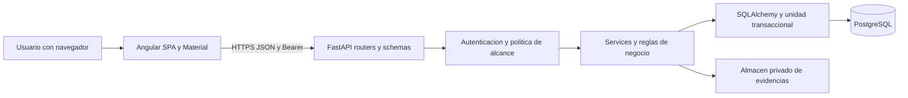
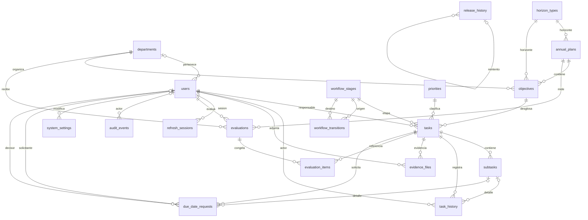
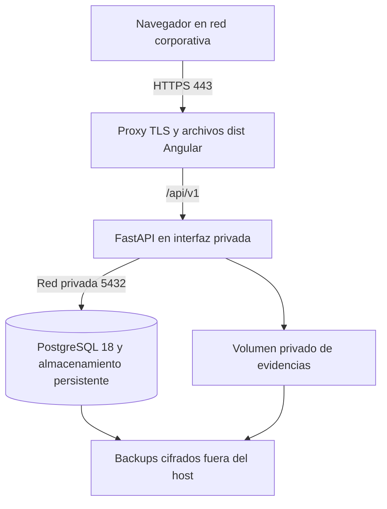

# OCOTE: arquitectura y modelo de datos

Version documental: 2.0 con incremento F2 autorizado el 2026-11-24. Modelo objetivo de 19 tablas; F2 agrega nueve tablas vacias a la tecnica release_history. No F3-F7 ni despliegue productivo/nube. Estado y evidencia vigentes en roadmap.

La [especificacion SDD](01-spec-driven-development.md) gobierna RN-01 a RN-07, RF-01 a RF-15 y tokens. El [roadmap](03-estado-actual-y-roadmap.md) distingue evidencia de propuesta y fija puertas D01-D08. La [guia de entrega](05-paquetizacion-instalacion-y-actualizaciones.md) gobierna paquetes, instalacion local/nube e integraciones y es fuente unica del protocolo de release.

La [guia de entorno y portabilidad](04-entorno-y-portabilidad.md) contiene el procedimiento operativo, credencial local y evidencia de verificacion. El contexto agnostico de agente parte de [AGENTS.md](../AGENTS.md); Copilot tiene un adaptador en [.github/copilot-instructions.md](../.github/copilot-instructions.md).

## 1. Decisiones de arquitectura

Monorepo ligero: Angular permanece en raiz y backend/ ya contiene F1/F2 por capas routers -> schemas/policies -> services -> models/BD. Monolito modular PostgreSQL/ACID; frontend/API pueden permanecer in-house aunque PostgreSQL sea gestionado. Nube no introduce multitenencia ni conexion del navegador a BD.

| Area          | Decision objetivo                                                               | Restriccion                                                                                            |
| ------------- | ------------------------------------------------------------------------------- | ------------------------------------------------------------------------------------------------------ |
| Frontend      | Angular 18.2 standalone, SPA sin SSR, SCSS y Material 3 custom                  | Node compatible con Angular 18; seguridad/soporte pendiente D07                                        |
| Interaccion   | Angular Animations, CDK drag-drop, vis-timeline                                 | Alternativa teclado al drag; Timeline de lectura/formulario                                            |
| Graficas      | Apache ECharts mediante ngx-echarts                                             | Validar peers y API con versiones del lockfile, no asumir compatibilidad por estar instalados          |
| API           | Python 3.12, FastAPI, Pydantic v2                                               | DTOs estrictos separados de modelos ORM                                                                |
| Persistencia  | SQLAlchemy 2.0.x sincrono, psycopg 3 y Alembic                                  | Endpoints de acceso sincrono `def` o ejecucion en threadpool; no bloquear event loop                   |
| BD            | Desarrollo 18.4/cluster 18; cliente PostgreSQL 18 local/contenedor o gestionado | Probar minor/proveedor y btree_gist; otra mayor requiere decision y homologacion, no editar PG_VERSION |
| Base objetivo | Nombre exacto ocoteAppDatabase, incluidas mayusculas                            | init-dev solo desarrollo loopback; aprovisionamiento cliente separado y autorizado                     |
| Seguridad     | Argon2id y JWT access/refresh con rotacion                                      | Sin contrasenas reversibles ni tokens en localStorage                                                  |
| Despliegue    | Reverse proxy HTTPS, SPA estatica, FastAPI y PostgreSQL privado                 | Mismo origen; la LAN no se considera confiable                                                         |
| Tema          | Tokens de seccion 5 de la SDD y paletas M3 verificadas                          | No generar aqui codigo de estilos ni paletas incompletas                                               |

### Vista logica



Routers autentican, validan DTO y adaptan HTTP; no calculan indicadores ni hacen commits parciales. Services autorizan por accion y recurso, aplican RN-\*, calculan metricas y controlan transaccion. Models describen persistencia y restricciones; schemas nunca exponen password_hash, jti_hash ni claves de almacenamiento. Repositorios pequenos solo cuando una consulta compartida lo justifique; no imponer un framework generico adicional.

Una Session por peticion/unidad de trabajo; commit unico despues de historia y cambios. Fallo: rollback y error uniforme. Las consultas aplican alcance antes de paginar o agregar. SQL parametrizado con ORM; sin concatenacion de filtros. API es unica autoridad: frontend solo representa permisos, no los impone.

## 2. Autenticacion, autorizacion y seguridad

### Ciclo de sesion

1. Login por HTTPS con email canonico y password. Verificar Argon2id con parametros medidos en el hardware destino; rehash al autenticar si cambian parametros. Rate limit por cuenta/IP, respuesta generica y auditoria sin secretos. No incluir password en logs de validacion.
2. Emitir access JWT de 10 minutos en JSON y refresh JWT en cookie HttpOnly, Secure, SameSite=Strict, Path=/api/v1/auth. Refresh con vencimiento absoluto de 7 dias desde el login; rotar no extiende ese limite. Cookie sin Domain, limpiada con el mismo Path/atributos.
3. Access queda solo en memoria de Angular; despues de recarga se recupera mediante refresh. Refresh nunca en JSON ni almacenamiento accesible a JavaScript. No habilitar un service worker que persista respuestas de autenticacion.
4. JWT firmado con RS256, algoritmo fijado por servidor, claves y `kid` controlados. Validar firma, `iss`, `aud`, `sub`, `iat`, `nbf`, `exp`, `jti`, `typ`, `ver`, `sid`. `typ` distingue access de refresh; `sid` es id de familia `refresh_sessions`. Tolerancia de reloj maxima 30 segundos, NTP obligatorio. Claims no sustituyen el usuario vigente de BD.
5. En cada solicitud protegida: usuario activo, rol/alcance vigente, `token_version` igual al claim `ver` y familia activa/no expirada. Access no autoriza si se revoco su sesion aunque aun no venza. Sin cache de autorizacion que retrase revocacion en MVP.
6. Refresh: verificar JWT y cookie, obtener fila de `refresh_sessions` por hash SHA-256 de jti aleatorio de al menos 256 bits y bloquearla con SELECT FOR UPDATE. Marcar usada y crear sucesora atomicamente. `family_id` se conserva y el `sid` identifica esa familia. Solo un uso puede tener exito.
7. Reutilizacion: revocar toda la familia y registrar evento; confirmar revocacion antes de devolver 401, sin que el manejador de errores la deshaga. Angular serializa refresh, incluida coordinacion entre pestanas; dos refresh simultaneos con la misma cookie se tratan como reutilizacion por seguridad.
8. Logout revoca familia; logout sin cookie valida limpia cookie y devuelve 204. Cambio de password, rol/departamento o desactivacion incrementa `users.token_version` y revoca todas las familias. No permitir desactivar o quitar rol al ultimo admin activo, ni desactivar usuario con tareas abiertas sin reasignarlas; serializar cambios de administradores para evitar dos bajas simultaneas.

Refresh usa filas con `id` propio y `family_id` comun; `sid` siempre apunta al identificador de familia, no a una fila rotada. La familia inicial se genera en el servidor al login. No se conserva el JWT completo en BD.

### CSRF, XSS y autorizacion

- Mismo origen es el despliegue obligatorio de MVP. Cookie refresh implica proteccion CSRF, no solo JWT. Verificar Origin/Referer contra origen permitido en login y comandos de autenticacion que usan cookies; peticiones sin un origen verificable no se aceptan como clientes de navegador.
- Refresh/logout requieren `X-CSRF-Token` vinculado criptograficamente a familia y expiracion. Login/refresh entregan `csrf_token`; un GET `/api/v1/auth/csrf` protegido por cookie y validacion de origen permite recuperarlo tras recarga, sin retornar credenciales. CORS no permite otros origenes. El token CSRF no autentica por si solo.
- Mutaciones de dominio requieren Bearer y JSON; no se autentican mediante cookie refresh. Angular usa texto escapado, sin HTML arbitrario de usuarios. CSP restrictiva con recursos autoalojados; no `unsafe-eval`. Evitar registros de cabeceras de autorizacion y cookies en proxy/APM.
- Politicas centralizadas implementan matriz de seccion 2 SDD, incluyendo descargas, historial y agregados. UUID dificulta enumeracion pero no reemplaza permisos. Pruebas contra IDOR, escalamiento de roles y mass assignment obligatorias.
- Secretos solo en configuracion protegida de despliegue; `.env` local ignorado y futuro `.env.example` sin valores reales. Cifrado de backups y disco donde residen datos/evidencias; claves separadas del respaldo.
- `audit_events` para accesos fallidos y administracion; `task_history` para hechos de tarea/subtarea. Cuenta de BD de migracion distinta de la cuenta runtime. Auditar acceso operativo privilegiado.

### Controles transversales y fronteras de confianza

- Threat model versionado: navegador, proxy, API, BD, archivos y operador son fronteras distintas. HTTPS y HSTS tras validar dominio/certificados; CSP restrictiva, frame-ancestors y Referrer-Policy; sin CDN obligatoria ni contenido activo en adjuntos. Cabeceras reenviadas solo desde proxies permitidos.
- Pydantic estricto/extra forbidden en comandos; allowlist de campos, filtros y orden; consultas parametrizadas. Limitar login/refresh, exportaciones y uploads por identidad/origen con valores de infraestructura medidos. 429/413 y errores no revelan consultas, rutas, secretos ni existencia ajena.
- Autorizacion rol+alcance antes de consulta, paginacion, agregacion y descarga. C no tiene analytics/exports/evaluations; contexto padre minimo en tarea, no endpoints CRUD completos. Cambios de rol invalidan sesiones de inmediato. Configuracion de permisos no se delega a flags del cliente.
- Least privilege: cuenta SO del servicio sin administrador; runtime sin DDL/CREATE/extension; migrador distinto y habilitado solo en mantenimiento; operador de backup con permisos minimos probados, sin exponer backup a API. Configuracion sensible por gestor de secretos/ACL, rotacion y plan de claves JWT/TLS con kid y ventana de transicion.
- Sin URLs remotas de evidencia ni webhooks en MVP (evitar SSRF). Escaneo antimalware y cuarentena privada antes de publicar archivos; no declarar seguro por MIME. Limpieza solo con politica aprobada, nunca borrar evidencia historica o fotos desde el CRUD.
- Dependencias bloqueadas, SBOM/licencias, analisis de vulnerabilidades y pruebas negativas de IDOR/CSRF/XSS/inyeccion/concurrencia obligatorios. Logs sanitizados, acceso y retencion aprobados; no recopilar IP/navegador sin D05. No se proclama invulnerabilidad de un superusuario.

## 3. Modelo entidad-relacion

Se conservan las 14 tablas del modelo documental anterior y se agregan system_settings, priorities, horizon_types, due_date_requests y release_history: 19 tablas objetivo, ninguna creada por esta documentacion. annual_plans/annual_plan_id son nombres estables, no restricciones anuales. alembic_version es metadata tecnica de Alembic, no una vigesima tabla de dominio ni sustituto de release_history.



### Convenciones de esquema

- IDs UUID generados por backend/herramienta operativa. SQLAlchemy: Uuid(as_uuid=True), String(n), Text, Date, DateTime(timezone=True), Boolean, Integer, BigInteger, Numeric, JSONB y ARRAY(String(n)); equivalen respectivamente a UUID, VARCHAR, TEXT, DATE, TIMESTAMPTZ, BOOLEAN, INT, BIGINT, NUMERIC, JSONB y ARRAY en PostgreSQL. Mapped/mapped_column y nombres estables de constraints para Alembic.
- Todos los campos de tablas siguientes son NOT NULL salvo indicacion `?`. Todos los modelos tienen PK `id UUID`; FK con ON DELETE RESTRICT y sin cascade delete del ORM. No se borran entidades de dominio en MVP.
- `M` significa `created_at TIMESTAMPTZ`, `updated_at TIMESTAMPTZ`, `version INT DEFAULT 1 CHECK(version > 0)`. Todas las tablas mutables lo incluyen. Tablas append-only tienen solo `created_at` y datos del hecho.
- Timestamps con hora de servidor UTC; `DATE` para fechas civiles. `created_at <= updated_at`. Booleanos con default explicito. Enums como VARCHAR + CHECK con exactamente los valores de la SDD, permitiendo migraciones visibles; no texto libre ni traducciones en BD.
- No guardar porcentajes actuales en tasks/objectives: se derivan. Solo evaluaciones guardan metricas historicas selladas. Contadores en respuestas se calculan con alcance y filtros identicos.
- `expected_version` y `expected_task_version` son campos de comando, no columnas. UPDATE condicionado por version y bloqueo donde corresponda; una escritura incrementa version una vez por recurso afectado.

### departments

| Columna   | Tipo / restriccion                                     |
| --------- | ------------------------------------------------------ |
| id, M     | Convenciones comunes                                   |
| code      | VARCHAR(40), UNIQUE, formato estable `[a-z][a-z0-9_]*` |
| name      | VARCHAR(120), no vacio                                 |
| is_active | BOOLEAN DEFAULT true                                   |

Indice UNIQUE(code). Desactivar exige no tener usuarios activos ni objetivos asociados a planes `draft`/`active`. No se reutiliza el codigo historico.

### users

| Columna       | Tipo / restriccion                                  |
| ------------- | --------------------------------------------------- |
| id, M         | Convenciones comunes                                |
| department_id | UUID FK departments.id, nullable solo admin/gerente |
| email         | VARCHAR(254), canonico trim + lowercase; UNIQUE     |
| display_name  | VARCHAR(120), no vacio                              |
| password_hash | TEXT, Argon2id completo, nunca serializado          |
| role          | VARCHAR(20), CHECK admin/gerente/lider/colaborador  |
| token_version | INT DEFAULT 1, CHECK > 0                            |
| is_active     | BOOLEAN DEFAULT true                                |

CHECK(role IN ('admin','gerente') OR department_id IS NOT NULL). UNIQUE(email) mas CHECK de forma canonica para impedir variantes por mayuscula; indice `(department_id, is_active)`. No se provee password por defecto: provision inicial CLI/interactiva en F2, sin secreto en repositorio; cambios administrativos fuerzan nueva credencial por mecanismo de soporte controlado, no reset por email en MVP.

### annual_plans

| Columna                 | Tipo / restriccion                                                      |
| ----------------------- | ----------------------------------------------------------------------- |
| id, M                   | Convenciones comunes                                                    |
| title                   | VARCHAR(200)                                                            |
| horizon_type            | VARCHAR(12), FK horizon_types.code; cinco valores definidos en catalogo |
| start_date, due_date    | DATE, extremos inclusivos obligatorios                                  |
| status                  | VARCHAR(12), CHECK draft/active/closed, DEFAULT draft                   |
| created_by              | UUID FK users.id                                                        |
| activated_at, closed_at | TIMESTAMPTZ ?, consistentes con status                                  |

CHECK(start_date <= due_date). CHECK: draft sin activated_at/closed_at; active con activated_at y sin closed_at; closed con ambos y closed_at >= activated_at. Indice `(start_date, due_date, status)`; sin year obligatorio, UNIQUE(year) ni exclusion de periodos entre planes. Dos planes pueden coincidir/solaparse; UUID es su identidad. Horizon_type es clasificacion, el intervalo explicito es autoridad segun RN-01.

Service valida cambios de periodo bajo bloqueo del plan y sus hijos: ningun objetivo/evaluacion existente puede quedar fuera del rango. Cambio de fechas/horizonte requiere reason y audit_events; plan cerrado es inmutable. No cambia fechas de tareas por cascada.

### workflow_stages

| Columna                            | Tipo / restriccion                        |
| ---------------------------------- | ----------------------------------------- |
| id, M                              | Convenciones comunes                      |
| code, name                         | VARCHAR(40) UNIQUE estable / VARCHAR(120) |
| position                           | INT UNIQUE, CHECK >= 0                    |
| kind                               | VARCHAR(12), CHECK open/blocked/completed |
| is_initial                         | BOOLEAN DEFAULT false                     |
| requires_evidence, requires_reason | BOOLEAN DEFAULT false                     |
| is_active                          | BOOLEAN DEFAULT true                      |

CHECK(NOT is_initial OR (kind='open' AND is_active AND NOT requires_evidence AND NOT requires_reason)); CHECK(kind <> 'completed' OR is_active). Indices unicos parciales sobre constante para `WHERE is_initial` y `WHERE kind='completed'` garantizan como maximo una inicial y una terminal. Instalacion vacia permitida sin seed; admin configura inicial, terminal y aristas atomicamente mediante POST /workflow. Una configuracion activa exige camino a terminal para cada etapa activa y no permite quitar inicial/terminal. Reordenamiento en una transaccion con unicidad diferible de position, sin estados intermedios visibles. Code/kind/is_initial no se cambian en PATCH F2; no se omiten controles por falta de tareas.

### workflow_transitions

| Columna                    | Tipo / restriccion                                                  |
| -------------------------- | ------------------------------------------------------------------- |
| id, M                      | Convenciones comunes                                                |
| from_stage_id, to_stage_id | UUID FK workflow_stages.id                                          |
| allowed_roles              | ARRAY VARCHAR(20), no vacio, subconjunto de admin/lider/colaborador |
| is_active                  | BOOLEAN DEFAULT true                                                |

UNIQUE(from_stage_id, to_stage_id), CHECK(from_stage_id <> to_stage_id). Sin rol gerente porque su rol es de lectura operativa. Service impide origen completed, destino inactivo, roles duplicados y grafos sin salida a completed. `admin` debe incluirse en toda arista habilitada; aun admin respeta reglas de negocio y no salta aristas. Indice `(from_stage_id, is_active)`.

### objectives

| Columna              | Tipo / restriccion                                                      |
| -------------------- | ----------------------------------------------------------------------- |
| id, M                | Convenciones comunes                                                    |
| annual_plan_id       | UUID FK annual_plans.id                                                 |
| department_id        | UUID FK departments.id                                                  |
| title                | VARCHAR(200)                                                            |
| description          | TEXT DEFAULT '', maximo 10000 validado                                  |
| horizon_type         | VARCHAR(12), FK horizon_types.code; cinco valores definidos en catalogo |
| start_date, due_date | DATE, obligatorios y contenidos en el intervalo del plan                |
| created_by           | UUID FK users.id                                                        |

CHECK(start_date <= due_date). Indices `(annual_plan_id, department_id, created_at, id)` y `(annual_plan_id, start_date, due_date)`. Service garantiza contencion en padre y de start_date/original_due_date/due_date de todas sus tareas ante cambios; bloqueo y audit_events segun RN-01. Sin porcentaje persistido ni FK redundante desde tasks a departamento/plan. Titulo no unico: UUID identifica al objetivo.

### tasks

| Columna                 | Tipo / restriccion                                                                    |
| ----------------------- | ------------------------------------------------------------------------------------- |
| id, M                   | Convenciones comunes                                                                  |
| objective_id            | UUID FK objectives.id                                                                 |
| assignee_id, created_by | UUID FK users.id                                                                      |
| stage_id                | UUID FK workflow_stages.id                                                            |
| priority_id             | UUID FK priorities.id; alta sin valor resuelve normal en service, no UUID hardcodeado |
| title, description      | VARCHAR(200) / TEXT DEFAULT ''                                                        |
| start_date              | DATE                                                                                  |
| original_due_date       | DATE inmutable, copia inicial de due_date                                             |
| due_date                | DATE, vigente                                                                         |
| completed_at            | TIMESTAMPTZ ?                                                                         |

CHECK(start_date <= original_due_date AND start_date <= due_date). Indices `(objective_id, stage_id, created_at, id)`, `(assignee_id, stage_id, created_at, id)`, `(stage_id, created_at, id)`, `(original_due_date, objective_id)` y `(due_date) WHERE completed_at IS NULL`. No se persiste `punctuality_status`: cambia al pasar el tiempo sin UPDATE.

Indice adicional (priority_id, created_at, id). Service valida catalogo activo al asignar/cambiar prioridad y registra task_updated; no invalida referencias inactivas sin cambio. Valida fechas contenidas, responsable del departamento y stage.kind=completed equivalente a completed_at presente. Cierre puede ser posterior al horizonte. Reglas entre tablas via service/bloqueos, no CHECK ficticio; trigger protege original_due_date. Prioridad no afecta formulas.

### subtasks

| Columna                                 | Tipo / restriccion                                    |
| --------------------------------------- | ----------------------------------------------------- |
| id, M                                   | Convenciones comunes                                  |
| task_id                                 | UUID FK tasks.id                                      |
| title                                   | VARCHAR(200)                                          |
| start_date, original_due_date, due_date | DATE, mismas convenciones de tarea                    |
| status                                  | VARCHAR(12), CHECK pending/completed, DEFAULT pending |
| completed_at                            | TIMESTAMPTZ ?                                         |
| created_by                              | UUID FK users.id                                      |

CHECK(start_date <= original_due_date AND start_date <= due_date); CHECK((status='completed') = (completed_at IS NOT NULL)). Indice `(task_id, status, created_at, id)`. Trigger protege original_due_date. Fechas dentro de limites de padre segun RN-02; hereda responsable y alcance, no tiene `assignee_id` ni etapa. Mutaciones bloquean padre antes de hija, verifican versiones y tambien incrementan version del padre.

### task_history

| Columna                 | Tipo / restriccion                                      |
| ----------------------- | ------------------------------------------------------- |
| id, created_at          | UUID PK / TIMESTAMPTZ                                   |
| task_id                 | UUID FK tasks.id                                        |
| subtask_id              | UUID FK subtasks.id ?                                   |
| actor_id                | UUID FK users.id                                        |
| event_type              | VARCHAR(40), CHECK segun catalogo de eventos            |
| before_data, after_data | JSONB, objetos con campos cambiados; {} para lado vacio |
| reason                  | TEXT ?, obligatorio para operaciones que lo exigen      |
| request_id              | UUID                                                    |

Catalogo: `task_created`, `task_updated`, `stage_changed`, `assignment_changed`, `due_date_changed`, `schedule_changed`, `subtask_created`, `subtask_updated`, `subtask_completed`, `subtask_due_date_changed`, `subtask_schedule_changed`, `evidence_added`. El cierre de tarea usa `stage_changed` con completed_at, sin duplicar un evento de cierre. JSON registra IDs y valores previos/nuevos; subtask_id debe pertenecer a task_id, validado en service. Indices `(task_id, created_at, id)`, `(subtask_id, created_at, id)` parcial y `(request_id)`.

### evidence_files

| Columna        | Tipo / restriccion                                          |
| -------------- | ----------------------------------------------------------- |
| id, created_at | UUID PK / TIMESTAMPTZ                                       |
| task_id        | UUID FK tasks.id                                            |
| uploaded_by    | UUID FK users.id                                            |
| original_name  | VARCHAR(255), saneado y solo informativo                    |
| storage_key    | VARCHAR(255) UNIQUE, generado por servidor                  |
| media_type     | VARCHAR(100), CHECK application/pdf, image/png o image/jpeg |
| size_bytes     | BIGINT CHECK entre 1 y 10485760                             |
| sha256         | CHAR(64), hexadecimal                                       |

Indice `(task_id, created_at, id)`. Archivo en almacenamiento privado, nunca en `public/`; descarga `Content-Disposition: attachment` y `X-Content-Type-Options: nosniff`. Historia de transicion registra los `evidence_ids` usados y foto de reglas de etapa. Persistir archivo con staging/rename atomico y compensacion si falla BD; archivos huerfanos se reconcilian por job operacional, nunca se confirma una fila antes de disponer del archivo definitivo. Politica antimalware/retencion es puerta D05.

### refresh_sessions

| Columna                 | Tipo / restriccion                           |
| ----------------------- | -------------------------------------------- |
| id, created_at          | UUID PK / TIMESTAMPTZ                        |
| user_id                 | UUID FK users.id                             |
| family_id               | UUID comun a las rotaciones, usado por sid   |
| jti_hash                | CHAR(64) UNIQUE                              |
| token_version           | INT CHECK > 0, version al emitir             |
| expires_at              | TIMESTAMPTZ, limite absoluto comun a familia |
| consumed_at, revoked_at | TIMESTAMPTZ ?                                |
| replaced_by_id          | UUID FK refresh_sessions.id ?, UNIQUE        |

CHECK(expires_at > created_at); replaced_by_id requiere consumed_at. Indices `(family_id)`, `(user_id, revoked_at)` y `(expires_at)`. Las filas usadas se conservan durante toda la ventana de deteccion; limpieza solo tras expiracion mas retencion aprobada. Revocacion actualiza todas las filas de familia bajo bloqueo coordinado. No hay endpoint publico de CRUD de sesiones.

### evaluations

| Columna                  | Tipo / restriccion                             |
| ------------------------ | ---------------------------------------------- |
| id, M                    | Convenciones comunes                           |
| annual_plan_id           | UUID FK annual_plans.id                        |
| department_id            | UUID FK departments.id                         |
| evaluator_id             | UUID FK users.id                               |
| period_start, period_end | DATE inclusivas                                |
| status                   | VARCHAR(12), CHECK draft/final, DEFAULT draft  |
| snapshot_at              | TIMESTAMPTZ, corte real de lectura             |
| metrics                  | JSONB con esquema versionado, estructura RN-06 |
| calculation_version      | VARCHAR(20), inicialmente `1.0`                |
| organization_timezone    | VARCHAR(100), copia de zona IANA usada         |
| summary                  | TEXT ?, 10..4000 al finalizar                  |
| finalized_at             | TIMESTAMPTZ ?                                  |

CHECK(period_start <= period_end); CHECK((status='final') = (finalized_at IS NOT NULL)); final requiere summary. UNIQUE(annual_plan_id, department_id, period_start, period_end). Exclusion GiST con `btree_gist` por igualdad de annual_plan_id/department_id y solapamiento de `daterange(period_start, period_end, '[]')`, incluyendo draft; evita carreras entre periodos solapados. Instalar extension mediante migracion autorizada. Indice `(department_id, period_end, status)`.

Service exige period_start/period_end dentro del rango del plan, no de un anio fijo; permite cruzar diciembre/enero. Metrics incluye foto de start_date/due_date/horizon_type del plan al corte. Snapshot_data de items conserva ademas el intervalo/horizonte del objetivo para explicar resultados aunque se amplien despues. Las formulas RN-06 no cambian por horizon_type.

La foto se obtiene con snapshot consistente REPEATABLE READ y filtros del actor; reintentos controlados si hay conflictos de serializacion. Insert/recalculate reemplaza items solo en draft; finalize recalcula y sella en la misma transaccion. Un trigger rechaza UPDATE/DELETE de evaluaciones final y cambios a sus items. No se incluye score subjetivo en el modelo MVP.

### evaluation_items

| Columna       | Tipo / restriccion                                |
| ------------- | ------------------------------------------------- |
| id            | UUID PK                                           |
| evaluation_id | UUID FK evaluations.id                            |
| task_id       | UUID FK tasks.id                                  |
| snapshot_data | JSONB NOT NULL, esquema segun calculation_version |

UNIQUE(evaluation_id, task_id). Cada item congela titulo/objetivo, departamento/responsable, clase/nombre de etapa, prioridad (id/code/name), horizonte (code/name), fechas original/vigente/cierre, totales de subtareas, avance sin redondeo, puntualidades, retrasos y version de tarea. Datos suficientes para explicar la foto sin nombres actuales, sin passwords/binarios ni historial completo. Cambios posteriores de catalogo no cambian la foto.

### audit_events

| Columna                 | Tipo / restriccion                                          |
| ----------------------- | ----------------------------------------------------------- |
| id, created_at          | UUID PK / TIMESTAMPTZ                                       |
| actor_id                | UUID FK users.id ?, nulo si intento no autenticado          |
| event_type              | VARCHAR(80), catalogo controlado de seguridad/configuracion |
| entity_type, entity_id  | VARCHAR(40) / UUID ?, para configuracion y evaluaciones     |
| before_data, after_data | JSONB sanitizado                                            |
| request_id              | UUID                                                        |
| outcome                 | VARCHAR(12), CHECK success/denied/failure                   |

Indices `(entity_type, entity_id, created_at, id)`, `(actor_id, created_at, id)`, `(request_id)`. No guardar passwords/tokens ni siquiera hashes de credenciales en before/after. Auditoria de mutaciones exitosas comparte transaccion; eventos de seguridad fallidos usan canal/transaccion independiente y no alteran datos de negocio. No se incluye navegador/IP por defecto hasta aprobar privacidad/retencion.

### system_settings

| Columna    | Tipo / restriccion                                                                                   |
| ---------- | ---------------------------------------------------------------------------------------------------- |
| id, M      | Convenciones comunes                                                                                 |
| key        | VARCHAR(64) UNIQUE; CHECK organization_name/organization_timezone/evidence_max_bytes/export_max_rows |
| value      | JSONB escalar, sin null; tipo/rango segun clave                                                      |
| updated_by | UUID FK users.id ?, null solo bootstrap con actor operacional externo registrado                     |

UNIQUE(key). CHECK dependiente de key: nombre JSON string 1..160; zona string 1..100; evidence/export JSON number entero 1..10485760 / 1..10000. Pydantic valida enteros sin coercion y pertenencia a zona IANA instalada; validacion numerica SQL con CASE por jsonb_typeof para no castear texto arbitrario. F2 no inserta valores: admin crea explicitamente las cuatro claves mediante POST /settings; 10485760/5000 son referencias previas, no defaults sembrados. No secretos, claves libres ni override env. Admin cambia value con reason/version, lock global exclusivo y audit_events en misma transaccion; nunca DELETE runtime. Zona bloqueada tras primera tarea/evaluacion. Cada request operacional lee bajo lock compartido; sin cache invalida. Tipos/politica de edicion son codigo, no columnas editables.

### priorities

| Columna   | Tipo / restriccion                                       |
| --------- | -------------------------------------------------------- |
| id, M     | Convenciones comunes                                     |
| code      | VARCHAR(40) UNIQUE, patron estable como departments.code |
| name      | VARCHAR(120), no vacio                                   |
| position  | INT >= 0, UNIQUE DEFERRABLE INITIALLY DEFERRED           |
| is_active | BOOLEAN DEFAULT true                                     |

CHECK(code <> 'normal' OR is_active). No seed low/normal/high: admin crea prioridades explicitamente; normal activa es requisito de configuracion completa, sin etiqueta/posicion inventada. Admin agrega/renombra/reordena/desactiva sin borrar ni cambiar code. UNIQUE(position) diferible. FK tasks.priority_id RESTRICT en F3. Desactivar no reasigna tareas existentes, impide nuevas selecciones; cambio de prioridad en tarea abierta requiere version e historia. Lock global exclusivo en catalogo, compartido en operacion; eventos en audit_events. No prioridad por subtarea ni orden automatico por urgencia.

### horizon_types

| Columna   | Tipo / restriccion                                                   |
| --------- | -------------------------------------------------------------------- |
| id, M     | Convenciones comunes                                                 |
| code      | VARCHAR(12) UNIQUE; CHECK annual/semiannual/quarterly/monthly/custom |
| name      | VARCHAR(120), no vacio                                               |
| position  | INT >= 0, UNIQUE DEFERRABLE INITIALLY DEFERRED                       |
| is_active | BOOLEAN DEFAULT true                                                 |

CHECK(code <> 'custom' OR is_active). F2 no crea filas: admin introduce explicitamente exactamente los cinco codes RN-01 por POST /horizon-types, eligiendo etiquetas/posiciones; no puede inventar otro code ni borrar/renombrar los existentes. INSERT runtime queda limitado por CHECK/UNIQUE y autorizacion admin; UPDATE solo nombre/orden/activo con lock exclusivo, version/motivo/auditoria, nunca DELETE. FK annual_plans.horizon_type/objectives.horizon_type referencia code UNIQUE en F3. No duracion rigida, formulas o JSON de plantillas ejecutables. Horizonte inactivo puede mantenerse en registros previos, nunca elegirse como nuevo code. Ampliar cinco semanticas exige revision de contrato.

### due_date_requests

| Columna                              | Tipo / restriccion                                                      |
| ------------------------------------ | ----------------------------------------------------------------------- |
| id, M                                | Convenciones comunes                                                    |
| task_id                              | UUID FK tasks.id                                                        |
| subtask_id                           | UUID FK subtasks.id ?, null significa destino tarea                     |
| requested_by                         | UUID FK users.id                                                        |
| proposed_due_date, previous_due_date | DATE, propuesta y valor vigente al solicitar                            |
| task_version_at_request              | INT CHECK > 0, copia de tasks.version                                   |
| subtask_version_at_request           | INT ?, CHECK > 0 cuando presente                                        |
| reason                               | TEXT, 10..2000                                                          |
| status                               | VARCHAR(12), CHECK pending/approved/rejected/cancelled, DEFAULT pending |
| decided_by                           | UUID FK users.id ?                                                      |
| decision_reason                      | TEXT ?, 10..2000 cuando presente                                        |
| decided_at                           | TIMESTAMPTZ ?                                                           |

CHECK: subtask_id y subtask_version_at_request ambos nulos o ambos presentes; propuesta distinta de anterior; pending sin datos de decision, terminal exige los tres y decided_at >= created_at; approved exige decided_by <> requested_by. UNIQUE parcial(task_id) WHERE status='pending' AND subtask_id IS NULL; UNIQUE parcial(subtask_id) WHERE status='pending' AND subtask_id IS NOT NULL. Indices (status, created_at, id), (task_id, created_at, id), (requested_by, created_at, id). Service valida hija pertenece a task, destino abierto/plan activo, permisos actuales y contencion. Propuesta es inmutable; solo decision terminal, protegida por trigger/privilegios. No borra solicitudes pendientes obsoletas: 409 al aprobar y requiere cancelar/rechazar. Orden de lock: config, usuarios, plan, objetivo, tarea, subtarea, solicitud. Alta/decision van a audit_events; aprobar ademas produce exactamente el evento de fecha correspondiente en task_history, en misma transaccion. Admin/gerente solicitan/deciden, lider solicita/cancela propia en departamento; sin autoaprobacion.

### release_history

| Columna                          | Tipo / restriccion                                                                          |
| -------------------------------- | ------------------------------------------------------------------------------------------- |
| id, M                            | UUID del intento, generado antes de conectar, convenciones comunes                          |
| retry_of_id                      | UUID FK release_history.id ?, CHECK distinto de id                                          |
| application_version              | VARCHAR(40), version del artefacto, no unica                                                |
| artifact_sha256, manifest_sha256 | CHAR(64), hexadecimal                                                                       |
| source_revision                  | VARCHAR(128) ?, null solo base virgen confirmada sin alembic_version                        |
| target_revision                  | VARCHAR(128), head exacta del manifest                                                      |
| operator_ref                     | VARCHAR(120), identidad operativa sanitizada, no credencial ni FK a usuario aun inexistente |
| deployment_mode                  | VARCHAR(16), CHECK local/managed                                                            |
| phase                            | VARCHAR(24), CHECK preflight/backup/migration/seeds/validation/reopening/complete           |
| status                           | VARCHAR(12), CHECK running/succeeded/failed/aborted, DEFAULT running                        |
| backup_manifest_sha256           | CHAR(64) ?, sin ubicacion sensible ni claves                                                |
| backup_verified_at               | TIMESTAMPTZ ?, evidencia de restore aislado                                                 |
| finished_at                      | TIMESTAMPTZ ?                                                                               |
| result_code                      | VARCHAR(64) ?, catalogo sanitizado de resultado, sin stack ni DSN                           |
| request_id                       | UUID UNIQUE, correlacion con bitacora externa                                               |

Indices (created_at, id), (application_version, created_at), (retry_of_id); checks hex de hashes, finished_at >= created_at, status running sin finished_at/result_code y terminal con ambos; succeeded exige phase complete y backup_verified_at/hash para actualizacion de base existente. Una instalacion vacia registra BACKUP_NOT_APPLICABLE en bitacora, nunca backup inventado; el valor null de source_revision no se usa para saltarse copia de una base con datos. Backup_verified_at requiere hash y no es anterior a created_at. Identidad, hashes y revisiones quedan inmutables tras INSERT; version/locks protegen avances running, terminal inmutable. Reintento es fila nueva con retry_of_id, no borrar/fingir intento anterior.

Solo rol operativo de release puede INSERT y avanzar columnas de estado mientras running; runtime solo SELECT sanitizado para admin. Eventos de avance append-only en bitacora externa y audit_events cuando disponible; permisos/trigger impiden reescribir terminales. release_history registra intentos/aprobacion/evidencia via request_id; alembic_version indica solo esquema vigente. Antes de que exista la tabla, caida de BD o fallo de migracion inicial: bitacora externa protegida es autoridad del intento. Se incorpora fielmente al recuperarse, con timestamps originales y request_id UNIQUE, sin inventar exito; no se exige insertar contra esquema incompatible. Si restore vuelve atras la propia tabla, reconciliar intentos desde esa bitacora antes de reabrir.

## 4. Integridad, consultas y migraciones

- CHECK/FK/UNIQUE/exclusion cubren integridad local. Services bajo bloqueo cubren pertenencia, roles, reglas de etapa, planes, intervalos padre-hija y existencia de etapa inicial/terminal. Triggers protegen fecha original, append-only y fotos finales frente a modificaciones accidentales fuera del ORM. No se promete que un CHECK consulte otras tablas.
- Orden de bloqueos de dominio: control de configuracion, departamentos por UUID, usuarios afectados por UUID, planes por UUID, objetivos por UUID, tareas por UUID y subtareas por UUID; cada comando toma solo las filas necesarias, siempre en ese orden. Configuracion de usuarios/departamentos coordina bloqueo con asignacion/creacion para que no se asigne a usuarios inactivos. Probar carreras, no solo validaciones secuenciales.
- Workflow, roles, parametros, prioridades y horizontes usan advisory transaccional global exclusivo; operacion toma el mismo compartido antes de leer configuracion/autorizar. Bootstrap usa exclusivo. Mantener orden completo antes de fila solicitud. Release usa lock operativo persistente distinto en conexion dedicada directa, no lock transaccional liberado por cada revision ni conexion del pool. Asignaciones bloquean usuarios antes de plan/tarea; si no se puede conservar orden, reiniciar transaccion.
- Consultas de metricas agregan subtareas por task_id antes de unirlas a tareas para no multiplicar denominadores. Evitar N+1 mediante carga explicita. Indices se validan con EXPLAIN y datos de volumen acordado, no se agregan sin medir.
- Migraciones Alembic versionadas/revisadas, sin create_all. F2 crea tablas/constraints vacias, bootstrap del primer admin por CLI y configuracion explicita de catalogos/parametros mediante API autenticada; no seeds. Futuras releases solo incorporan seeds por code/key si aprobados, sin pisar datos. Auditoria externa cubre etapa anterior a users/audit_events; CLI de bootstrap deja primer audit transaccional.
- Campos de evidencia y JSONB tienen contratos versionados y validacion Pydantic, no son un escape a la definicion del dominio. Limite de peticion JSON 1 MiB; evidencias con limite dedicado en proxy y API.

### Actualizaciones del cliente y cambios de esquema

Toda release sigue la [guia de entrega, seccion 7](05-paquetizacion-instalacion-y-actualizaciones.md#7-actualizacion-controlada): mantenimiento, backup automatico y restore aislado, Alembic/seeds, integridad/smoke y reapertura o contingencia. init-dev no es actualizador. release_history y bitacora externa registran cada intento.

- DDL exclusivamente en revisiones Alembic bajo backend/alembic/versions y Git. SQLAlchemy describe modelos; autogenerate es borrador a revisar, no detecta renombres ni protege datos por si mismo. Prohibidos cambios manuales no versionados, create_all y stamp head para ocultar divergencias.
- Una sola head por release, revision esperada y revisiones origen compatibles en su manifest inmutable. En el artefacto validado, `alembic upgrade head` aplica solo pendientes; la tabla alembic_version hace idempotente la invocacion, no vuelve idempotente cualquier SQL arbitrario. Se rechazan heads multiples, esquema desconocido o release incorrecta.
- PostgreSQL DDL transaccional por revision donde aplique; fallos revierten la revision en curso pero no se presume rollback de revisiones ya confirmadas. CREATE INDEX CONCURRENTLY y otros pasos no transaccionales exigen plan separado, deteccion de estado parcial y reanudacion probada.
- Expand/backfill/validate/contract: agregar primero columnas nullable o estructuras compatibles, backfill por lotes reanudables con claves estables, verificar datos y aplicar restricciones solo al final. Para NOT NULL: completar nulos y validar CHECK antes de SET NOT NULL. Renombrados: campos nuevos/compatibilidad antes de retirar viejos; tipos: columna paralela y conversion validada sin truncamientos. Contract solo en release posterior cuando no queden consumidores antiguos y exista aprobacion de retencion.
- Para una hipotetica instalacion legacy con year: agregar start_date/due_date/horizon_type inicialmente nullable, derivar annual y fechas calendario solo de year valido, conservar IDs/FK y auditar decisiones; objectives hereda rango del plan solo cuando falte y sea compatible con todas sus tareas. Resolver excepciones antes de endurecer y retirar unicidad anual. No ejecutar este backfill en esta sesion: no existen tablas legacy implementadas.
- Nunca reescribir fechas originales, IDs, task_history, audit_events ni fotos finales como efecto de un seed/upgrade. Cambios al esquema de bitacoras son aditivos, sin alterar sus hechos; correcciones de negocio son eventos nuevos autorizados. Comparar integridad referencial y evidencia de auditoria antes/despues.
- Downgrade no es seguro por definicion: solo con reversion probada, datos compatibles y aprobacion explicita; preferir fix-forward. Si se requiere restore, preservar estado fallido y recuperar en destino aislado con validacion y cambio controlado de conexion, no sobrescribir data/ ni restaurar silenciosamente sobre la base cliente. Tras nuevas escrituras puede haber perdida al volver a un backup: detener y reconciliar, nunca prometer rollback sin perdida automatico.

## 5. Organizacion objetivo del proyecto

Leyenda: Angular, docs/, scripts/, instrucciones agenticas y database/ existen; los binarios, data y logs son locales ignorados por Git. backend/, deploy/ y carpetas funcionales frontend son propuesta futura, no scaffolding generado.

```text
ocoteApp/
  AGENTS.md
  .github/
    copilot-instructions.md
  .env.example
  .gitattributes
  .gitignore
  angular.json
  package.json
  package-lock.json
  tsconfig*.json
  public/
  src/
    main.ts
    index.html
    styles.scss
    app/
      app.component.*
      app.config.ts
      app.routes.ts
      core/                  [F4: sesion, permisos, HTTP, layout]
      shared/                [F4: controles y estados comunes]
      features/              [F4-F6: modulos de negocio lazy]
    styles/                  [F4: tokens y tema Material]
  backend/                   [F1 en adelante]
    pyproject.toml
    archivo-lock             [herramienta Python elegida en F1]
    .env.example
    alembic.ini
    alembic/
      env.py
      versions/
    app/
      main.py
      core/                  [config, security, policies, errors]
      db/                    [engine, session, metadata]
      routers/               [API /api/v1]
      schemas/               [DTOs Pydantic]
      services/              [reglas, transacciones y metricas]
      models/                [SQLAlchemy]
    tests/
      unit/
      integration/
      contract/
  deploy/                    [F1/F7: proxy, contenedores, runbooks]
  scripts/
    init-dev.sh              [entrada de retoma y resumen local]
    db-start.sh              [helper local idempotente]
    db-start.test.cjs         [pruebas aisladas con mocks]
  database/                  [contenido local, no distribuido por Git]
    postgres/bin/            [PostgreSQL 18.4 Windows]
    data/                    [cluster inicializado, PG_VERSION=18]
    logs/                    [postgres.log]
  docs/
    01-spec-driven-development.md
    02-arquitectura.md
    03-estado-actual-y-roadmap.md
    04-entorno-y-portabilidad.md
    05-paquetizacion-instalacion-y-actualizaciones.md
```

No guardar binarios PostgreSQL, data, logs, evidencias, `.env`, `.venv` ni backups en Git. La convencion de desarrollo es database/ dentro del workspace pero ignorada: un clon no la reconstruye. Para produccion se recomienda almacenamiento fuera del checkout. La guia operativa define aprovisionamiento manual y restauracion sin sobrescribir data existente.

## 6. Despliegue local y PostgreSQL gestionado



- Desarrollo comprobado: PG18.4 Windows en database/postgres/bin, cluster18 en database/data, logs en database/logs, 127.0.0.1:5432/ocoteAppDatabase. Head20261124_0002, once tablas: nueve F2 vacias mas release_history/alembic_version. Roles separados; migracion/no-op/restores y permisos probados en [evidencia F2](03-estado-actual-y-roadmap.md#8-identidad-y-administracion-f2-local). ocote se conserva sin renombrar/copiar/borrar. Bootstrap/configuracion del operador pendientes; no homologacion productiva.
- Arranque/verificacion: `bash scripts/init-dev.sh` y luego `bash scripts/init-dev.sh --check`. Delega en db-start.sh: valida pg_ctl status, pg_isready, version mayor y SHOW data_directory antes de consultar/crear ocoteAppDatabase con mayusculas exactas. Nunca hace initdb, migrations/seeds, reset, stop ni configuracion persistente. Solo al arrancar fija loopback/puerto; init-dev muestra estado de backend/.venv, backend/alembic y node_modules.
- Produccion in-house (D06 pendiente): portable bajo usuario dedicado o contenedor con volumen persistente; FastAPI separado y proxy sirviendo `dist/ocote-app/browser` segun salida verificada del build. SPA fallback a index.html solo fuera de `/api`; errores API no devuelven HTML. Validar version minor soportada y parcheada antes de desplegar.
- `initdb` solo para una instalacion nueva sin cluster, mediante decision explicita del operador; jamas para reparar una falla de arranque. Portable no significa copiar data mientras el servidor esta activo ni incluir la BD en Angular.
- Migrar entre equipos/SO usa `pg_dump` formato custom y `pg_restore`, roles/configuracion documentados y misma version mayor compatible. Binarios nativos no son portables entre sistemas operativos; respaldos logicos si. Upgrade mayor requiere procedimiento probado, no cambiar imagen sobre el volumen.
- Exponer solo HTTPS; PostgreSQL escucha interfaz privada/local, `pg_hba.conf` restringido con SCRAM, sin `trust`. TLS en conexion BD si cruza host. Backend no escucha publicamente salvo proxy controlado.
- Desarrollo: Angular dev server con proxy `/api` a FastAPI, manteniendo origen unico; secure cookies mediante HTTPS local en pruebas integrales. No introducir una excepcion insecure que pueda llegar a produccion.

### Modalidad gestionada remota

- Mismo proxy/origen y servicios; solo cambia endpoint privado de BD. PostgreSQL 18 y btree_gist disponibles/verificados en proveedor; no prometer soporte de proveedor especifico. TLS sslmode=verify-full, CA confiable/rotacion y hostname, sin downgrade a require/prefer ni IP que rompa validacion. Firewall/VPN/allowlist de salida del backend; nada de 0.0.0.0/0 ni acceso del navegador.
- Runtime: pool_size/max_overflow acotados, pool_timeout y statement/lock/idle-in-transaction timeouts definidos por carga/proveedor; suma de procesos\*(pool_size+max_overflow) deja reserva para administracion/migracion. pool_pre_ping y recuperacion de conexiones probados. No fijar numeros de produccion sin capacidad acordada.
- Migrador/lock de release/backup usan endpoint directo y conexion dedicada, no pool transaccional PgBouncer; probar psycopg/prepared statements si se introduce pooler. No pasar superusuario al backend; DBA instala/autoriza btree_gist si rol migrador no puede. DSN runtime y migracion separados y secretos fuera de tablas.
- Backup automatico/PITR del proveedor complementa, no sustituye, el gate por release: pg_dump logico portable y restore aislado con evidencias incluidas. Copia de evidencias/CA/config y prueba de exportacion al abandonar proveedor. Region/residencia, mantenimiento/failover, cuotas/coste, retencion y RPO/RTO requieren aprobacion D05/D06. Fallo de conectividad mantiene mantenimiento, nunca apunta a otra BD para sortearlo.
- No ejecutar init-dev ni comandos pg_ctl/SHOW data_directory del helper contra nube. Instalacion y checklist especificas en guia de entrega; F1/F7 deben probar ambas modalidades antes de anunciar soporte operativo.

### Operacion y recuperacion

Base D05/D06 aprobada el 2026-11-24: RPO <=24 h/RTO <=4 h son objetivos de diseno, respaldos diarios/por release con retencion minima 30 dias y restore mensual/por release. Responsable: LUIS ANGEL VALLEJO - DESARROLLADOR; excepcion expresa sin suplente hasta 2026-12-24 solo F1/F2 local/sintetico, operaciones suspendidas si falta el responsable. Politica de privacidad, cuarentena/escaneo fail-closed antes de F5, cifrado/custodia y conservacion en [guia 05, seccion 3.1](05-paquetizacion-instalacion-y-actualizaciones.md#31-base-aprobada-de-privacidad-y-recuperacion-d05d06). No scheduler/escaneo/cifrado off-host implementados ni datos reales autorizados. Restore tecnico en mismo cluster no demuestra RPO/RTO productivos; dimensionar/probar host alterno, volumen y operacion antes de un SLA.

Respaldar BD y evidencias como conjunto consistente: pausar escrituras durante la captura MVP, `pg_dump` y manifest de archivos/hash, claves/configuracion protegidas por separado. Restore en entorno aislado con comprobacion de FK, revision Alembic, conteos, archivos y login; conservar evidencia de duracion y resultado. Volumen persistente no equivale a backup y un backup sin prueba de restore no satisface DoD.

Salud F1 implementada: GET `/api/v1/health/live` minimo sin BD; GET `/api/v1/health/ready` exige X-Health-Token (403 si falta/es incorrecto), 200 con base/head compatibles o 503 por fallo/revision/mantenimiento. Logs sanitizados con request_id, duracion y codigo. Almacenamiento/evidencia no existe todavia: su verificacion, metricas de errores/latencia/conexiones/espacio/ultimo backup/TLS y alertas con responsable quedan para fases correspondientes, no se afirman implementados.

## 7. Verificacion arquitectonica antes de produccion

- Pruebas unitarias de formulas y politicas; integracion real PostgreSQL de constraints, transacciones, concurrencia, migraciones y restauracion. SQLite no reemplaza ARRAY, JSONB, GiST, bloqueos ni semantica de PostgreSQL.
- Contratos OpenAPI para campos read-only, strict validation y errores; pruebas E2E por cada rol, incluidos accesos negativos a evidencia, metricas e historia.
- Prototipo de compatibilidad Angular/Material/CDK, ngx-echarts/ECharts y vis-timeline con build produccion ejecutados en F1 como fixture sintetica de pruebas; no UI funcional ni tema OCOTE homologados. Angular 18 sin soporte y 61 alertas npm bajo aceptaciones temporales separadas hasta 2026-12-24 solo local/sintetico; no sustituyen remediacion ni aprobacion productiva. Actualizaciones requieren autorizacion y nuevas pruebas.
- Validacion visual y accesible de Material, Kanban, Timeline y ECharts con tokens de la SDD. Automatizacion de contraste no reemplaza evaluacion de foco, teclado ni lectores de pantalla.
- Revision de amenazas: robo/reuso refresh, CSRF, XSS, IDOR, escalamiento, uploads, borrado de auditoria y perdida de volumen. D07 bloquea produccion sin resolver politica de soporte de Angular 18.
