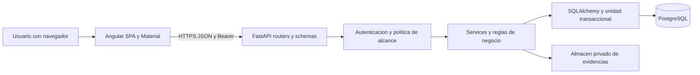
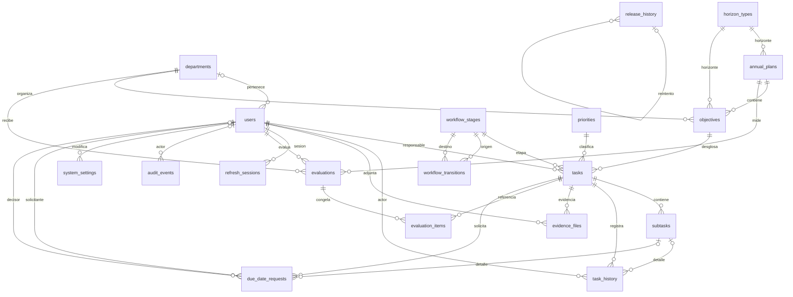
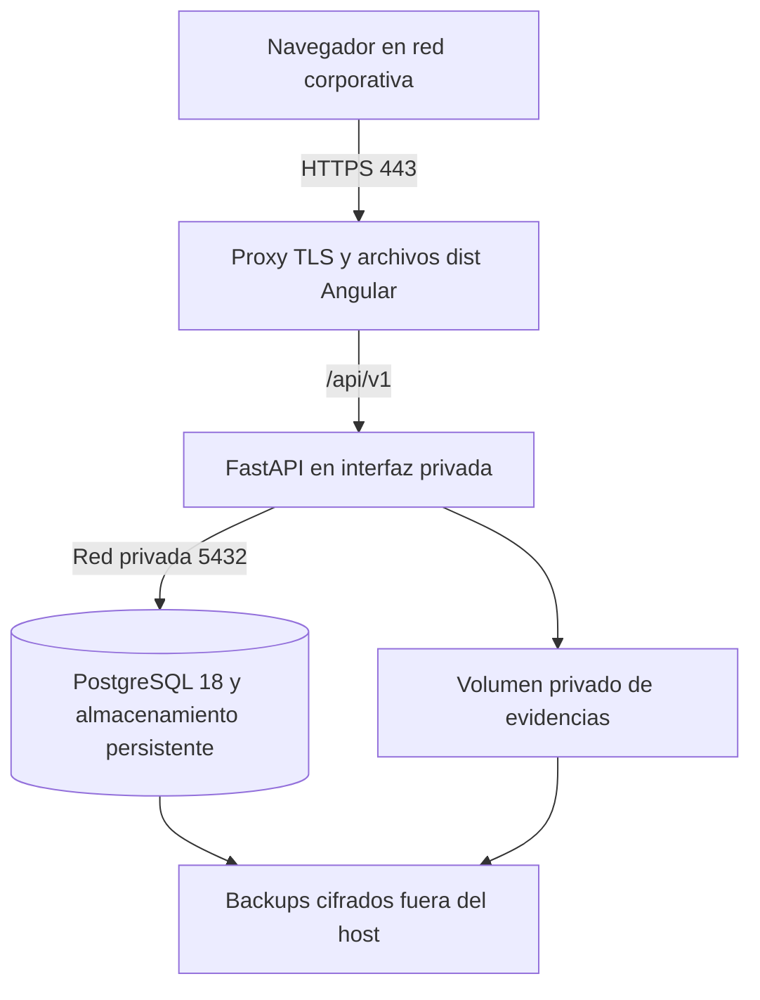
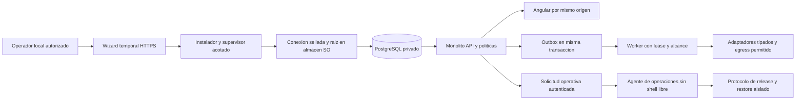
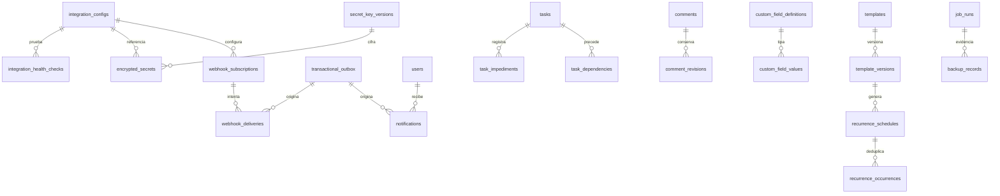

# OCOTE: arquitectura y modelo de datos

**F9 cerrada local/sintetico (2026-11-26).** UUID0007->0008->no-op/preservacion/protecciones2 aprobadas/13.01s y PG1 final294 aprobadas/0 fallidas/528.27s, una advertencia conocida. Release bf0b4ae8-d7c4-41d4-aeaf-41f64cc19723 aplicada: head0008/50 tablas/9 releases terminales;18 tablas F9 instaladas vacias/sin seeds y datos previos preservados. Tres backups/restores UUID con ACL/no-op/grants/boveda verificados; cero UUID/sin mantenimiento y ambos sellos revocados/ausentes. API8000 live/ready200; Angular21/F9 https://localhost:8443/proxy ready200/bundle comprobado,8445 cerrado; arranque sin PGPASSWORD y AUTH_ORIGIN/SSL/Secure intactos. PG0 previo210/84/Ruff/pip y Angular186/build/visual38 conservados.0008 inmutable: no repetir apply ni administracion sin nueva autorizacion/captura privada explicita. Evidencia4b8ff633-7a73-43f3-af0e-cfb7c29c7b2c/acta21; pendientes/resultados inferiores anteriores son historicos. No homologacion cliente; F10..F12 bloqueadas y wizard/empaquetador posterior a F12.

**Drenaje F9 nativo verificado, release pendiente:** Win32 sustituye completamente PowerShell en f9_local: TCP IPv4/IPv6, handle estable, imagen/comando factory/directorio del checkout, reconsulta y terminacion/espera verificadas. Nueve pruebas/Ruff/propiedad API real aprobados sin detener origen; PG0 actualizado207/84. Preflight inicial rechazo factory relativo y revoco relevos antes de PG1; nueva captura privada explicita pendiente. Preview8445 cerrado; la politica de PowerShell permanece intacta.

**F9 autorizada/en curso, no cerrada:** [acta F9](03-estado-actual-y-roadmap.md#21-f9-autorizada-ejecucion-en-curso). Codigo0008/18 modelos y servicios/API/Angular implementado: service_principals/job_runs/transactional_outbox, DAG/impedimentos, plantillas/recurrencia, campos/etiquetas, comentarios y saved_views; calendarios F8 reutilizados. Worker runtime acotado y release propios preparados, no ejecutados en origen. Inventario conocido sigue0007/32 tablas/8 releases;50 tablas es objetivo de0008, no conteo instalado. PG0:198 aprobadas/84 omitidas, Ruff/pip limpios; Angular186/186/build421.93kB iniciales y visual38 capturas1280/360 CSS aprobados. DDL/triggers/privilegios/actores/transacciones/restores aun requieren ensayo UUID/PG1/preservacion y release; la validacion visual interceptada no los acredita. F8 cerrada; F10..F12 bloqueadas, sin transporte/API externa ni wizard/empaquetador.

**F8 cerrada local/sintetico:** [acta20](03-estado-actual-y-roadmap.md#estado-f8-tras-la-release0007), head20261125_0007/32 tablas incluyendo Alembic/8 releases terminales; **PG1 final223 aprobadas/0 fallidas**,596.53s/una advertencia conocida. Reset de reautenticacion con flush antes de otra mutacion, misma transaccion/sin commits adicionales ni DDL, validado en PG real. PG0 previo147/76 omitidas y Ruff/pip aprobados; Angular175/build/visual1280-360 CSS previos conservados.32 tablas/configuracion/instancia/raiz y codigo durante PG1 intactos, cero UUID restantes; live/ready/8443 en200, relevo revocado inmediatamente/ausente.0001..0007 inmutables; siguiente esquema requiere0008/autorizacion. Custodia/proveedores/ClamAV reales pendientes, cargas cerradas; no homologacion cliente ni autorizacion F9..F12. Estados F7/F6 siguientes historicos.

### Modelo F8 instalado

[Revision0007](../backend/alembic/versions/20261125_0007_enterprise.py) y [modelos F8](../backend/app/models/enterprise.py): seis tablas nuevas, cero filas precargadas en origen. El inventario empresarial de47 nombres proyectados tiene ahora12 materializados minimos F7/F8 y35 pendientes; las columnas/contratos extendidos proyectados no se declaran completos.

| Tabla F8 | Contrato instalado |
| --- | --- |
| security_policies | Singleton explicito, politica/limites tipados con techos fijos, version y revision auditada; sin seed |
| feature_flags | Code cerrado/instalado, enabled/version/revision; futuro no instalable mediante flag |
| private_assets | Bytes PNG/JPEG recodificados/escaneados/hash, sin DELETE/TRUNCATE runtime ni publicacion anonima |
| organization_profiles | Texto/tokens/logo privado por version/revision; nombre institucional conserva autoridad system_settings |
| calendar_configs | Organizacion o departamento, weekday_mask e inheritance explicitos, version/revision |
| calendar_holidays | Fecha civil/festivo activo-inactivo/revision, sin DELETE ni cambio de compromisos |

configuration_revisions agrega secuencia BIGINT global; users agrega contador/ventana/bloqueo, refresh_sessions.last_seen_at y vencimientos dinamicos sin prolongar familia. integration_configs agrega object_storage S3/Azure/alcance/owner secreto/revision; activacion exige prueba actual <=10min (sustituye15min F7). evidence_files captura storage_config_id/version para objetos nuevos, null historico mantiene local. FK, historial, originales/finales/root_key_ref y grants minimos preservados. Sin cambio de roles/formulas, seeds, purga, colas ni wizard.

[Transporte HTTPS](../backend/app/core/object_storage.py) valida TLS/SNI y DNS/IP allowlist sin redirects; S3 SigV4/Azure Shared Key, probes UUID privados, hash y borrado solo de sonda/objeto nuevo compensado. [Selector de evidencia](../backend/app/services/object_integrations.py) prioriza departamento/organizacion y usa referencia capturada al descargar. AES-GCM write-only purpose object_storage en raiz DPAPI existente; nada de secretos en GET/SPA/logs. Blocklist offline NCSC/SecLists empaquetada/licenciada/hash fijo; no egress de contrasenas. Tests de transporte sinteticos, sin servicio externo/identidad administrada/antivirus real homologados; custodia pendiente/cargas cerradas.

Estado vigente: [incremento F7 acotado completado local/sintetico](03-estado-actual-y-roadmap.md#cierre-del-incremento-f7-acotado), head0006/26 tablas/siete releases, datos F6 preservados. Seis tablas F7 minimas implementadas de las47 proyectadas;41 nombres restantes sin crear y columnas/contratos extendidos aun futuros. Angular21 LTS; PG0:105/73 omitidas, PG1:178, Angular171/build/visual1280-360 CSS/Ruff/pip aprobados; API live/ready200 y relevo administrativo eliminado. Raiz de boveda nueva DPAPI externa y AES-256-GCM persistido/write-only, sin sustitucion de claves de autenticacion. Custodia BD/API/UI disponible pero contactos vacios, proveedores sin configurar/cargas cerradas. Setup Wizard y empaquetador in-house diferidos al cierre final posterior a branding/F8..F12; fases aun bloqueadas. Inventario F6 y restricciones documentales siguientes son antecedentes, no estado actual ni homologacion cliente.

### Modelo F7 minimo instalado

La [revision0006](../backend/alembic/versions/20261125_0006_vault.py) es autoridad del esquema instalado, sin seeds; [modelos](../backend/app/models/platform.py) y [servicio](../backend/app/services/platform.py) concretan este incremento. No confundir con campos del inventario objetivo de seccion8:

| Tabla instalada | Contrato actual |
| --- | --- |
| deployment_instances | UUID singleton, root_key_ref inmutable, version y contactos nullable titular/suplente distintos; una identidad tecnica, sin setup_state/wizard ni custodios inventados |
| configuration_revisions | UUID append-only por mutacion, actor/request_id/entity/reason y changed_keys sanitizados; no contador global BIGINT ni diff secreto |
| secret_key_versions | UUID/instancia/proposito/epoch, wrapped_dek48bytes con tag incluido, nonce12bytes, raiz referenciada; append-only/nonce unico |
| encrypted_secrets | UUID owner/proposito/version/key FK, ciphertext con tag incluido/nonce separados; append-only/nonce unico/version unica; AAD autentica contexto |
| integration_configs | Dos kinds locales, JSONB de root o port/timeout cerrado, version de edicion distinta de config_revision, prueba y activacion separadas; sin centro/proveedores F8 |
| integration_health_checks | Append-only de revision probada/resultado/actor/request_id, vigencia de activacion15min; sin jobs/latencia prometidos |

Runtime sin INSERT de instancia ni DELETE/TRUNCATE en estas seis tablas; rol migrador inicializa identidad/raiz solo en release explicita. Estado/configuracion no se escribe al arrancar. Secretos limitados a100 owners por rotacion/listado/413, no truncar. Raiz DPAPI ausente/corrupta falla cerrada, nunca regenerar. Custodia incompleta no bloquea autor unico local ni se interpreta como entrega operativa. Puerto ClamAV solo loopback; evidencia usa exclusivamente BD activa/verificada y reescanea cada publicacion. Backup UUID con secreto sintetico cifrado y copia de raiz DPAPI fue descifrado; misma cuenta Windows, no recuperacion entre equipos. Wizard, empaquetado, referencias tipadas ampliadas y tablas/columnas restantes requieren sus etapas/autorizaciones.

Version documental: 2.0 con F6 local autorizada/implementada/migrada el2026-11-25.19 tablas de dominio/20 contando alembic_version, head20261125_0005. Analitica/evaluaciones/exports internos por alcance; D03/D08/RN-06 ratificados. Aceptacion del operador/cierre operativo F5 y almacenamiento/ClamAV reales pendientes, cargas cerradas. F7 bloqueado, sin produccion/nube. [Estado/evidencia vigente](03-estado-actual-y-roadmap.md#17-analitica-evaluaciones-y-exports-f6-local-2026-11-25); conservar actas historicas.

La [especificacion SDD](01-spec-driven-development.md) gobierna RN-01 a RN-07, RF-01 a RF-15 y tokens. El [roadmap](03-estado-actual-y-roadmap.md) distingue evidencia de propuesta y fija puertas D01-D08. La [guia de entrega](05-paquetizacion-instalacion-y-actualizaciones.md) gobierna paquetes, instalacion local/nube e integraciones y es fuente unica del protocolo de release.

La [guia de entorno y portabilidad](04-entorno-y-portabilidad.md) contiene el procedimiento operativo, credencial local y evidencia de verificacion. El contexto agnostico de agente parte de [AGENTS.md](../AGENTS.md); Copilot tiene un adaptador en [.github/copilot-instructions.md](../.github/copilot-instructions.md).

## 1. Decisiones de arquitectura

Monorepo ligero: Angular permanece en raiz y backend/ contiene F1-F3 por capas routers -> schemas/policies -> services -> models/BD. Monolito modular PostgreSQL/ACID; navegador nunca conecta a BD, tampoco en modalidad gestionada.

F3: configuracion compartida y locks departamento -> usuarios UUID ordenados -> plan -> objetivo -> tarea -> subtarea -> solicitud; el plan serializa cambios/altas/cierre y administracion usa exclusivo. Session sin autoflush y flush explicito unen datos/version/historia/decision en una transaccion; dependencia confirma antes de responder. Progreso con fracciones/promedio por tarea/null sin datos y puntualidad civil en zona de BD. Triggers protegen originales/identidad/versiones/cierres/terminales; runtime sin DELETE ni UPDATE de historia. [Evidencia F3](03-estado-actual-y-roadmap.md#9-nucleo-operativo-f3-local).

| Area          | Decision objetivo                                                               | Restriccion                                                                                            |
| ------------- | ------------------------------------------------------------------------------- | ------------------------------------------------------------------------------------------------------ |
| Frontend      | Angular 18.2 standalone, SPA sin SSR, SCSS y Material 3 custom                  | Node compatible con Angular 18; seguridad/soporte pendiente D07                                        |
| Interaccion   | Angular Animations, CDK drag-drop, vis-timeline                                 | Alternativa teclado al drag; Timeline de lectura/formulario                                            |
| Graficas      | Apache ECharts mediante ngx-echarts                                             | Validar peers y API con versiones del lockfile, no asumir compatibilidad por estar instalados          |
| API           | Python 3.12, FastAPI, Pydantic v2                                               | DTOs estrictos separados de modelos ORM                                                                |
| Persistencia  | SQLAlchemy 2.0.x sincrono, psycopg 3 y Alembic                                  | Endpoints de acceso sincrono `def` o ejecucion en threadpool; no bloquear event loop                   |
| BD            | Desarrollo 18.4/cluster 18; cliente PostgreSQL 18 local/contenedor o gestionado | Probar minor/proveedor y btree_gist; otra mayor requiere decision y homologacion, no editar PG_VERSION |
| Base objetivo | Nombre exacto ocoteAppDatabase, incluidas mayusculas                            | init-dev solo desarrollo loopback; aprovisionamiento cliente separado y autorizado                     |
| Seguridad     | Argon2id y JWT access/refresh con rotacion                                      | Sin contrasenas reversibles ni tokens en localStorage                                                  |
| Despliegue    | Reverse proxy HTTPS, SPA estatica, FastAPI y PostgreSQL privado                 | Mismo origen; la LAN no se considera confiable                                                         |
| Tema          | Tokens canonicos SDD/paletas M3 completas aplicados en F4                    | Sass publico18.2; no variables privadas, mapas incompletos ni otras versiones                           |

### Vista logica



Routers autentican, validan DTO y adaptan HTTP; no calculan indicadores ni hacen commits parciales. Services autorizan por accion y recurso, aplican RN-\*, calculan metricas y controlan transaccion. Models describen persistencia y restricciones; schemas nunca exponen password_hash, jti_hash ni claves de almacenamiento. Repositorios pequenos solo cuando una consulta compartida lo justifique; no imponer un framework generico adicional.

Una Session por peticion/unidad de trabajo; commit unico despues de historia y cambios. Fallo: rollback y error uniforme. Las consultas aplican alcance antes de paginar o agregar. SQL parametrizado con ORM; sin concatenacion de filtros. API es unica autoridad: frontend solo representa permisos, no los impone.

## 2. Autenticacion, autorizacion y seguridad

### Ciclo de sesion

1. Login por HTTPS con email canonico y password. Verificar Argon2id con parametros medidos en el hardware destino; rehash al autenticar si cambian parametros. Rate limit por cuenta/IP, respuesta generica y auditoria sin secretos. No incluir password en logs de validacion.
2. Emitir access JWT de 10 minutos en JSON y refresh JWT en cookie HttpOnly, Secure, SameSite=Strict, Path=/api/v1/auth. Refresh con vencimiento absoluto de 7 dias desde el login; rotar no extiende ese limite. Cookie sin Domain, limpiada con el mismo Path/atributos.
3. Access queda solo en memoria de Angular; despues de recarga se recupera mediante refresh. Refresh nunca en JSON ni almacenamiento accesible a JavaScript. No habilitar un service worker que persista respuestas de autenticacion.
4. JWT firmado con RS256, algoritmo fijado por servidor, claves y `kid` controlados. Validar firma, `iss`, `aud`, `sub`, `iat`, `nbf`, `exp`, `jti`, `typ`, `ver`, `sid`. `typ` distingue access de refresh; `sid` es id de familia `refresh_sessions`. Tolerancia de reloj maxima 30 segundos, NTP obligatorio. Claims no sustituyen el usuario vigente de BD.
5. En cada solicitud protegida: usuario activo, rol/alcance vigente, `token_version` igual al claim `ver` y familia activa/no expirada. Access no autoriza si se revoco su sesion aunque aun no venza. Sin cache de autorizacion que retrase revocacion en MVP.
6. Refresh: verificar JWT y cookie, obtener fila de `refresh_sessions` por hash SHA-256 de jti aleatorio de al menos 256 bits y bloquearla con SELECT FOR UPDATE. Marcar usada y crear sucesora atomicamente. `family_id` se conserva y el `sid` identifica esa familia. Solo un uso puede tener exito.
7. Reutilizacion: revocar toda la familia y registrar evento; confirmar revocacion antes de devolver 401, sin que el manejador de errores la deshaga. Angular serializa refresh, incluida coordinacion entre pestanas; dos refresh simultaneos con la misma cookie se tratan como reutilizacion por seguridad.
8. Logout revoca familia; logout sin cookie valida limpia cookie y devuelve 204. Cambio de password, rol/departamento o desactivacion incrementa `users.token_version` y revoca todas las familias. No permitir desactivar o quitar rol al ultimo admin activo, ni desactivar usuario con tareas abiertas sin reasignarlas; serializar cambios de administradores para evitar dos bajas simultaneas.

F4 implementa este cliente en [session.ts](../src/app/core/session.ts): HttpClient/interceptor relativo, access/CSRF privados en memoria, restore mediante CSRF fresco/refresh/me, single-flight por pestana y Web Lock exclusivo por origen alrededor de login/refresh/logout. GET csrf usa Referer same-origin y los POST Origin del navegador; no se fabrican cabeceras prohibidas. Sin Web Locks rechaza cerrado. BroadcastChannel solo comunica cierre, nunca tokens. 401 reintenta una vez tras refresh; un segundo401 o refresh revocado limpia identidad. Logout503 conserva identidad/error; cookie expirada401 limpia estado local. Cookie y secretos no entran en storage/SPA. Guardas y visibilidad por auth/me no sustituyen politicas servidor.

Refresh usa filas con `id` propio y `family_id` comun; `sid` siempre apunta al identificador de familia, no a una fila rotada. La familia inicial se genera en el servidor al login. No se conserva el JWT completo en BD.

### CSRF, XSS y autorizacion

- Mismo origen es el despliegue obligatorio de MVP. Cookie refresh implica proteccion CSRF, no solo JWT. Verificar Origin/Referer contra origen permitido en login y comandos de autenticacion que usan cookies; peticiones sin un origen verificable no se aceptan como clientes de navegador.
- Refresh/logout requieren `X-CSRF-Token` vinculado criptograficamente a familia y expiracion. Login/refresh entregan `csrf_token`; un GET `/api/v1/auth/csrf` protegido por cookie y validacion de origen permite recuperarlo tras recarga, sin retornar credenciales. CORS no permite otros origenes. El token CSRF no autentica por si solo.
- Mutaciones de dominio requieren Bearer y JSON; no se autentican mediante cookie refresh. Angular usa texto escapado, sin HTML arbitrario de usuarios. CSP restrictiva con recursos autoalojados; no `unsafe-eval`. Evitar registros de cabeceras de autorizacion y cookies en proxy/APM.
- Politicas centralizadas implementan matriz de seccion 2 SDD, incluyendo descargas, historial y agregados. UUID dificulta enumeracion pero no reemplaza permisos. Pruebas contra IDOR, escalamiento de roles y mass assignment obligatorias.
- F1-F6 instaladas: secretos en configuracion protegida de despliegue, .env local ignorado y plantillas sin valores reales. Evolucion D09/D10: boveda cifrada en PostgreSQL y bootstrap minimo sellado externo segun seccion8; aun no implementada ni autorizada. Cifrado de backups/disco y claves separadas del respaldo siguen siendo requisitos.
- `audit_events` para accesos fallidos y administracion; `task_history` para hechos de tarea/subtarea. Cuenta de BD de migracion distinta de la cuenta runtime. Auditar acceso operativo privilegiado.

### Controles transversales y fronteras de confianza

- Threat model versionado: navegador, proxy, API, BD, archivos y operador son fronteras distintas. HTTPS y HSTS tras validar dominio/certificados; CSP restrictiva, frame-ancestors y Referrer-Policy; sin CDN obligatoria ni contenido activo en adjuntos. Cabeceras reenviadas solo desde proxies permitidos.
- Pydantic estricto/extra forbidden en comandos; allowlist de campos, filtros y orden; consultas parametrizadas. Limitar login/refresh, exportaciones y uploads por identidad/origen con valores de infraestructura medidos. 429/413 y errores no revelan consultas, rutas, secretos ni existencia ajena.
- Autorizacion rol+alcance antes de consulta, paginacion, agregacion y descarga. C no tiene analytics/exports/evaluations; contexto padre minimo en tarea, no endpoints CRUD completos. Cambios de rol invalidan sesiones de inmediato. Configuracion de permisos no se delega a flags del cliente.
- Least privilege: cuenta SO del servicio sin administrador; runtime sin DDL/CREATE/extension; migrador distinto y habilitado solo en mantenimiento; operador de backup con permisos minimos probados, sin exponer backup a API. Configuracion sensible por gestor de secretos/ACL, rotacion y plan de claves JWT/TLS con kid y ventana de transicion.
- Sin URLs remotas de evidencia ni webhooks en MVP (evitar SSRF). Escaneo antimalware y cuarentena privada antes de publicar archivos; no declarar seguro por MIME. Limpieza solo con politica aprobada, nunca borrar evidencia historica o fotos desde el CRUD.
- Dependencias bloqueadas, SBOM/licencias, analisis de vulnerabilidades y pruebas negativas de IDOR/CSRF/XSS/inyeccion/concurrencia obligatorios. Logs sanitizados, acceso y retencion aprobados; no recopilar IP/navegador sin D05. No se proclama invulnerabilidad de un superusuario.

## 3. Modelo entidad-relacion

Se conservan las14 tablas del modelo documental anterior y se agregan system_settings, priorities, horizon_types, due_date_requests y release_history:19 tablas de dominio implementadas por migraciones F1-F6, no por redactar este documento. annual_plans/annual_plan_id son nombres estables, no restricciones anuales. alembic_version es metadata tecnica:20 tablas al contarla, no una vigesima tabla de dominio ni sustituto de release_history.



### Convenciones de esquema

- IDs UUID generados por backend/herramienta operativa. SQLAlchemy: Uuid(as_uuid=True), String(n), Text, Date, DateTime(timezone=True), Boolean, Integer, BigInteger, Numeric, JSONB y ARRAY(String(n)); equivalen respectivamente a UUID, VARCHAR, TEXT, DATE, TIMESTAMPTZ, BOOLEAN, INT, BIGINT, NUMERIC, JSONB y ARRAY en PostgreSQL. Mapped/mapped_column y nombres estables de constraints para Alembic.
- Todos los campos de tablas siguientes son NOT NULL salvo indicacion `?`. Todos los modelos tienen PK `id UUID`; FK con ON DELETE RESTRICT y sin cascade delete del ORM. No se borran entidades de dominio en MVP.
- `M` significa `created_at TIMESTAMPTZ`, `updated_at TIMESTAMPTZ`, `version INT DEFAULT 1 CHECK(version > 0)`. Todas las tablas mutables lo incluyen. Tablas append-only tienen solo `created_at` y datos del hecho.
- Timestamps con hora de servidor UTC; `DATE` para fechas civiles. `created_at <= updated_at`. Booleanos con default explicito. Enums como VARCHAR + CHECK con exactamente los valores de la SDD, permitiendo migraciones visibles; no texto libre ni traducciones en BD.
- No guardar porcentajes actuales en tasks/objectives: se derivan. Solo evaluaciones guardan metricas historicas selladas. Contadores en respuestas se calculan con alcance y filtros identicos.
- `expected_version` y `expected_task_version` son campos de comando, no columnas. UPDATE condicionado por version y bloqueo donde corresponda; una escritura incrementa version una vez por recurso afectado.

### departments

| Columna   | Tipo / restriccion                                     |
| --------- | ------------------------------------------------------ |
| id, M     | Convenciones comunes                                   |
| code      | VARCHAR(40), UNIQUE, formato estable `[a-z][a-z0-9_]*` |
| name      | VARCHAR(120), no vacio                                 |
| is_active | BOOLEAN DEFAULT true                                   |

Indice UNIQUE(code). Desactivar exige no tener usuarios activos ni objetivos asociados a planes `draft`/`active`. No se reutiliza el codigo historico.

### users

| Columna       | Tipo / restriccion                                  |
| ------------- | --------------------------------------------------- |
| id, M         | Convenciones comunes                                |
| department_id | UUID FK departments.id, nullable solo admin/gerente |
| email         | VARCHAR(254), canonico trim + lowercase; UNIQUE     |
| display_name  | VARCHAR(120), no vacio                              |
| password_hash | TEXT, Argon2id completo, nunca serializado          |
| role          | VARCHAR(20), CHECK admin/gerente/lider/colaborador  |
| token_version | INT DEFAULT 1, CHECK > 0                            |
| is_active     | BOOLEAN DEFAULT true                                |

CHECK(role IN ('admin','gerente') OR department_id IS NOT NULL). UNIQUE(email) mas CHECK de forma canonica para impedir variantes por mayuscula; indice `(department_id, is_active)`. No se provee password por defecto: provision inicial CLI/interactiva en F2, sin secreto en repositorio; cambios administrativos fuerzan nueva credencial por mecanismo de soporte controlado, no reset por email en MVP.

### annual_plans

| Columna                 | Tipo / restriccion                                                      |
| ----------------------- | ----------------------------------------------------------------------- |
| id, M                   | Convenciones comunes                                                    |
| title                   | VARCHAR(200)                                                            |
| horizon_type            | VARCHAR(12), FK horizon_types.code; cinco valores definidos en catalogo |
| start_date, due_date    | DATE, extremos inclusivos obligatorios                                  |
| status                  | VARCHAR(12), CHECK draft/active/closed, DEFAULT draft                   |
| created_by              | UUID FK users.id                                                        |
| activated_at, closed_at | TIMESTAMPTZ ?, consistentes con status                                  |

CHECK(start_date <= due_date). CHECK: draft sin activated_at/closed_at; active con activated_at y sin closed_at; closed con ambos y closed_at >= activated_at. Indice `(start_date, due_date, status)`; sin year obligatorio, UNIQUE(year) ni exclusion de periodos entre planes. Dos planes pueden coincidir/solaparse; UUID es su identidad. Horizon_type es clasificacion, el intervalo explicito es autoridad segun RN-01.

Service valida cambios de periodo bajo bloqueo del plan y sus hijos: ningun objetivo/evaluacion existente puede quedar fuera del rango. Cambio de fechas/horizonte requiere reason y audit_events; plan cerrado es inmutable. No cambia fechas de tareas por cascada.

### workflow_stages

| Columna                            | Tipo / restriccion                        |
| ---------------------------------- | ----------------------------------------- |
| id, M                              | Convenciones comunes                      |
| code, name                         | VARCHAR(40) UNIQUE estable / VARCHAR(120) |
| position                           | INT UNIQUE, CHECK >= 0                    |
| kind                               | VARCHAR(12), CHECK open/blocked/completed |
| is_initial                         | BOOLEAN DEFAULT false                     |
| requires_evidence, requires_reason | BOOLEAN DEFAULT false                     |
| is_active                          | BOOLEAN DEFAULT true                      |

CHECK(NOT is_initial OR (kind='open' AND is_active AND NOT requires_evidence AND NOT requires_reason)); CHECK(kind <> 'completed' OR is_active). Indices unicos parciales sobre constante para `WHERE is_initial` y `WHERE kind='completed'` garantizan como maximo una inicial y una terminal. Instalacion vacia permitida sin seed. Antes de tareas/evaluaciones, admin puede construir etapas por `/workflow-stages` y aristas por `/workflow-transitions` en transacciones separadas: configuracion incompleta no es operacion habilitada. La inicial puede crearse sola, siempre abierta/activa/sin requisitos; unicidad y reglas locales siguen vigentes. `configuration-status` y comandos operativos validan el grafo completo con camino a terminal para cada etapa activa. Tras el primer uso las mutaciones no pueden dejar un grafo invalido; POST `/workflow` sigue disponible en Configuracion para cambios completos atomicos/versionados. Reordenamiento en una transaccion con unicidad diferible de position, sin estados intermedios visibles. Code/kind/is_initial no se cambian en PATCH F2; nunca se quitan las restricciones de BD.

### workflow_transitions

| Columna                    | Tipo / restriccion                                                  |
| -------------------------- | ------------------------------------------------------------------- |
| id, M                      | Convenciones comunes                                                |
| from_stage_id, to_stage_id | UUID FK workflow_stages.id                                          |
| allowed_roles              | ARRAY VARCHAR(20), no vacio, subconjunto de admin/lider/colaborador |
| is_active                  | BOOLEAN DEFAULT true                                                |

UNIQUE(from_stage_id, to_stage_id), CHECK(from_stage_id <> to_stage_id). Sin rol gerente porque su rol es de lectura operativa. Service impide origen completed, extremos inactivos en arista activa y roles duplicados incluso durante construccion. El requisito de caminos a completed se aplica al estado operativo y a mutaciones tras uso; antes del uso se permite guardar una construccion parcial sin habilitar negocio. `admin` debe incluirse en toda arista habilitada; aun admin respeta reglas de negocio y no salta aristas. Indice `(from_stage_id, is_active)`.

### objectives

| Columna              | Tipo / restriccion                                                      |
| -------------------- | ----------------------------------------------------------------------- |
| id, M                | Convenciones comunes                                                    |
| annual_plan_id       | UUID FK annual_plans.id                                                 |
| department_id        | UUID FK departments.id                                                  |
| title                | VARCHAR(200)                                                            |
| description          | TEXT DEFAULT '', maximo 10000 validado                                  |
| horizon_type         | VARCHAR(12), FK horizon_types.code; cinco valores definidos en catalogo |
| start_date, due_date | DATE, obligatorios y contenidos en el intervalo del plan                |
| created_by           | UUID FK users.id                                                        |

CHECK(start_date <= due_date). Indices `(annual_plan_id, department_id, created_at, id)` y `(annual_plan_id, start_date, due_date)`. Service garantiza contencion en padre y de start_date/original_due_date/due_date de todas sus tareas ante cambios; bloqueo y audit_events segun RN-01. Sin porcentaje persistido ni FK redundante desde tasks a departamento/plan. Titulo no unico: UUID identifica al objetivo.

### tasks

| Columna                 | Tipo / restriccion                                                                    |
| ----------------------- | ------------------------------------------------------------------------------------- |
| id, M                   | Convenciones comunes                                                                  |
| objective_id            | UUID FK objectives.id                                                                 |
| assignee_id, created_by | UUID FK users.id                                                                      |
| stage_id                | UUID FK workflow_stages.id                                                            |
| priority_id             | UUID FK priorities.id; alta sin valor resuelve normal en service, no UUID hardcodeado |
| title, description      | VARCHAR(200) / TEXT DEFAULT ''                                                        |
| start_date              | DATE                                                                                  |
| original_due_date       | DATE inmutable, copia inicial de due_date                                             |
| due_date                | DATE, vigente                                                                         |
| completed_at            | TIMESTAMPTZ ?                                                                         |

CHECK(start_date <= original_due_date AND start_date <= due_date). Indices `(objective_id, stage_id, created_at, id)`, `(assignee_id, stage_id, created_at, id)`, `(stage_id, created_at, id)`, `(original_due_date, objective_id)` y `(due_date) WHERE completed_at IS NULL`. No se persiste `punctuality_status`: cambia al pasar el tiempo sin UPDATE.

Indice adicional (priority_id, created_at, id). Service valida catalogo activo al asignar/cambiar prioridad y registra task_updated; no invalida referencias inactivas sin cambio. Valida fechas contenidas, responsable del departamento y stage.kind=completed equivalente a completed_at presente. Cierre puede ser posterior al horizonte. Reglas entre tablas via service/bloqueos, no CHECK ficticio; trigger protege original_due_date. Prioridad no afecta formulas.

### subtasks

| Columna                                 | Tipo / restriccion                                    |
| --------------------------------------- | ----------------------------------------------------- |
| id, M                                   | Convenciones comunes                                  |
| task_id                                 | UUID FK tasks.id                                      |
| title                                   | VARCHAR(200)                                          |
| start_date, original_due_date, due_date | DATE, mismas convenciones de tarea                    |
| status                                  | VARCHAR(12), CHECK pending/completed, DEFAULT pending |
| completed_at                            | TIMESTAMPTZ ?                                         |
| created_by                              | UUID FK users.id                                      |

CHECK(start_date <= original_due_date AND start_date <= due_date); CHECK((status='completed') = (completed_at IS NOT NULL)). Indice `(task_id, status, created_at, id)`. Trigger protege original_due_date. Fechas dentro de limites de padre segun RN-02; hereda responsable y alcance, no tiene `assignee_id` ni etapa. Mutaciones bloquean padre antes de hija, verifican versiones y tambien incrementan version del padre.

### task_history

| Columna                 | Tipo / restriccion                                      |
| ----------------------- | ------------------------------------------------------- |
| id, created_at          | UUID PK / TIMESTAMPTZ                                   |
| task_id                 | UUID FK tasks.id                                        |
| subtask_id              | UUID FK subtasks.id ?                                   |
| actor_id                | UUID FK users.id                                        |
| event_type              | VARCHAR(40), CHECK segun catalogo de eventos            |
| before_data, after_data | JSONB, objetos con campos cambiados; {} para lado vacio |
| reason                  | TEXT ?, obligatorio para operaciones que lo exigen      |
| request_id              | UUID                                                    |

Catalogo: `task_created`, `task_updated`, `stage_changed`, `assignment_changed`, `due_date_changed`, `schedule_changed`, `subtask_created`, `subtask_updated`, `subtask_completed`, `subtask_due_date_changed`, `subtask_schedule_changed`, `evidence_added`. El cierre de tarea usa `stage_changed` con completed_at, sin duplicar un evento de cierre. JSON registra IDs y valores previos/nuevos; subtask_id debe pertenecer a task_id, validado en service. Indices `(task_id, created_at, id)`, `(subtask_id, created_at, id)` parcial y `(request_id)`.

### evidence_files

| Columna        | Tipo / restriccion                                          |
| -------------- | ----------------------------------------------------------- |
| id, created_at | UUID PK / TIMESTAMPTZ                                       |
| task_id        | UUID FK tasks.id                                            |
| uploaded_by    | UUID FK users.id                                            |
| original_name  | VARCHAR(255), saneado y solo informativo                    |
| storage_key    | VARCHAR(32) UNIQUE, hexadecimal generado por servidor F5    |
| media_type     | VARCHAR(100), CHECK application/pdf, image/png o image/jpeg |
| size_bytes     | BIGINT CHECK entre 1 y 10485760                             |
| sha256         | CHAR(64), hexadecimal                                       |
| scan_engine    | VARCHAR(32), CHECK clamav, atestacion tecnica privada        |
| scan_version   | VARCHAR(200), no vacio, no publicado en metadata             |
| scanned_at     | TIMESTAMPTZ, CHECK <= created_at                             |

Indice `(task_id, created_at, id)`. F50004 implementa tabla/triggers append-only y runtime SELECT/INSERT. Archivo privado **fuera del checkout/releases**, ACL API/SYSTEM/Administradores o POSIX0700, no symlinks/junctions; descarga attachment/nosniff/no-store autorizada con tamano/hash y solicitud auditada. Historia conserva evidence_ids/foto de reglas/versiones. Staging privado/fsync/ClamAV loopback mantenido/rename atomico; solo limpio confirmado publica, error/desconocido/ausente503 sin fila/transicion. Compensacion de archivo nuevo tras rollback cierto; commit incierto conserva para reconciliacion autorizada, **sin job automatico implementado** ni borrado de publicados. Raiz/puerto scanner no configurados en este equipo: puerta operativa D05 pendiente. Pruebas usan dobles sinteticos identificados, no antivirus real.

### refresh_sessions

| Columna                 | Tipo / restriccion                           |
| ----------------------- | -------------------------------------------- |
| id, created_at          | UUID PK / TIMESTAMPTZ                        |
| user_id                 | UUID FK users.id                             |
| family_id               | UUID comun a las rotaciones, usado por sid   |
| jti_hash                | CHAR(64) UNIQUE                              |
| token_version           | INT CHECK > 0, version al emitir             |
| expires_at              | TIMESTAMPTZ, limite absoluto comun a familia |
| consumed_at, revoked_at | TIMESTAMPTZ ?                                |
| replaced_by_id          | UUID FK refresh_sessions.id ?, UNIQUE        |

CHECK(expires_at > created_at); replaced_by_id requiere consumed_at. Indices `(family_id)`, `(user_id, revoked_at)` y `(expires_at)`. Las filas usadas se conservan durante toda la ventana de deteccion; limpieza solo tras expiracion mas retencion aprobada. Revocacion actualiza todas las filas de familia bajo bloqueo coordinado. No hay endpoint publico de CRUD de sesiones.

### evaluations

| Columna                  | Tipo / restriccion                             |
| ------------------------ | ---------------------------------------------- |
| id, M                    | Convenciones comunes                           |
| annual_plan_id           | UUID FK annual_plans.id                        |
| department_id            | UUID FK departments.id                         |
| evaluator_id             | UUID FK users.id                               |
| period_start, period_end | DATE inclusivas                                |
| status                   | VARCHAR(12), CHECK draft/final, DEFAULT draft  |
| snapshot_at              | TIMESTAMPTZ, corte real de lectura             |
| metrics                  | JSONB con esquema versionado, estructura RN-06 |
| calculation_version      | VARCHAR(20), inicialmente `1.0`                |
| organization_timezone    | VARCHAR(100), copia de zona IANA usada         |
| summary                  | TEXT ?, 10..4000 al finalizar                  |
| finalized_at             | TIMESTAMPTZ ?                                  |

CHECK(period_start <= period_end); CHECK((status='final') = (finalized_at IS NOT NULL)); final requiere summary. UNIQUE(annual_plan_id, department_id, period_start, period_end). Exclusion GiST con `btree_gist` por igualdad de annual_plan_id/department_id y solapamiento de `daterange(period_start, period_end, '[]')`, incluyendo draft; evita carreras entre periodos solapados. Instalar extension mediante migracion autorizada. Indice `(department_id, period_end, status)`.

Service exige period_start/period_end dentro del rango del plan, no de un anio fijo; permite cruzar diciembre/enero. Metrics incluye foto de start_date/due_date/horizon_type del plan al corte. Snapshot_data de items conserva ademas el intervalo/horizonte del objetivo para explicar resultados aunque se amplien despues. Las formulas RN-06 no cambian por horizon_type.

La foto se obtiene con snapshot consistente REPEATABLE READ y filtros del actor; reintentos controlados si hay conflictos de serializacion. Insert/recalculate reemplaza items solo en draft; finalize recalcula y sella en la misma transaccion. Un trigger rechaza UPDATE/DELETE de evaluaciones final y cambios a sus items. No se incluye score subjetivo en el modelo MVP.

### evaluation_items

| Columna       | Tipo / restriccion                                |
| ------------- | ------------------------------------------------- |
| id            | UUID PK                                           |
| evaluation_id | UUID FK evaluations.id                            |
| task_id       | UUID FK tasks.id                                  |
| snapshot_data | JSONB NOT NULL, esquema segun calculation_version |

UNIQUE(evaluation_id, task_id). Cada item congela titulo/objetivo, departamento/responsable, clase/nombre de etapa, prioridad (id/code/name), horizonte (code/name), fechas original/vigente/cierre, totales de subtareas, avance sin redondeo, puntualidades, retrasos y version de tarea. Datos suficientes para explicar la foto sin nombres actuales, sin passwords/binarios ni historial completo. Cambios posteriores de catalogo no cambian la foto.

### audit_events

| Columna                 | Tipo / restriccion                                          |
| ----------------------- | ----------------------------------------------------------- |
| id, created_at          | UUID PK / TIMESTAMPTZ                                       |
| actor_id                | UUID FK users.id ?, nulo si intento no autenticado          |
| event_type              | VARCHAR(80), catalogo controlado de seguridad/configuracion |
| entity_type, entity_id  | VARCHAR(40) / UUID ?, para configuracion y evaluaciones     |
| before_data, after_data | JSONB sanitizado                                            |
| request_id              | UUID                                                        |
| outcome                 | VARCHAR(12), CHECK success/denied/failure                   |

Indices `(entity_type, entity_id, created_at, id)`, `(actor_id, created_at, id)`, `(request_id)`. No guardar passwords/tokens ni siquiera hashes de credenciales en before/after. Auditoria de mutaciones exitosas comparte transaccion; eventos de seguridad fallidos usan canal/transaccion independiente y no alteran datos de negocio. No se incluye navegador/IP por defecto hasta aprobar privacidad/retencion.

### system_settings

| Columna    | Tipo / restriccion                                                                                   |
| ---------- | ---------------------------------------------------------------------------------------------------- |
| id, M      | Convenciones comunes                                                                                 |
| key        | VARCHAR(64) UNIQUE; CHECK organization_name/organization_timezone/evidence_max_bytes/export_max_rows |
| value      | JSONB escalar, sin null; tipo/rango segun clave                                                      |
| updated_by | UUID FK users.id ?, null solo bootstrap con actor operacional externo registrado                     |

UNIQUE(key). CHECK dependiente de key: nombre JSON string 1..160; zona string 1..100; evidence/export JSON number entero 1..10485760 / 1..10000. Pydantic valida enteros sin coercion y pertenencia a zona IANA instalada; validacion numerica SQL con CASE por jsonb_typeof para no castear texto arbitrario. F2 no inserta valores: admin crea explicitamente las cuatro claves mediante POST /settings; 10485760/5000 son referencias previas, no defaults sembrados. No secretos, claves libres ni override env. Admin cambia value con reason/version, lock global exclusivo y audit_events en misma transaccion; nunca DELETE runtime. Zona bloqueada tras primera tarea/evaluacion. Cada request operacional lee bajo lock compartido; sin cache invalida. Tipos/politica de edicion son codigo, no columnas editables.

### priorities

| Columna   | Tipo / restriccion                                       |
| --------- | -------------------------------------------------------- |
| id, M     | Convenciones comunes                                     |
| code      | VARCHAR(40) UNIQUE, patron estable como departments.code |
| name      | VARCHAR(120), no vacio                                   |
| position  | INT >= 0, UNIQUE DEFERRABLE INITIALLY DEFERRED           |
| is_active | BOOLEAN DEFAULT true                                     |

CHECK(code <> 'normal' OR is_active). No seed low/normal/high: admin crea prioridades explicitamente; normal activa es requisito de configuracion completa, sin etiqueta/posicion inventada. Admin agrega/renombra/reordena/desactiva sin borrar ni cambiar code. UNIQUE(position) diferible. FK tasks.priority_id RESTRICT en F3. Desactivar no reasigna tareas existentes, impide nuevas selecciones; cambio de prioridad en tarea abierta requiere version e historia. Lock global exclusivo en catalogo, compartido en operacion; eventos en audit_events. No prioridad por subtarea ni orden automatico por urgencia.

### horizon_types

| Columna   | Tipo / restriccion                                                   |
| --------- | -------------------------------------------------------------------- |
| id, M     | Convenciones comunes                                                 |
| code      | VARCHAR(12) UNIQUE; CHECK annual/semiannual/quarterly/monthly/custom |
| name      | VARCHAR(120), no vacio                                               |
| position  | INT >= 0, UNIQUE DEFERRABLE INITIALLY DEFERRED                       |
| is_active | BOOLEAN DEFAULT true                                                 |

CHECK(code <> 'custom' OR is_active). F2 no crea filas: admin introduce explicitamente exactamente los cinco codes RN-01 por POST /horizon-types, eligiendo etiquetas/posiciones; no puede inventar otro code ni borrar/renombrar los existentes. INSERT runtime queda limitado por CHECK/UNIQUE y autorizacion admin; UPDATE solo nombre/orden/activo con lock exclusivo, version/motivo/auditoria, nunca DELETE. FK annual_plans.horizon_type/objectives.horizon_type referencia code UNIQUE en F3. No duracion rigida, formulas o JSON de plantillas ejecutables. Horizonte inactivo puede mantenerse en registros previos, nunca elegirse como nuevo code. Ampliar cinco semanticas exige revision de contrato.

### due_date_requests

| Columna                              | Tipo / restriccion                                                      |
| ------------------------------------ | ----------------------------------------------------------------------- |
| id, M                                | Convenciones comunes                                                    |
| task_id                              | UUID FK tasks.id                                                        |
| subtask_id                           | UUID FK subtasks.id ?, null significa destino tarea                     |
| requested_by                         | UUID FK users.id                                                        |
| proposed_due_date, previous_due_date | DATE, propuesta y valor vigente al solicitar                            |
| task_version_at_request              | INT CHECK > 0, copia de tasks.version                                   |
| subtask_version_at_request           | INT ?, CHECK > 0 cuando presente                                        |
| reason                               | TEXT, 10..2000                                                          |
| status                               | VARCHAR(12), CHECK pending/approved/rejected/cancelled, DEFAULT pending |
| decided_by                           | UUID FK users.id ?                                                      |
| decision_reason                      | TEXT ?, 10..2000 cuando presente                                        |
| decided_at                           | TIMESTAMPTZ ?                                                           |

CHECK: subtask_id y subtask_version_at_request ambos nulos o ambos presentes; propuesta distinta de anterior; pending sin datos de decision, terminal exige los tres y decided_at >= created_at; approved exige decided_by <> requested_by. UNIQUE parcial(task_id) WHERE status='pending' AND subtask_id IS NULL; UNIQUE parcial(subtask_id) WHERE status='pending' AND subtask_id IS NOT NULL. Indices (status, created_at, id), (task_id, created_at, id), (requested_by, created_at, id). Service valida hija pertenece a task, destino abierto/plan activo, permisos actuales y contencion. Propuesta es inmutable; solo decision terminal, protegida por trigger/privilegios. No borra solicitudes pendientes obsoletas: 409 al aprobar y requiere cancelar/rechazar. Orden de lock: config, usuarios, plan, objetivo, tarea, subtarea, solicitud. Alta/decision van a audit_events; aprobar ademas produce exactamente el evento de fecha correspondiente en task_history, en misma transaccion. Admin/gerente solicitan/deciden, lider solicita/cancela propia en departamento; sin autoaprobacion.

### release_history

| Columna                          | Tipo / restriccion                                                                          |
| -------------------------------- | ------------------------------------------------------------------------------------------- |
| id, M                            | UUID del intento, generado antes de conectar, convenciones comunes                          |
| retry_of_id                      | UUID FK release_history.id ?, CHECK distinto de id                                          |
| application_version              | VARCHAR(40), version del artefacto, no unica                                                |
| artifact_sha256, manifest_sha256 | CHAR(64), hexadecimal                                                                       |
| source_revision                  | VARCHAR(128) ?, null solo base virgen confirmada sin alembic_version                        |
| target_revision                  | VARCHAR(128), head exacta del manifest                                                      |
| operator_ref                     | VARCHAR(120), identidad operativa sanitizada, no credencial ni FK a usuario aun inexistente |
| deployment_mode                  | VARCHAR(16), CHECK local/managed                                                            |
| phase                            | VARCHAR(24), CHECK preflight/backup/migration/seeds/validation/reopening/complete           |
| status                           | VARCHAR(12), CHECK running/succeeded/failed/aborted, DEFAULT running                        |
| backup_manifest_sha256           | CHAR(64) ?, sin ubicacion sensible ni claves                                                |
| backup_verified_at               | TIMESTAMPTZ ?, evidencia de restore aislado                                                 |
| finished_at                      | TIMESTAMPTZ ?                                                                               |
| result_code                      | VARCHAR(64) ?, catalogo sanitizado de resultado, sin stack ni DSN                           |
| request_id                       | UUID UNIQUE, correlacion con bitacora externa                                               |

Indices (created_at, id), (application_version, created_at), (retry_of_id); checks hex de hashes, finished_at >= created_at, status running sin finished_at/result_code y terminal con ambos; succeeded exige phase complete y backup_verified_at/hash para actualizacion de base existente. Una instalacion vacia registra BACKUP_NOT_APPLICABLE en bitacora, nunca backup inventado; el valor null de source_revision no se usa para saltarse copia de una base con datos. Backup_verified_at requiere hash y no es anterior a created_at. Identidad, hashes y revisiones quedan inmutables tras INSERT; version/locks protegen avances running, terminal inmutable. Reintento es fila nueva con retry_of_id, no borrar/fingir intento anterior.

Solo rol operativo de release puede INSERT y avanzar columnas de estado mientras running; runtime solo SELECT sanitizado para admin. Eventos de avance append-only en bitacora externa y audit_events cuando disponible; permisos/trigger impiden reescribir terminales. release_history registra intentos/aprobacion/evidencia via request_id; alembic_version indica solo esquema vigente. Antes de que exista la tabla, caida de BD o fallo de migracion inicial: bitacora externa protegida es autoridad del intento. Se incorpora fielmente al recuperarse, con timestamps originales y request_id UNIQUE, sin inventar exito; no se exige insertar contra esquema incompatible. Si restore vuelve atras la propia tabla, reconciliar intentos desde esa bitacora antes de reabrir.

## 4. Integridad, consultas y migraciones

- CHECK/FK/UNIQUE/exclusion cubren integridad local. Services bajo bloqueo cubren pertenencia, roles, reglas de etapa, planes, intervalos padre-hija y existencia de etapa inicial/terminal. Triggers protegen fecha original, append-only y fotos finales frente a modificaciones accidentales fuera del ORM. No se promete que un CHECK consulte otras tablas.
- Orden de bloqueos de dominio: control de configuracion, departamentos por UUID, usuarios afectados por UUID, planes por UUID, objetivos por UUID, tareas por UUID y subtareas por UUID; cada comando toma solo las filas necesarias, siempre en ese orden. Configuracion de usuarios/departamentos coordina bloqueo con asignacion/creacion para que no se asigne a usuarios inactivos. Probar carreras, no solo validaciones secuenciales.
- Workflow, roles, parametros, prioridades y horizontes usan advisory transaccional global exclusivo; operacion toma el mismo compartido antes de leer configuracion/autorizar. Bootstrap usa exclusivo. Mantener orden completo antes de fila solicitud. Release usa lock operativo persistente distinto en conexion dedicada directa, no lock transaccional liberado por cada revision ni conexion del pool. Asignaciones bloquean usuarios antes de plan/tarea; si no se puede conservar orden, reiniciar transaccion.
- Consultas de metricas agregan subtareas por task_id antes de unirlas a tareas para no multiplicar denominadores. Evitar N+1 mediante carga explicita. Indices se validan con EXPLAIN y datos de volumen acordado, no se agregan sin medir.
- Migraciones Alembic versionadas/revisadas, sin create_all. F2 crea tablas/constraints vacias, bootstrap del primer admin por CLI y configuracion explicita de catalogos/parametros mediante API autenticada; no seeds. Futuras releases solo incorporan seeds por code/key si aprobados, sin pisar datos. Auditoria externa cubre etapa anterior a users/audit_events; CLI de bootstrap deja primer audit transaccional.
- Campos de evidencia y JSONB tienen contratos versionados y validacion Pydantic, no son un escape a la definicion del dominio. Limite de peticion JSON 1 MiB; evidencias con limite dedicado en proxy y API.

### Actualizaciones del cliente y cambios de esquema

Toda release sigue la [guia de entrega, seccion 7](05-paquetizacion-instalacion-y-actualizaciones.md#7-actualizacion-controlada): mantenimiento, backup automatico y restore aislado, Alembic/seeds, integridad/smoke y reapertura o contingencia. init-dev no es actualizador. release_history y bitacora externa registran cada intento.

- DDL exclusivamente en revisiones Alembic bajo backend/alembic/versions y Git. SQLAlchemy describe modelos; autogenerate es borrador a revisar, no detecta renombres ni protege datos por si mismo. Prohibidos cambios manuales no versionados, create_all y stamp head para ocultar divergencias.
- Una sola head por release, revision esperada y revisiones origen compatibles en su manifest inmutable. En el artefacto validado, `alembic upgrade head` aplica solo pendientes; la tabla alembic_version hace idempotente la invocacion, no vuelve idempotente cualquier SQL arbitrario. Se rechazan heads multiples, esquema desconocido o release incorrecta.
- PostgreSQL DDL transaccional por revision donde aplique; fallos revierten la revision en curso pero no se presume rollback de revisiones ya confirmadas. CREATE INDEX CONCURRENTLY y otros pasos no transaccionales exigen plan separado, deteccion de estado parcial y reanudacion probada.
- Expand/backfill/validate/contract: agregar primero columnas nullable o estructuras compatibles, backfill por lotes reanudables con claves estables, verificar datos y aplicar restricciones solo al final. Para NOT NULL: completar nulos y validar CHECK antes de SET NOT NULL. Renombrados: campos nuevos/compatibilidad antes de retirar viejos; tipos: columna paralela y conversion validada sin truncamientos. Contract solo en release posterior cuando no queden consumidores antiguos y exista aprobacion de retencion.
- Para una hipotetica instalacion legacy con year: agregar start_date/due_date/horizon_type inicialmente nullable, derivar annual y fechas calendario solo de year valido, conservar IDs/FK y auditar decisiones; objectives hereda rango del plan solo cuando falte y sea compatible con todas sus tareas. Resolver excepciones antes de endurecer y retirar unicidad anual. No ejecutar este backfill en esta sesion: no existen tablas legacy implementadas.
- Nunca reescribir fechas originales, IDs, task_history, audit_events ni fotos finales como efecto de un seed/upgrade. Cambios al esquema de bitacoras son aditivos, sin alterar sus hechos; correcciones de negocio son eventos nuevos autorizados. Comparar integridad referencial y evidencia de auditoria antes/despues.
- Downgrade no es seguro por definicion: solo con reversion probada, datos compatibles y aprobacion explicita; preferir fix-forward. Si se requiere restore, preservar estado fallido y recuperar en destino aislado con validacion y cambio controlado de conexion, no sobrescribir data/ ni restaurar silenciosamente sobre la base cliente. Tras nuevas escrituras puede haber perdida al volver a un backup: detener y reconciliar, nunca prometer rollback sin perdida automatico.

## 5. Organizacion objetivo del proyecto

Leyenda: Angular F4-F6, backend F1-F3/F5/F6, docs/, scripts/ e instrucciones existen. database/ es local/ignorado; deploy/ sigue objetivo F7. Arbol simplificado, no orden para crear carpetas futuras.

```text
ocoteApp/
  AGENTS.md
  .github/
    copilot-instructions.md
  .env.example
  .gitattributes
  .gitignore
  angular.json
  package.json
  package-lock.json
  tsconfig*.json
  public/
    fonts/                   [fuentes locales y licencias]
    ocote-mark.svg
  proxy.conf.json            [solo desarrollo loopback]
  src/
    main.ts
    index.html
    styles.scss
    _ocote-tokens.scss
    _ocote-palettes.scss
    app/
      app.component.*
      app.config.ts
      app.routes.ts
      core/                  [F4: sesion, permisos, HTTP, problemas sanitizados]
      shared/                [F4: controles y estados comunes]
      auth/                  [F4: login/perfil]
      admin/                 [F4: configuracion/recursos/grafo atomico]
      operations/            [F4: planes/objetivos/tareas/solicitudes/historia]
      shell.ts               [F4: navegacion por permisos]
  backend/                   [F1 en adelante]
    pyproject.toml
    requirements.lock
    .env.example
    alembic.ini
    alembic/
      env.py
      versions/
    app/
      main.py
      core/                  [config, security, policies, errors]
      db/                    [engine, session, metadata]
      routers/               [API /api/v1]
      schemas/               [DTOs Pydantic]
      services/              [reglas, transacciones y metricas]
      models/                [SQLAlchemy]
    tests/                   [suites tecnicas/identidad/operaciones existentes]
  deploy/                    [objetivo F7, no existe actualmente]
  scripts/
    init-dev.sh              [entrada de retoma y resumen local]
    db-start.sh              [helper local idempotente]
    db-start.test.cjs         [pruebas aisladas con mocks]
  database/                  [contenido local, no distribuido por Git]
    postgres/bin/            [PostgreSQL 18.4 Windows]
    data/                    [cluster inicializado, PG_VERSION=18]
    logs/                    [postgres.log]
  docs/
    01-spec-driven-development.md
    02-arquitectura.md
    03-estado-actual-y-roadmap.md
    04-entorno-y-portabilidad.md
    05-paquetizacion-instalacion-y-actualizaciones.md
```

No guardar binarios PostgreSQL, data, logs, evidencias, `.env`, `.venv` ni backups en Git. La convencion de desarrollo es database/ dentro del workspace pero ignorada: un clon no la reconstruye. Para produccion se recomienda almacenamiento fuera del checkout. La guia operativa define aprovisionamiento manual y restauracion sin sobrescribir data existente.

F4 carga shell/paginas standalone lazy y usa formularios reactivos Material con campos allowlist, fechas civiles estrictas y comandos especificos con versiones. No hay JSON ejecutable ni editor de roles/formulas.409 conserva valores/bloquea reenvio hasta descartar/recargar; problem+json se traduce por codigo, nunca muestra detail/SQL/entradas, request_id restringido. Las tablas F4-F6 reutilizan [Pagination/Pager](../src/app/shared/pager.ts): limit5 inicial, selector5/10/20/50 y cursores primera/anterior/siguiente; cada pagina conserva filtros/carga y acepta el cursor tras respuesta exitosa. Tamano/filtros reinician el historial local, sin conteos ficticios. Pickers/reordenamientos recorren todas las paginas autorizadas mediante Api.all(limit100), sin inventar catalogos. Kanban conserva limit25 por carril; listas de historia/evidencia no cambian. C solo consulta tareas/contexto minimo; G no recibe accion de mover etapa. Progreso/puntualidades provienen del servidor, originales nunca forman parte de comandos. Texto escapado; evidencia F5 selecciona IDs verificados de misma tarea, con diagnostico vacio/configuracion y requisito obligatorio.

F6 agrega rutas lazy /analitica y /evaluaciones: ECharts con tokens/tablas equivalentes, comparacion departamental/tendencia mensual, filtros/cortes/denominador y fotos capturadas. REPEATABLE READ por peticion, no corte unico entre endpoints;10000 tareas/1200 meses maximos,413 sin truncar. Borrador solo se recalcula por comando explicito y finalize recalcula/sella; ambos exigen version. Final/items protegidos por triggers e intervalos no solapados mediante GiST incluso en draft. Exports materializados con limite BD+1/16MiB, CSV seguro, contexto/conclusion/metrics congelados y auditoria independiente fail-closed; transaccion termina antes de transporte. C sin modulos/reportes, L solo departamento/finales; A/G gestionan evaluaciones. [Contratos implementados](01-spec-driven-development.md#precisiones-f6-implementadas).

## 6. Despliegue local y PostgreSQL gestionado



- Desarrollo comprobado: PG18.4 Windows, database/postgres/bin, cluster18 database/data, logs database/logs,127.0.0.1:5432/ocoteAppDatabase. Head20261125_0005/19 tablas de dominio/20 contando Alembic y seis releases terminales; roles separados, migracion/no-op/backups/restores/grants en [F6](03-estado-actual-y-roadmap.md#17-analitica-evaluaciones-y-exports-f6-local-2026-11-25). ocote/bootstrap/datos/configuracion previos conservados; evidencia/evaluaciones/items vacios al cierre. CREATE temporal migrador autorizado solo para btree_gist y revocado. No homologacion productiva ni scanner real aprobado.
- Arranque/verificacion: `bash scripts/init-dev.sh` y luego `bash scripts/init-dev.sh --check`. Delega en db-start.sh: valida pg_ctl status, pg_isready, version mayor y SHOW data_directory antes de consultar/crear ocoteAppDatabase con mayusculas exactas. Nunca hace initdb, migrations/seeds, reset, stop ni configuracion persistente. Solo al arrancar fija loopback/puerto; init-dev muestra estado de backend/.venv, backend/alembic y node_modules.
- Produccion in-house (D06 pendiente): portable bajo usuario dedicado o contenedor con volumen persistente; FastAPI separado y proxy sirviendo `dist/ocote-app/browser` segun salida verificada del build. SPA fallback a index.html solo fuera de `/api`; errores API no devuelven HTML. Validar version minor soportada y parcheada antes de desplegar.
- `initdb` solo para una instalacion nueva sin cluster, mediante decision explicita del operador; jamas para reparar una falla de arranque. Portable no significa copiar data mientras el servidor esta activo ni incluir la BD en Angular.
- Migrar entre equipos/SO usa `pg_dump` formato custom y `pg_restore`, roles/configuracion documentados y misma version mayor compatible. Binarios nativos no son portables entre sistemas operativos; respaldos logicos si. Upgrade mayor requiere procedimiento probado, no cambiar imagen sobre el volumen.
- Exponer solo HTTPS; PostgreSQL escucha interfaz privada/local, `pg_hba.conf` restringido con SCRAM, sin `trust`. TLS en conexion BD si cruza host. Backend no escucha publicamente salvo proxy controlado.
- Desarrollo: Angular dev server con proxy `/api` a FastAPI, manteniendo origen unico; secure cookies mediante HTTPS local en pruebas integrales. No introducir una excepcion insecure que pueda llegar a produccion.

### Modalidad gestionada remota

- Mismo proxy/origen y servicios; solo cambia endpoint privado de BD. PostgreSQL 18 y btree_gist disponibles/verificados en proveedor; no prometer soporte de proveedor especifico. TLS sslmode=verify-full, CA confiable/rotacion y hostname, sin downgrade a require/prefer ni IP que rompa validacion. Firewall/VPN/allowlist de salida del backend; nada de 0.0.0.0/0 ni acceso del navegador.
- Runtime: pool_size/max_overflow acotados, pool_timeout y statement/lock/idle-in-transaction timeouts definidos por carga/proveedor; suma de procesos\*(pool_size+max_overflow) deja reserva para administracion/migracion. pool_pre_ping y recuperacion de conexiones probados. No fijar numeros de produccion sin capacidad acordada.
- Migrador/lock de release/backup usan endpoint directo y conexion dedicada, no pool transaccional PgBouncer; probar psycopg/prepared statements si se introduce pooler. No pasar superusuario al backend; DBA instala/autoriza btree_gist si rol migrador no puede. DSN runtime y migracion separados y secretos fuera de tablas.
- Backup automatico/PITR del proveedor complementa, no sustituye, el gate por release: pg_dump logico portable y restore aislado con evidencias incluidas. Copia de evidencias/CA/config y prueba de exportacion al abandonar proveedor. Region/residencia, mantenimiento/failover, cuotas/coste, retencion y RPO/RTO requieren aprobacion D05/D06. Fallo de conectividad mantiene mantenimiento, nunca apunta a otra BD para sortearlo.
- No ejecutar init-dev ni comandos pg_ctl/SHOW data_directory del helper contra nube. Instalacion y checklist especificas en guia de entrega; F1/F7 deben probar ambas modalidades antes de anunciar soporte operativo.

### Operacion y recuperacion

Base D05/D06 aprobada2026-11-24: RPO <=24 h/RTO <=4 h objetivos, no SLA; backups diarios/por release, retencion minima30 dias y restore mensual/por release. Responsable LUIS ANGEL VALLEJO - DESARROLLADOR; excepcion sin suplente hasta2026-12-24 extendida a F6 local/sintetico, sin responsable suspender operaciones. Privacidad/cuarentena/escaneo fail-closed antes de habilitar cargas/cifrado/custodia en [guia05,seccion3.1](05-paquetizacion-instalacion-y-actualizaciones.md#31-base-aprobada-de-privacidad-y-recuperacion-d05d06). Adaptador privado/ClamAV implementado; scanner/configuracion reales, scheduler/cifrado/copia off-host pendientes, sin datos reales autorizados. Restore mismo cluster no demuestra recuperacion de host/carga/RPO/RTO productivos.

Respaldar BD y evidencias como conjunto consistente: pausar escrituras durante la captura MVP, `pg_dump` y manifest de archivos/hash, claves/configuracion protegidas por separado. Restore en entorno aislado con comprobacion de FK, revision Alembic, conteos, archivos y login; conservar evidencia de duracion y resultado. Volumen persistente no equivale a backup y un backup sin prueba de restore no satisface DoD.

Salud F1 implementada: GET `/api/v1/health/live` minimo sin BD; GET `/api/v1/health/ready` exige X-Health-Token (403 si falta/es incorrecto), 200 con base/head compatibles o 503 por fallo/revision/mantenimiento. Logs sanitizados con request_id, duracion y codigo. Ready no demuestra scanner/almacen operativo: F5 los verifica por solicitud y falla cerrado. Monitorizacion continua de almacenamiento/errores/latencia/conexiones/espacio/ultimo backup/TLS y alertas con responsable pendientes, no se afirman implementadas.

## 7. Verificacion arquitectonica antes de produccion

- Pruebas unitarias de formulas y politicas; integracion real PostgreSQL de constraints, transacciones, concurrencia, migraciones y restauracion. SQLite no reemplaza ARRAY, JSONB, GiST, bloqueos ni semantica de PostgreSQL.
- Contratos OpenAPI para campos read-only, strict validation y errores; pruebas E2E por cada rol, incluidos accesos negativos a evidencia, metricas e historia.
- Prototipo de compatibilidad Angular/Material/CDK, ngx-echarts/ECharts y vis-timeline con build produccion ejecutados en F1 como fixture sintetica de pruebas; no UI funcional ni tema OCOTE homologados. Angular 18 sin soporte y 61 alertas npm bajo aceptaciones temporales separadas hasta 2026-12-24 solo local/sintetico; no sustituyen remediacion ni aprobacion productiva. Actualizaciones requieren autorizacion y nuevas pruebas.
- Validacion visual y accesible de Material, Kanban, Timeline y ECharts con tokens de la SDD. Automatizacion de contraste no reemplaza evaluacion de foco, teclado ni lectores de pantalla.
- Revision de amenazas: robo/reuso refresh, CSRF, XSS, IDOR, escalamiento, uploads, borrado de auditoria y perdida de volumen. D07 bloquea produccion sin resolver politica de soporte de Angular 18.

## 8. Arquitectura empresarial proyectada

Solo diseno RF-16..35/RN-08..20/D09..16, sin nuevas tablas ni servicios instalados. Base inmutable de partida: head20261125_0005,19 tablas dominio/20 contando Alembic. [Contratos funcionales y formularios](01-spec-driven-development.md#8-evolucion-empresarial-propuesta), [secuencia/autorizaciones](03-estado-actual-y-roadmap.md#18-evolucion-empresarial-documental) y [protocolo futuro de entrega](05-paquetizacion-instalacion-y-actualizaciones.md#9-entrega-empresarial-sin-archivos-operativos) gobiernan esta extension. Se conserva monolito modular; workers y agente son procesos con fronteras de privilegio, no una exigencia de microservicios ni nueva dependencia instalada.

### Configuracion Total en BD y raiz de confianza



La unica configuracion externa es un registro generado y sellado por instalador/almacen SO: identidad de instancia, destino PG (host/puerto/nombre/SSL/CA inicial), credenciales independientes para alcanzar PG por servicio y referencia MASTER_ENCRYPTION_KEY. API solo recibe acceso runtime; migrador/backup viven bajo identidades SO y permisos separados. La raiz se genera automaticamente, nunca se deriva de la credencial local publica ni se guarda en PostgreSQL. Elegir otra BD exige mantenimiento/captura/restore y switchover aprobado: no modificar DSN en caliente ni usar otra base ante error. El wizard es canal privilegiado temporal autenticado, no panel publico accesible por no haber usuarios.

Al conectar se obtiene revision compatible y configuracion tipada de PostgreSQL, incluidas politicas de seguridad, origen HTTPS, claves JWT/certificados de servicio cifrados, limites, flags, branding e integraciones. Proxy/servicios consumen por IPC autenticado la configuracion desde supervisor; si requieren PEM, se materializa automaticamente con ACL, reemplazo atomico y eliminacion segura de temporales. Eso no habilita archivos sueltos editables por el cliente. Binarios, datos PG, evidencia y respaldos siguen siendo archivos/objetos persistentes. Para la primera pantalla TLS sin BD, instalador genera identidad/certificado temporal local o usa identidad SO homologada; solo sirve al canal local emparejado, no aprueba un certificado productivo.

Registry de claves, DTO, algoritmos, proveedores y rangos forma parte del paquete firmado. La BD guarda valores, no plugins ejecutables ni roles/formulas configurables. Configuracion combinada se valida/guarda en una transaccion con revision global, expected_version y auditoria sanitizada; los cuatro settings F2 conservan claves/semantica y autoridad, no se duplican en JSON de conectores. organization_profiles guarda branding, no un segundo organization_name/timezone. Cada request/job lee revision vigente antes de autorizar, obtiene snapshot de configuracion y lo conserva durante la unidad de trabajo. NOTIFY/IPC acelera invalidacion, pero comprobacion de revision/fail-closed evita que perdida de aviso o worker atrasado aplique permisos revocados. No cache indefinida ni mezcla de versiones. Cambio de origen/certificado se aplica mediante transicion supervisada que drena conexiones y revoca/revalida sesiones; cambio de origen no fabrica Origin/Referer ni relaja cookies.

No se borra el .env actual ni se cambia su precedencia en esta sesion. F7 futura debe importar solo valores existentes explicitamente aprobados, cifrar secretos, comparar comportamiento y confirmar cambio de autoridad atomico. Una clave migrada no tiene fallback a .env; ausencia/invalidez bloquea, nunca regresa silenciosamente a una version vieja. Valores que faltan requieren operador, sin seeds/defaults de negocio. La seguridad fija de RN-03/RN-06/RN-07 y limites duros siempre prevalece sobre flags.

### Boveda y ciclo criptografico

AEAD AES-256-GCM por biblioteca mantenida; DEK aleatoria por version/proposito, cifrada por raiz KEK del almacen SO. encrypted_secrets contiene ciphertext/nonce96/tag128, key_version_id y AAD de instancia/secret_id/proposito/version; UNIQUE(key_version_id,nonce), validacion de formato y autenticacion antes de usar. secret_key_versions guarda solo DEK envuelta, wrapping_nonce/tag, algoritmo y referencia de raiz/epoch, nunca KEK/DEK en claro. Nonces nuevos y no reutilizados por clave tambien al restaurar; no rollback de contadores/estado criptografico sobre claves en uso. Implementacion debe demostrar unicidad/rotacion con pruebas de biblioteca, no construir cifrador propio.

Alta/reemplazo produce version de secreto nueva e inmutable; referencias se cambian atomicamente con config_revision y audit_event sin contenido secreto. GET de negocio no retorna ciphertext ni metadatos criptograficos; solo estado/rotated_at/version. No endpoint de desencriptacion generico; resolver por proposito permitido dentro del adaptador. Passwords de usuarios, api_keys y tokens verificables se hashean, no se meten reversiblemente en boveda. La boveda protege robo de dump, no compromiso del proceso autorizado/SO, ni sustituye RBAC/ACL/TLS. Catalogar quien puede usar cada secreto y reducir memoria/logs/core dumps.

Rotar credencial externa requiere validar version nueva, activar referencia, retirar credencial anterior en proveedor y probar consumidores/reintentos. Rotar raiz genera epoch nuevo y nuevas DEK/versiones cifradas, verifica lectura bajo mantenimiento y cambia referencias por lotes reanudables sin modificar ciphertext historico. Raices antiguas permanecen selladas solo mientras las requieran respaldos/historia conforme custodia, no se eliminan por completar un job. Fallo conserva referencia anterior y mantenimiento cuando no sea posible consistencia; nunca rehace secretos por no poder descifrar. Dump cifrado, registro de versiones y claves por canal separado son necesarios: prueba de restore en host aislado incluye bootstrap, claves de recuperacion y secretos funcionales de sandbox. Perder BD o raiz no se resuelve con reset de admin.

### Conectores, trabajos e identidad tecnica

Adaptador por tipo/proveedor implementado y firmado con operaciones permitidas (test/read/write especifica), DTO por proveedor y politica egress compartida. Ninguna URL/config habilita fetch arbitrario. DNS/IP se revalidan en cada intento, sin redirects y con excepcion privada exacta por host/puerto/protocolo aprobada y auditada; CA/hostname, timeouts/bytes/cuotas tambien en pruebas. Configuracion puede desactivarse sin eliminar recursos historicos: evidence_files debe resolver storage_config_id y version capturados, no apuntar todo al proveedor activo actual. Migrar objetos exige copia/hash/lectura/backup antes de cambiar referencia operativa; no mover ni borrar originales por un toggle.

Outbox: service muta dominio+historia+audit+evento en misma transaccion. Worker reclama lote acotado mediante FOR UPDATE SKIP LOCKED en transaccion corta, lease_owner/token/lease_until y fencing token impiden finalizar un lease viejo. Red fuera de transaccion de dominio; timeout/no respuesta es ambiguo, usar event_id/idempotency_key del proveedor. Reintento at-least-once, dedup por destino/evento y dead-letter tras presupuesto agotado; sin prometer exactly-once. Antes de cada envio revalidar usuario/servicio/regla/configuracion/alcance vigentes; baja de usuario no deja datos listos para enviar. Estado job terminal no se reescribe: retry es nuevo intento ligado. Fallo de proveedor no revierte tarea; fallo de insertar outbox si la regla es obligatoria si revierte mutacion completa.

api_keys autentica service_principal con scopes/department_ids acotados, sin refresh humano ni rol admin. Un grant no evita politicas de tarea/cierre/version. Desde F9 para recurrencia se proyecta actor_service_id nullable y actor_kind en task_history/audit_events, por revision expand/validate; F11 reutiliza esa identidad para API externa. Hechos antiguos y actor_id originales intactos; nuevos eventos humanos usan solo actor_id, tecnicos solo actor_service_id, no autenticados solo audit_events con actor_kind=anonymous y ambos null. El job registra ademas owner_user_id delegante y revalida interseccion de sus permisos vigentes con los del servicio, no atribuye ejecucion humana ficticia. CHECK de exclusividad/trigger y FK RESTRICT, sin reescribir historia. Cambiar nulabilidad para nuevos eventos tecnicos no permite editar eventos existentes. Normalizar identidad en politica antes de acceso, no un bypass por header de key.

SSO usa librerias OIDC/SAML/LDAP mantenidas; external_identities liga issuer/subject estable a users existente tras vinculo seguro. Nuevos callbacks futuros /api/v1/auth/sso/{config_id}/start y /callback son contratos de protocolo: state/nonce/PKCE/SAML correlation de un uso, sin aceptar configuracion desde callback; se convierten en sesion OCOTE. Para SAML POST cross-site, la excepcion de CSRF se limita a ese endpoint autenticado por asercion/correlacion, no elimina Origin/CSRF del resto ni cambia SameSite/HttpOnly de refresh. Si navegador/politica impiden el flujo, bloquear homologacion, no reducir seguridad. LDAP nunca envuelve password en logs ni la persiste. Descubrimiento solo contra endpoint permitido, no Issuer URL como SSRF libre. DevOps conserva IDs externos y alias unico de tarea, sin recalcular RN-03.

### Inventario relacional futuro

Son47 tablas nuevas proyectadas, no migradas; sin fusionar entes distintos en system_settings. Convenciones: id UUID PK; M=created_at/updated_at UTC y version>=1 con trigger incremento exacto; A=append-only sin UPDATE/DELETE/TRUNCATE. FK RESTRICT salvo referencia opcional explicita; toda relacion tiene indice FK, todo listado `(scope/owner,created_at,id)`/cursor. CHECKs no sustituyen validacion semantica de servicio. Los CHECK por tipo que acceden a otra tabla se implementan con trigger/locks o FK compuesta, nunca CHECK con subconsulta invalida. Definiciones y filas nuevas se crean solo en fase autorizada, sin sembrar valores. Fases F7..F12 son dependencias de implementacion, no permisos ya otorgados.

| Tabla proyectada | Claves, campos, indices y protecciones adicionales | Primera fase |
| --- | --- | --- |
| deployment_instances | Singleton confirmado por instalador, instance_uuid UNIQUE, setup_state, public_origin, config_revision FK, seal_epoch, manifest_revision; M; trigger de transicion setup irrepetible y origen HTTPS | F7 |
| configuration_revisions | revision BIGINT PK creciente, schema_version, changed_keys, sanitized_diff, actor_id FK users nullable solo setup externo, request_id, created_at; A; sin copiar secretos ni credenciales SQL | F7 |
| organization_profiles | Singleton FK deployment_instances, logo_asset_id FK private_assets, welcome/footer texto, palette tipada; M; no duplicar cuatro claves system_settings, validar contraste en servicio | F8 |
| security_policies | Singleton FK instancia, password/session/lockout/pagination/import limites tipados, revision FK; M; CHECK rangos RN-09/techos y auditoria atomica | F7 base/F8 extension |
| feature_flags | code UNIQUE de registry, enabled, config_revision FK; M; trigger/servicio impide habilitar codigo ausente y desactivar con invariantes pendientes | F8 |
| secret_key_versions | UUID PK, purpose, key_epoch UNIQUE por instancia/proposito, wrapped_dek, wrapping_nonce/tag, root_key_ref, algorithm fijo; A; UNIQUE(root_key_ref,wrapping_nonce); sin key en claro | F7 |
| encrypted_secrets | purpose, owner/config identificable, secret_version, key_version_id FK, ciphertext/nonce/tag, rotated_at; A; UNIQUE(owner,purpose,secret_version), UNIQUE(key_version_id,nonce); proposito/owner validados | F7 |
| private_assets | kind CA/cert/logo, media_type, size/hash, bytes BYTEA acotado privado, secret_ref FK solo claves cifradas separadas, scan_at si logo; A; CA parseada sin private key, logo<=1MiB sin contenido activo | F7 certificados/F8 branding |
| integration_configs | type/provider/scope_kind/department_id FK, name, config_schema_version, validated_config JSONB no secreto, secret_refs tipadas, state, tested_revision; M; CHECK ambito, UNIQUE tipo/nombre/ambito con NULLS NOT DISTINCT | F7 local/ClamAV F5; F8 centro |
| integration_health_checks | config_id FK/config_version, kind, status/latency/checked_at/result_code, job_id FK job_runs; resultado A, sin cuerpo/secreto; indice(config_id,checked_at,id) y validez ligada a version | F7 local/ClamAV F5; F8 centro |
| service_principals | name, approved_scopes, department_ids normalizados/validados, is_active, token_version, created_by FK users; M; sin password/rol humano; indice estado/owner | F9 worker/F11 API |
| api_keys | principal_id FK, public_prefix UNIQUE, token_hash UNIQUE/pepper_ref, scopes subconjunto, CIDR list tipada, expires_at/revoked_at; M para revocar, hash/scopes de token emitido inmutables, rotar crea fila nueva | F11 |
| webhook_subscriptions | config_id FK, event_codes permitidos, scope, signing_secret_id FK, retry_policy tipada, is_active; M; version invalida prueba y firma usa version capturada | F11 |
| webhook_deliveries | subscription_id FK, outbox_id FK, event_id, attempt_no, payload_hash, timestamp/status/http_code/next_attempt_at; UNIQUE(subscription_id,event_id,attempt_no); intento mutable solo hasta terminal, sin cuerpo sensible en visor | F11 |
| webhook_inbox | config_id FK, provider_delivery_id, body_hash, received_at/verified_at, job_id FK; UNIQUE(config_id,provider_delivery_id), A; mismo ID/cuerpo distinto se deniega, payload permitido cifrado/limitado | F11 |
| external_identities | config_id FK, issuer/subject UNIQUE conjunto, user_id FK, last_validated_at, is_active; M; nunca vinculo automatico por email ni auto-admin, revocar sesiones al desvincular | F11 |
| task_external_links | task_id/config_id FK, provider/repository/external_id/type, URL derivada permitida, alias capturado; UNIQUE(config_id,repository,external_id,task_id); M solo active/version, identidad inmutable y desvinculacion auditada sin DELETE | F11 |
| transactional_outbox | event_id UUID UNIQUE, event_type/schema_version/resource FK segun tipo, scope/actor, payload minimo validado, created_at; A para hecho, distribucion via deliveries/jobs; indice(created_at,id) | F9 |
| job_runs | kind/owner/request_id/idempotency_key, input_hash, state, attempt/retry_of_id FK propia, lease_token/lease_until, config_revision FK; UNIQUE(kind,owner,idempotency_key); M solo no terminal, indice(state,next_run_at,id) | F7 instalacion/F8+ trabajos |
| notification_rules | name/scope/department FK, trigger, conditions/actions JSONB permitidas, channel_config_ids validados, enabled; M; indice(scope,enabled,event_type), no expresion ejecutable | F10 |
| notifications | user_id FK, outbox_id FK, rule_version, safe_projection, created_at/read_at, version; UNIQUE(user_id,outbox_id,rule_version); solo read_at/version mutable, no contenido publico ni conteo por otro usuario | F10 |
| notification_deliveries | notification_id/config_id FK, channel, attempt_no, state/provider_ref/error_code; UNIQUE(notification_id,channel,config_id,attempt_no); terminal protegido y dedup logico por destinatario/evento/regla/canal | F10 |
| notification_preferences | user_id PK/FK, channels permitidos, quiet_start/end TIME, timezone IANA, opt_in; M; no facultad de habilitar canal/modulo desactivado | F10 |
| calendar_configs | name/scope_kind/department_id FK nullable para org, weekday_mask entero1..127, inheritance, revision; M; UNIQUE ambito con NULLS NOT DISTINCT, una configuracion efectiva por scope | F9 |
| calendar_holidays | calendar_id FK, holiday_date DATE, name; M/desactivacion, UNIQUE(calendar_id,holiday_date), indice fecha; sin feriados precargados | F9 |
| calendar_feeds | owner_user_id FK, scope derivado, token_hash UNIQUE, signing_key_ref, expires_at/revoked_at, version; M revocacion, indice(owner_user_id,expires_at), no access JWT persistido | F10 |
| calendar_sync_items | config_id/feed_id/task_id FK, event_kind start/current/original, external_uid/etag, source_version, last_sync_at; UNIQUE(config_id,task_id,event_kind), CAS de etag; sin escritura de fechas origen | F11 |
| task_dependencies | predecessor_task_id/successor_task_id FK tasks, created_by FK, active, M; CHECK distintos, UNIQUE par, indice inverso; trigger toma lock de grafo por plan y rechaza ciclo/ambito incompatible | F9 |
| task_impediments | task_id/owner_user_id FK, reason/opened_at/closed_at/resolution, M; CHECK cierre>=apertura y resolucion requerida; indice(task_id,closed_at), aperturas/cierres auditados sin borrar intervalos | F9 |
| templates | type/scope/department FK, name/current_version/is_active, M; UNIQUE nombre normalizado/ambito/tipo; permisos por tipo, catalogo inicialmente vacio | F9 |
| template_versions | template_id FK, template_version, payload JSONB validado/referencias catalogo, schema_version/hash, created_by FK; UNIQUE(template_id,template_version), A | F9 |
| recurrence_schedules | template_version_id/owner_user_id/calendar_id FK, frequency/interval/end_policy/missed_policy, next_due_at, enabled, M; CHECK limites/fin o cantidad, indice(enabled,next_due_at) | F9 |
| recurrence_occurrences | schedule_id/job_id FK, scheduled_for civil+zona capturada, occurrence_key UNIQUE(schedule_id,scheduled_for), generated_entity FK tipada, result; A al terminal, idempotencia entre reinicios/DST | F9 |
| custom_field_definitions | entity_type/key/scope/department FK, data_type, label, constraints/required_stage_ids permitidos, active, M; UNIQUE tipo/key/ambito; tipo/key inmutables tras uso | F9 |
| custom_field_options | definition_id FK, code/label/position/is_active, M; UNIQUE(definition_id,code), indice(definition_id,position,id), desactivar conserva valores | F9 |
| custom_field_values | definition_id FK y exactamente uno plan_id/objective_id/task_id FK; columnas text/NUMERIC(18,4)/DATE/boolean/option tipadas, M; UNIQUE definicion/entidad con NULLS NOT DISTINCT; trigger tipo/ambito/opciones | F9 |
| tags | name_normalized/scope/department FK, label/color_code permitidos/is_active, M; UNIQUE nombre/ambito; colores accesibles, no CSS/HTML | F9 |
| entity_tags | tag_id FK y exactamente un plan_id/objective_id/task_id FK, assigned_by FK/created_at; UNIQUE tag/entidad, M solo active/version; retiro logico auditado, sin borrar vinculacion historica | F9 |
| comments | exactamente un task_id/objective_id FK, author_id FK users, parent_comment_id FK propia nullable/inmutable, current_revision, annulled_at, M; indices recurso/created_at/id y padre/id; trigger mismo recurso/profundidad<=5/sin ciclo; texto solo en revisiones | F9 |
| comment_revisions | comment_id/author_id FK, revision_no/body/reason/created_at, annulment flag; UNIQUE(comment_id,revision_no), A; transicion atomica current_revision y tombstone | F9 |
| comment_mentions | comment_revision_id/mentioned_user_id FK, notification_event_id FK outbox cuando aplique; UNIQUE(revision,user), A; permisos revalidados, no autocomplete global | F9 |
| saved_views | owner_id FK, scope/department, entity_type/name/filter_schema_version/filters JSONB, M; UNIQUE owner/nombre/entidad/ambito; no SQL ni permisos capturados permanentes | F9 |
| import_jobs | job_id PK/FK job_runs, actor_id FK, entity_type/file_hash/mapping/preview_hash, config_revision, expires_at, state/version; CHECK estado de preview antes commit, hash/idempotencia ligados | F12 |
| import_rows | import_id FK, row_number1..1000, normalized_data cifrada/ref, errors tipados/row_hash; UNIQUE(import_id,row_number), indice(import_id,row_number); staging sin FK falsa a entidad no creada | F12 |
| export_jobs | job_id PK/FK, requester_id/final_evaluation_id FK opcional, format/filters/cut/scope/row_count/byte_count/hash/expires_at, result_storage_config_id FK y result_object_key privado; terminal inmutable, descarga reautoriza cada vez | F12 |
| retention_policies | category UNIQUE, minimum_days/legal_hold/responsible_user_id FK/approval_ref, M; CHECK dias aprobados, no DELETE por reducir numero; categorias historicas protegidas | F7 politica/F12 consola |
| backup_records | job_id FK, source_revision/instance_id, manifest_hash/dump_hash/size, encrypted_key_ref, private_location_ref, restore_job_id FK/result/duration; A; indice(instancia,created_at,id), sin descarga via SPA | F7 |

No se infiere que la futura BD final tenga ese numero de tablas: el inventario es propuesta47 nuevas mas19 dominio base, sujeto a revision/migraciones por fase, no head publicada ni66 tablas ya existentes. No hay DDL ejecutable en este documento. Relacion comun de configuracion/boveda/jobs y ejemplo de extension:



### Cambios aditivos sobre tablas existentes

- system_settings conserva cuatro claves/tipos actuales; ampliaciones del registry requieren revision versionada/contrato, no claves arbitrarias ni otro organization_timezone. Cada nueva tabla de politica tiene una sola fuente de verdad; un secreto nunca es value de setting.
- evidence_files conserva IDs/hash/storage_key/atestacion/versiones publicadas. Una futura columna nullable storage_config_id y provider_version admite legacy sin reescribir filas append-only: mapa tecnico aditivo de ubicaciones aprobado o revision de contrato especifica, nunca backfill de historia/firma antimalware inventada. Resolver ruta legacy requiere valor existente confirmado por operador; no default de proveedor. private_assets no sustituye evidencia ni usa su contenido para logos.
- tasks puede incorporar display_code unico autogenerado solo al crear, con prefijo confirmado, secuencia atomica y UUID permanente; legacy obtiene alias por backfill explicitamente autorizado sin tocar originales/historia. Sin prefijo aprobado, DevOps no vincula codigos ficticios. Campos/custom tags se almacenan aparte; no crear columna por definicion del cliente.
- task_history/audit_events solo amplian catalogo de eventos y columnas de identidad tecnica en revision nueva, conservan triggers append-only y todo hecho previo. Mutacion de extension que afecta tarea agrega hecho y version de tarea en misma transaccion. evaluations/evaluation_items finales no se alteran: extensiones leen foto v1 como v1 y nuevos reportes no la enriquecen retroactivamente.
- Para multi_select, custom_field_values conserva lista acotada de option_ids JSONB y trigger verifica pertenencia/actividad bajo lock de definicion/opciones; valores scalars usan columnas tipadas. No FK polimorfica opaca: entidades referenciadas tienen FK explicita y CHECK exactamente una, coherente con entity_type y departamento. Indices B-tree `(definition_id,number/date/option,entity_id)` segun rama y GIN acotado en listas/text search, creados por migracion de release tras EXPLAIN con volumen autorizado, nunca CREATE INDEX desde formulario.

### Privilegios, triggers y concurrencia

| Identidad futura | Permisos estrictos | Prohibiciones |
| --- | --- | --- |
| ocote_runtime | SELECT proyecciones/autorizacion; INSERT/UPDATE versionado en configuracion y entidades mutables; INSERT en A; SELECT ciphertext solo via repositorio de proposito necesario, nunca API publica | Sin DDL/CREATE/extension/TRUNCATE/DELETE historico, sin credencial migrador, sin UPDATE/DELETE de hechos A o ciphertext existente |
| ocote_migrador | DDL de revisiones aprobadas bajo maintenance/lock; grants explicitos y backfills versionados ensayados | No runtime ni sesion de negocio; no CREATE general heredado de F6 ni editar0001..0005 |
| Worker, rol tecnico futuro por aprobar | SELECT de configuracion/secretos de sus propositos, claim/update de jobs/deliveries no terminales, INSERT de resultados/outbox autorizado; comandos de recurrencia mismos services/politicas | Sin privilegio humano global ni DDL, no acceso universal a secretos de otro tipo/backup; particionar grants/vistas si comparte BD, no presumir RLS implementada |
| Agente operaciones, identidad SO/SQL separada por aprobar | Capacidades install/backup/restore-isolated/update sobre instancia/destinos aprobados; obtiene migrador solo durante release | No endpoint shell/SQL libre, no exponer dump/claves al admin web, no restore sobre origen por clic |

REVOKE PUBLIC en tablas/secuencias/funciones; grants por tabla/columna y version de paquete, no GRANT ALL. Permisos de ejemplo son requisitos, no roles creados. Pruebas SQL con cada identidad demuestran que un fallo en API no permite borrar hechos. Cambios de secreto/flag/configuracion requieren autorizacion y audit aun siendo admin; reautenticar sensible y no mostrar credencial por tener rol.

Triggers comunes: version+1 y columnas identidad inmutables; transiciones validas/terminales congelados; FK/ambito/tipo y append-only con rechazo de TRUNCATE; ciclos de dependencia bajo lock serializador compartido por todos los escritores del grafo. Pertenencia/alcance se valida tambien antes de consulta en services; no afirmar que trigger equivale a RBAC. Sin SECURITY DEFINER generico; cualquier funcion privilegiada futura fija search_path, valida capacidad y recibe grant minimo revisado.

Orden futuro de locks conserva prefijo F3: configuracion compartida/exclusiva -> departamento -> usuarios UUID ordenados -> lock de grafo/plan -> objetivo -> tareas UUID -> subtareas -> solicitud -> extension/definicion UUID -> job/outbox. Publicar regla requerida o cambiar catalogo toma configuracion exclusiva; operacion toma compartida antes de resolver requisitos. Claim de cola se confirma antes de acceder al dominio, sin red/leases largos bloqueando filas de tareas. Completar/crear dependencia/activar requisito/commit de import revalida versiones bajo mismos locks; deadlock/serialization/timeout normalizado409, rollback completo, cliente conserva formulario sin retry ciego.

### Puertas tecnicas por extension

F7 homologa soporte/dependencias D07, custodios D06, setup emparejado, TLS remoto verify-full, backup/restore con claves y origen preservado. F8 prueba AEAD/proveedor/escaneo y revocacion/recarga multi-proceso antes de activar configuracion; F9 prueba DAG inverso concurrente, campos requeridos/plantillas/festivos sin cambio de RN-03/RN-06; F10 prueba outbox/quiet hours/alcance al entregar; F11 replay/SSRF/firmas/JIT/revocacion y acceso de emergencia; F12 atomicidad de import, export final/limites, caida del agente y contingencia. Indices y politicas se miden con datos autorizados aislados; no numeros de capacidad, soporte de proveedor ni AA certificados por estos diagramas.
